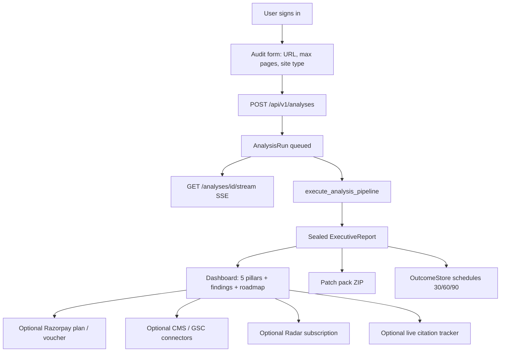
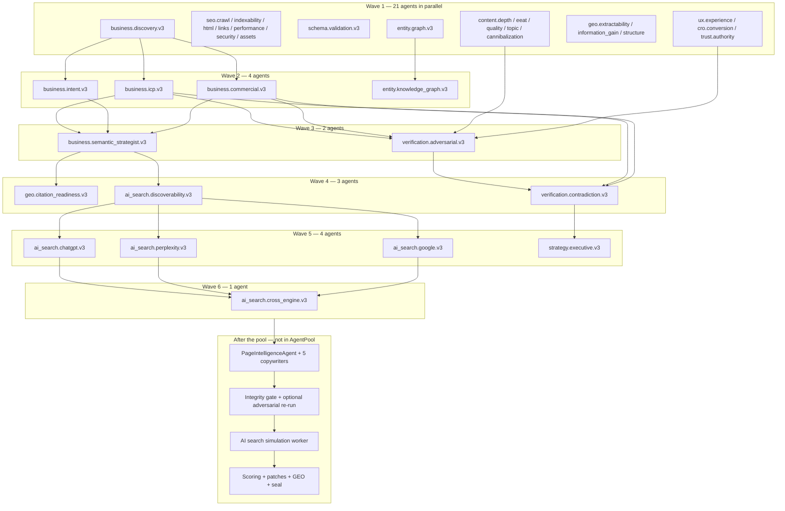
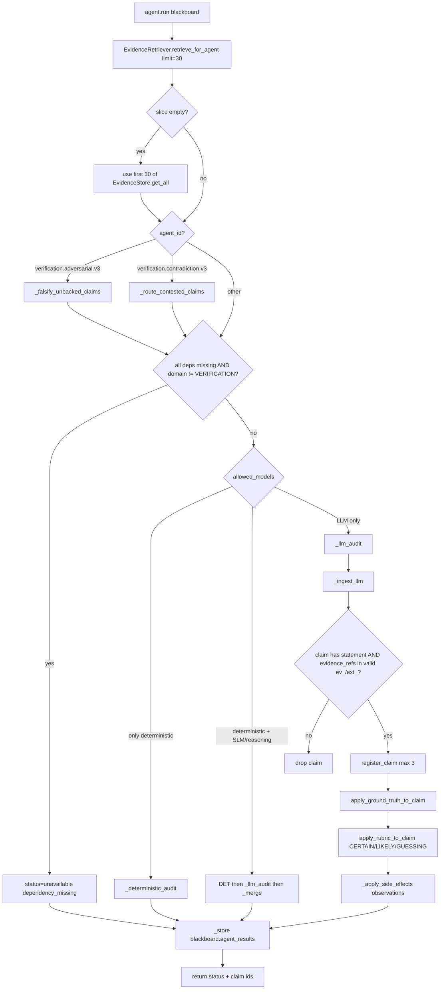

# Dristik AI — Architecture, Features & Specialist Agent Reference

**Product:** Dristik AI — evidence-driven website intelligence and growth auditor  
**Code version:** `2.0.0` (`APP_VERSION` in `backend/app/core/config.py`)  
**Policy pack:** `enterprise_web_intel_v4`  
**Source of truth:** live codebase (`backend/app/`), not older marketing copy  
**Updated:** 20 September 2026

This document is the architecture + product map for how Dristik actually runs: the problem it solves, the solution shape, the feature list, the audit flow, the sealed outputs, the full backend tree, and the 105-agent specialist workforce across 12 domains and 7 pipeline workflow sections with live Kahn-wave order.

Companion product report (parameters, APIs, gaps): [`DRISTIK_PRODUCT_REPORT.md`](DRISTIK_PRODUCT_REPORT.md).

---

## Table of contents

1. [The problem](#1-the-problem)
2. [The solution](#2-the-solution)
3. [Feature list](#3-feature-list)
4. [Output list](#4-output-list)
5. [Execution flow](#5-execution-flow)
6. [Specialist agent workforce](#6-specialist-agent-workforce)
7. [Live agent DAG (Kahn waves)](#7-live-agent-dag-kahn-waves)
8. [One-agent internal flow](#8-one-agent-internal-flow)
9. [Full backend directory structure](#9-full-backend-directory-structure)
10. [Operational guarantees](#10-operational-guarantees)

---

## 1. The problem

Most website “audits” fail in the same four ways:

1. **Vanity scores.** Tools invent Core Web Vitals, ChatGPT ranks, backlink counts, TAM, or CAC from HTML. The number looks precise; it was never measured.
2. **SEO-only coverage.** Ranking checklists ignore GEO/AEO (can an answer engine extract a citable definition?), CRO (can a buyer act in five seconds?), and brand/entity clarity (who is this company, for whom, at what price).
3. **Unusable deliverables.** A 60-page PDF of generic advice does not give a developer a JSON-LD graph, a 50–60 character title, or a 7/30/90-day order of work.
4. **No proof trail.** There is no content-addressed snapshot, no evidence token, and no way to re-run the same audit. Guesses are mixed with facts.

The buyer’s actual questions are commercial, not academic:

- What do you sell, and for whom?
- How much does it cost?
- Can Google crawl and understand the pages?
- Can ChatGPT / Perplexity / Google AI Overviews *cite* you, or only guess from thin copy?
- What is the single bottleneck, and what code do we ship this week?

---

## 2. The solution

Dristik is a FastAPI + React platform that **crawls a public site, hashes every observation, runs a 105-specialist agent DAG across 12 domains and 7 pipeline workflow sections over a shared blackboard, adversarially verifies claims, then seals an executive report** with scores, findings, a 7/30/90 roadmap, and drop-in patches.

LLMs are a **replaceable inference engine**, not a source of truth. They operate over:

| Plane | Role |
|---|---|
| Deterministic evidence | DOM, headers, schema, links, TTFB, robots/sitemap — `$0` inference |
| Immutable store | `ev_NNN` (DOM) and `ext_NNN` (external) tokens with `content_sha256` + `snap_<sha256>` bodies |
| Cognitive blackboard | Shared claims, site facts, findings, contradictions |
| 105-agent DAG across 12 domains (7 pipeline workflow sections) | Kahn topological waves; no canned specialist fallback (`allow_fallback=False`) |
| Integrity + rubric | CERTAIN / LIKELY / GUESSING; GUESSING+CRITICAL held from the executive |
| Deterministic scoring | Intent-adaptive 8-category engine; guesses do not deduct |
| Seal | `manifest.json` pins report UUID ↔ evidence ↔ snapshots ↔ agent-call hashes |

**Product thesis:** sell evidence-backed audit reports and roadmaps for **SEO + GEO/AEO + agent readiness + CRO + brand intelligence**. If a metric was not measured, emit `NOT_CONFIGURED` / `UNAVAILABLE` / `SIMULATION_ONLY`. Never invent CAC, TAM, field CWV, live ChatGPT ranks, or backlink counts from HTML.

---

## 3. Feature list

### 3.1 Core audit (every sealed run)

| Feature | What it does |
|---|---|
| Multi-page crawl | SSRF-guarded httpx fetch; Playwright / Firecrawl for thin SPAs; robots.txt + sitemap; page-type priority (homepage 100 → pricing 95 → product 85 → …) |
| Deterministic analyzers | HTML/visible text, meta, DOM, schema, links, performance (TTFB/payload), security headers, trust signals, dynamic CMS JSON |
| Wave-0 site facts | Business-name candidates, CTAs, schemas, `sameAs`, FAQs, pricing-present, HTTPS, nav — `$0` LLM |
| External enrichment | `ExternalEvidenceEnricher` writes `ext_NNN` from DNS, TLS, security headers, CrUX (or `NOT_CONFIGURED`), firmographic stubs |
| Evidence graph | Pages, H1s, observations, SHA-256, DOM selectors; re-synced at seal |
| Content-addressed snapshots | Raw bodies under `data/runs/<analysis_id>/snapshots/`; hash mismatch refuses overwrite |
| Business identity | `BusinessUnderstandingOrchestrator` — declared vs detected site type; contradiction event if they differ |
| 105-specialist DAG across 12 domains | `AgentPool.execute_all` — Kahn waves across 7 workflow sections, parallel inside a wave |
| Page intelligence | Per-URL SEO audit + 5 copywriting cards (not in AgentPool) |
| Integrity gate | Dangling refs purged; synthetic markers flagged |
| Confidence rubric | CERTAIN (≥2 independent sources), LIKELY (one source), GUESSING (absence / simulation) |
| Adversarial hold | GUESSING + CRITICAL held from `strategy.executive.v3` until reviewed; stays GUESSING |
| Causal + hypotheses | Root-cause bottlenecks, hypothesis evaluation, opportunity detector |
| AI search simulation | 6 commercial questions labeled `SIMULATION_ONLY` unless a live tracker ran |
| Scoring | 8 intent-adaptive categories + Honest Human / Google / AI readiness (visibility separate) |
| GEO readiness | On-page extractability (N of 6 buyer questions). Visibility is **not** invented from HTML |
| Character-safe copy | Title 50–60 chars, meta 140–160, hero 40–60 words |
| 7 / 30 / 90 roadmap | Prioritized items tied to finding IDs |
| Developer patch pack | ZIP: `schema.jsonld`, `metadata.html`, `faq.html`, `llms.txt`, `robots.txt`, `README_DEV_INSTALL.md` |
| Sealed manifest | Report UUID, evidence tokens, snapshot IDs, agent call pins (`model`, `provider`, `prompt_sha256`) |
| Visual intelligence | Adaptive chart payload (radar, funnel, severity, engine comparison) from measured scores |
| Outcome jobs | On seal, `OutcomeStore` schedules 30/60/90-day finding rechecks (`outcome.tracking.v1`, not in the DAG) |
| SSE progress | Stages: queued → ingesting → deterministic_analysis → planning → specialist_execution → adversarial_verification → executive_synthesis → scoring → completed |

### 3.2 Five product pillars (UI)

| Pillar | Weight | Signals |
|---|---|---|
| Search Intelligence (SEO) | 25% | Status codes, robots/sitemap, titles/H1, schema, TTFB |
| AI Search (GEO/AEO) | 25% | Extractability, 6 buyer questions, live citations **if measured** |
| Experience (SXO) | 20% | Readability, viewport, scannability |
| Conversion (CRO) | 20% | 5-second clarity, CTA verbs, form friction |
| Brand / Trust | 10% | HTTPS, Organization schema, privacy/terms, NAP, authors |

### 3.3 Side products (not fused into the sealed GEO visibility layer today)

| Feature | Clock | Notes |
|---|---|---|
| Live AI citation tracker | On demand | Up to 8 engines when keys exist; fail-closed `null` if nothing measured |
| GEO/AEO pipeline | Snapshots + trends | Separate SQLite `geo_aeo_pipeline.db` |
| Competitor bakeoff | On demand | Same 6 questions vs a crawled rival — no invented category giants |
| Competitor discovery / 5-pillar homepage compare | On demand | Crawled peers only |
| Radar pulse | Monthly / biweekly | DOM changelog + saved prompts; refuses fake baselines |
| Website intelligence timeline | Audit-to-audit | Score/finding deltas |
| Outcome tracking | 30 / 60 / 90 days | Recheck original `finding_id`s; correlation ≠ causation |
| CMS connectors | HITL patches | WordPress, GitHub PR, Shopify, Webflow, Generic, GSC |
| Analytics integrations | Optional | GSC / GA4 / DataForSEO — disconnected paths must not invent metrics |
| Payments | Razorpay + GST | Plans and vouchers exist; start-analysis entitlement is not fully enforced |
| Auth / tenancy | Cookie + RBAC | `system_admin`, `owner`, `admin`, `analyst`, `viewer`, `auditor`; org / workspace / project |

### 3.4 What a user submits

From `AuditForm` / `AnalysisRequest`: `website_url` (required, SSRF-guarded), `max_crawl_pages` (5 / 10 / 20 / 50 / all), `site_type`, notes, optional competitors, voucher, Firecrawl key, org/workspace/project, country/language (stored, not a live geo-rank input).

Auth gate: signed in with `mission:create`. Viewers cannot start audits.

---

## 4. Output list

A completed run produces an `ExecutiveReport` (`backend/app/domain/models.py`) plus on-disk artifacts.

### 4.1 Sealed report fields

| Artifact | What it is |
|---|---|
| `ExecutiveReport` | C-suite report: profile, scores, findings, roadmaps, patches, GEO, commercial Q&A |
| Honest scores | Human, Google, **AI readiness** (on-page). `ai_visibility_score` stays null / `NOT_MEASURED` unless live engines ran |
| Category scores | 8 weighted categories, intent-adaptive, 0–100, diminishing deductions; GUESSING does not deduct |
| Findings | Evidence-tokened claims with CERTAIN / LIKELY / GUESSING, materiality, impact/effort |
| Exploratory hypotheses | GUESSING block — dashed “Working hypotheses” in the UI, excluded from Big-4 severity counts |
| Per-page reports | SEO + copywriting + UX for every crawled URL |
| Character-safe copy | Title / meta / hero with compliance status |
| Code patches + remediation patches | Drop-in snippets with risk `SAFE_AUTO` / `HUMAN_APPROVAL` / `DEVELOPER_REQUIRED` |
| 7 / 30 / 90 roadmap | Ordered remediation tied to finding IDs |
| GEO readiness | Layer = `readiness`; visibility_status = `NOT_CONFIGURED` on the seal path today |
| Commercial evaluations | 6 buyer questions, 1–10, `is_simulated` unless live |
| AI search matrix | Simulated ChatGPT / Perplexity / Google / cross-engine |
| Three-way comparison | Human vs Google vs AI narrative |
| WhatsApp 1-pager | Mobile C-suite summary |
| Evidence graph summary | Node/edge counts, SHA-256 verified nodes, selectors |
| Visual intelligence | Chart specs + spotlight metrics |
| Telemetry | Token/cost/latency, agent-call pins |
| Crawl summary | Pages crawled/discovered, sitemap/robots, TTFB, duplicates, broken links |
| Contradictions | Declared vs detected identity (and later DOM vs `ext_` contests) |
| `manifest_id` / `sealed_evidence_snapshot_id` | Cryptographic pin |
| `policy_pack` | `enterprise_web_intel_v4` |

### 4.2 On-disk / API artifacts

| Path / endpoint | Content |
|---|---|
| `data/runs/<analysis_id>/snapshots/` | Raw fetch bodies `snap_<sha256>` |
| `manifest.json` | Sealed pin of tokens, snapshots, agent hashes |
| `GET /analyses/{id}/report` | Full `ExecutiveReport` |
| `GET /analyses/{id}/manifest` | Manifest |
| `GET /analyses/{id}/snapshots/{sid}` | Raw snapshot |
| `GET /analyses/{id}/patch-pack/zip` | 6-file developer ZIP |
| `GET /analyses/{id}/whatsapp-summary` | 1-pager |
| `GET /analyses/{id}/evidence-graph` | Graph export |
| Outcome jobs | 30/60/90 recheck schedule in OutcomeStore SQLite |

### 4.3 Developer patch pack files

1. `schema.jsonld` — Organization, WebSite, Service/SoftwareApplication, BreadcrumbList, FAQPage  
2. `metadata.html` — character-safe title/meta, OpenGraph, Twitter, robots  
3. `faq.html` — semantic FAQ accordion + microdata  
4. `llms.txt` — AI-agent entity file  
5. `robots.txt` — including AI crawler directives  
6. `README_DEV_INSTALL.md` — Next.js / WordPress / Webflow / Shopify install notes  

---

## 5. Execution flow

### 5.1 End-to-end user flow



### 5.2 Live pipeline (`AnalysisOrchestrator.execute_analysis_pipeline`)

```
Website URL
    │
    ▼
[Zero-Trust SSRF Guard]
    │
    ▼
[Crawler: httpx → Playwright/Firecrawl if thin]
    │
    ▼
[Deterministic analyzers] ──► PageEvidence + CrawlManifest
    │
    ▼
[EvidenceStore ev_NNN] + [SnapshotStore snap_<sha256>] + [EvidenceGraph]
    │
    ▼
[Wave-0 site_facts]  ($0 inference)
    │
    ▼
[ExternalEvidenceEnricher] ──► ext_NNN (DNS, TLS, headers, CrUX or NOT_CONFIGURED)
    │
    ▼
[Tier-1 deterministic capabilities]  (robots, schema, readability, …)
    │
    ▼
[BusinessUnderstandingOrchestrator]  (declared vs detected identity)
    │
    ▼
[AgentPool & Modular DAG: 105 specialists in 12 domains across 7 pipeline sections]
    │
    ▼
[PageIntelligenceAgent]  (per-URL SEO + 5 copywriters)
    │
    ▼
[Integrity gate + CERTAIN/LIKELY/GUESSING rubric]
    │     optional re-run of verification.adversarial.v3
    ▼
[Causal bottlenecks + hypotheses + opportunities]
    │
    ▼
[AI search simulation worker]  (6 commercial questions, labeled simulation)
    │
    ▼
[Synthesizer] → [DecisionEngine] → [ScoringEngine] → [RemediationPlanner] → [Roadmap]
    │
    ▼
[GEO readiness] + [Honest scores] + [character-safe copy] + [visual intelligence]
    │
    ▼
[Seal manifest.json] → ExecutiveReport → SSE completed
    │
    ▼
[OutcomeStore.schedule 30/60/90]
```

### 5.3 Numbered steps (S00–S36)

| Step | Code | What happens |
|---|---|---|
| S00 | `AuditForm` | URL, max pages, site type |
| S01 | `POST /api/v1/analyses` | Require `mission:create` |
| S02 | `create_run` | In-memory run + SSE queue |
| S03 | `MissionDirector.create_mission` | `audit_type=standard_growth` |
| S04 | `security.ssrf.is_safe_url` | Allow / deny |
| S05 | `CrawlerService.crawl_site_and_analyze` | robots + sitemap + pages |
| S05a–e | analyzers + `record_fetch` | `PageEvidence`, `ev_NNN`, `snap_<sha>` |
| S06 | `EvidenceGraph.populate_from_evidence_store` | Graph nodes/edges |
| S07 | `extract_site_facts` | Wave-0 fact pack |
| S07b | `ExternalEvidenceEnricher.enrich_domain` | `ext_NNN` |
| S08 | `select_capabilities_for_mission` | Tier lists |
| S09 | `HypothesisEngine.generate_initial_hypotheses` | Pre-reasoning hypotheses |
| S10 | Tier-1 deterministic caps | robots, schema, readability, … |
| S11 | `BusinessUnderstandingOrchestrator` | Identity vs declared type |
| S12 | `AgentPool.execute_all` | 105 specialists across 12 domains, Kahn waves |
| S13 | `PageIntelligenceAgent.run` | Per-URL SEO + 5 copywriters |
| S14 | Integrity gate + rubric | Purge / downgrade |
| S15 | Optional adversarial re-run | Held GUESSING+CRITICAL |
| S16 | `EvidenceGapDetector` | Uncorroborated marketing claims |
| S17 | `CausalReasoningEngine` | Root-cause bottlenecks |
| S18 | Hypothesis evaluation | Vs accumulated evidence |
| S19 | `OpportunityDetector` | Growth opportunities |
| S20 | `CognitiveSimulatorWorker` | 6 commercial questions |
| S21 | Synthesizer if narrative empty | Executive story |
| S22 | `DecisionEngine.synthesize_findings` | `Finding[]` |
| S23 | `ScoringEngine.calculate_scores` | Intent-adjusted categories |
| S24 | `CalibratedConfidenceEngine` | Grounding / coverage |
| S25 | `RemediationPlanner` | `CodePatch[]` |
| S26 | `RoadmapBuilder` | 7 / 30 / 90 |
| S27 | Digital twin + timeline | In-memory domain state |
| S28 | `NarrativeGenerator` | Story fields |
| S29 | `evaluate_geo_readiness` | `visibility_measured=False` on seal |
| S30 | `calculate_honest_scores` | Human / Google / AI readiness |
| S31 | Character-safe copy + WhatsApp | Title/meta/hero + 1-pager |
| S32 | Graph re-sync | Findings + claims linked |
| S33 | `build_run_manifest` / `seal_manifest` | `manifest.json` |
| S34 | `OutcomeStore.schedule` | 30/60/90 jobs |
| S35 | `ExecutiveReport` + visual intelligence | SSE `completed` |
| S36 | Frontend tabs / pillars | User-facing UI |

### 5.4 SSE stages

| Stage | Typical progress | What happens |
|---|---|---|
| `queued` | 0 | Run created |
| `ingesting` | 10–25 | Multi-page crawl |
| `deterministic_analysis` | 25–38 | Analyzers + Wave-0 + enrichment + tier-1 |
| `planning` | ~38 | MissionDirector selects capabilities |
| `specialist_execution` | 42–85 | Identity → 105-agent DAG (7 workflow sections) → page intel → causal → AI sim |
| `adversarial_verification` | 82–83 | Integrity gate + optional adversarial re-run |
| `executive_synthesis` | 88 | Narrative |
| `scoring` | 93 | Scores, patches, roadmap, seal |
| `completed` / `failed` | 100 | Stream closes |

### 5.5 Evidence → claim → finding → score

```mermaid
flowchart LR
    DOM[Raw HTML / headers] --> EV[ev_NNN tokens]
    API[External APIs] --> EXT[ext_NNN tokens]
    EV --> BB[CognitiveBlackboard]
    EXT --> BB
    BB --> AG[SpecialistAgent]
    AG --> CL[Claim PROVISIONAL]
    CL --> GT[Ground-truth bind]
    GT --> RB[Rubric CERTAIN/LIKELY/GUESSING]
    RB --> ADV[Adversarial falsify]
    ADV --> CON[Contradiction route, no winner]
    CON --> GATE[Integrity gate]
    GATE --> DE[DecisionEngine findings]
    DE --> SC[ScoringEngine]
    SC --> EX[strategy.executive.v3 + report]
```



---

## 6. Specialist agent workforce

Live runtime class for all 35: `SpecialistAgent` in `backend/app/agents/runtime/specialist.py`, instantiated from `SPECIALIST_AGENTS_V3` in `backend/app/agents/runtime/registry.py`. Tests require **exactly 35** specialists (`backend/tests/test_agent_pool_35.py`).

Copywriting IDs `copywriting.{seo,geo,cro,clarity,section}.v3` live in `COPYWRITING_AGENTS_V3` and run **inside** `PageIntelligenceAgent` after the pool — they are not AgentPool members.

`dag.py` is unused by the main orchestrator. Real DAG: `agent_pool.topological_waves()`.

Modes:

- **DETERMINISTIC** — crawl facts only, no LLM (`seo.crawl`, `seo.html`, `seo.performance`, `seo.security`)
- **HYBRID** — deterministic pass then LLM merge (`seo.indexability`, `seo.internal_links`, `seo.assets`, `schema.validation`, `ux.experience`)
- **LLM** — structured JSON, `allow_fallback=False`, max 3 claims, drop any claim without a real `ev_` / `ext_` token

Gated families (policy v4, agent IDs stay `*.v3`): ICP, pricing, performance, trust, authorship. Before finalizing those claims, consult `ext_xxx`. CONFIRMS cites both; CONTRADICTS is CONTESTED and routes to `verification.contradiction.v3` **without picking a winner**; missing usable ext is MEDIUM at best (`SINGLE_SOURCE_UNVERIFIED`).

### Domain 1 — Business intelligence

| Agent ID | Name | Mode | Depends on | What it does |
|---|---|---|---|---|
| `business.discovery.v3` | Business Discovery | LLM | — | Legal/brand name, offerings, industry, value proposition from page text |
| `business.icp.v3` | ICP Intelligence | LLM | discovery | B2B/B2C, buyer roles, stated audience. Gated (ICP). No invented personas |
| `business.intent.v3` | Search Intent | LLM | discovery | Informational / commercial / transactional / navigational / comparison per URL |
| `business.commercial.v3` | Commercial Intelligence | LLM | discovery | Pricing, plans, checkout friction. Missing prices = `NOT_IN_EVIDENCE`. Gated (PRICING) |
| `business.semantic_strategist.v3` | Semantic Strategist | LLM | discovery, icp, intent, commercial | Positioning conflicts (e.g. enterprise pitch vs self-serve pricing) |

### Domain 2 — Technical SEO

| Agent ID | Name | Mode | What it does |
|---|---|---|---|
| `seo.crawl.v3` | Crawl Intelligence | DET | robots.txt, sitemaps, status codes, redirects, crawl depth |
| `seo.indexability.v3` | Indexability | HYBRID | Canonical, noindex, X-Robots-Tag. Homepage noindex = CRITICAL |
| `seo.html.v3` | Technical HTML | DET | Title, meta description, H1–H6, HTML5 landmarks |
| `seo.internal_links.v3` | Internal Links | HYBRID | Link graph, orphans, weak anchors |
| `seo.performance.v3` | Performance | DET | Measured TTFB and payload. **Forbidden:** invent LCP/CLS/INP. Gated (PERFORMANCE) |
| `seo.security.v3` | Security SEO | DET | HTTPS, TLS, HSTS, CSP, X-Frame-Options |
| `seo.assets.v3` | Media & Assets | HYBRID | Alt text, WebP/AVIF, dimensions, lazy load |

### Domain 3 — Structured data & knowledge graph

| Agent ID | Name | Mode | Depends on | What it does |
|---|---|---|---|---|
| `schema.validation.v3` | Schema Intelligence | HYBRID | — | JSON-LD / microdata types and required fields |
| `entity.graph.v3` | Entity Intelligence | LLM | — | Organization, Person, Product, Service, Place |
| `entity.knowledge_graph.v3` | Knowledge Graph | LLM | entity.graph | `sameAs`, disambiguation. **Forbidden:** claim live KG inclusion without proof |

### Domain 4 — Content

| Agent ID | Name | Mode | What it does |
|---|---|---|---|
| `content.depth.v3` | Content Depth | LLM | Word count, topical breadth, thin vs substantive |
| `content.eeat.v3` | E-E-A-T | LLM | Observable author names, credentials, citations. Gated (AUTHORSHIP) |
| `content.quality.v3` | Content Quality | LLM | Clarity, fluff (`cutting-edge`, `seamless`, …) |
| `content.topic_coverage.v3` | Topic Coverage | LLM | H1–H3 topic tree and gaps |
| `content.cannibalization.v3` | Cannibalization | LLM | Title/intent collisions across pages |

### Domain 5 — GEO (readiness, not live rank)

| Agent ID | Name | Mode | Depends on | What it does |
|---|---|---|---|---|
| `geo.extractability.v3` | Answer Extractability | LLM | — | 40–60 word definitions, lists, tables, FAQs |
| `geo.information_gain.v3` | Information Gain | LLM | — | Original stats / methodology vs rehashed copy |
| `geo.citation_readiness.v3` | Citation Readiness | LLM | strategist, entity.graph, content.quality | Claim → evidence mapping |
| `geo.structure.v3` | Generative Structure | LLM | — | Answer-first openings, TL;DR, FAQ blocks |

HTML must never produce a ChatGPT / Perplexity / AI Overview **rank**. Missing connectors → `NOT_CONFIGURED`. Scoring is N of 6 buyer questions: SUPPORTED / PARTIAL / UNSUPPORTED / CONFLICTING.

### Domain 6 — AI search (simulation unless live tracker)

| Agent ID | Name | Mode | Depends on | What it does |
|---|---|---|---|---|
| `ai_search.discoverability.v3` | AI Discoverability | LLM | strategist | Synthetic buyer prompt matrix |
| `ai_search.chatgpt.v3` | ChatGPT Visibility | LLM | discoverability | DOM answerability. **SIMULATION_ONLY.** Forbidden: fake live citations |
| `ai_search.perplexity.v3` | Perplexity Visibility | LLM | discoverability | Citation eligibility. Same prohibition |
| `ai_search.google.v3` | Google AI Search | LLM | discoverability | AI Overview / snippet readiness from schema + definitions |
| `ai_search.cross_engine.v3` | Cross-Engine | LLM | chatgpt, perplexity, google | Compare simulated visibility |

Capability map note: `29_gemini_scenario` routes to `ai_search.google.v3`; `30_claude_scenario` routes to `ai_search.cross_engine.v3`. There is no dedicated Gemini or Claude specialist class.

### Domain 7 — UX / CRO / Trust

| Agent ID | Name | Mode | What it does |
|---|---|---|---|
| `ux.experience.v3` | UX Intelligence | HYBRID | Nav, readability, mobile friction |
| `cro.conversion.v3` | Conversion Intelligence | LLM | CTA copy/placement, form friction |
| `trust.authority.v3` | Trust Authority | LLM | Testimonials, NAP, privacy, badges. Gated (TRUST) |

### Domain 8 — Verification / executive

| Agent ID | Name | Mode | Depends on | What it does |
|---|---|---|---|---|
| `verification.adversarial.v3` | Adversarial Verification | LLM + code falsify | icp, commercial, eeat, trust *(plus three stale IDs ignored by the pool)* | Drops unbacked claims; reviews GUESSING+CRITICAL |
| `verification.contradiction.v3` | Contradiction & Causal | LLM + code route | adversarial, icp, commercial, performance, eeat, trust | Records contests. **Never picks a DOM vs ext winner** |
| `strategy.executive.v3` | Executive Intelligence | LLM | contradiction | Narrative + 7/30/90 from **executive-eligible** claims only |

### Domain 9 — Copywriting (5) — not in AgentPool

Invoked once per crawled URL inside `PageIntelligenceAgent` after the specialist DAG.

| ID | Name | Production output |
|---|---|---|
| `copywriting.seo.v3` | SERP Copywriter | Title 50–60 chars, meta 140–160 |
| `copywriting.geo.v3` | GEO Citation Copywriter | 40–60 word definition + FAQ pairs |
| `copywriting.cro.v3` | CRO Copywriter | 3-second hook + active-verb CTAs |
| `copywriting.clarity.v3` | Clarity & Voice | Grade 7–9, fluff ban, ICP callouts |
| `copywriting.section.v3` | Section Architect | Hero / Problem / Solution / Proof / FAQ / CTA rewrites |

### Around the DAG (not in the 35)

| ID / class | When | Role |
|---|---|---|
| `BusinessUnderstandingOrchestrator` | Before AgentPool | Declared vs detected identity |
| `ExternalEvidenceEnricher` | After Wave-0 facts | DNS / TLS / headers / CrUX / firmographic `ext_` |
| `PageIntelligenceAgent` | After AgentPool | Per-page SEO + copy |
| `CognitiveSimulatorWorker` | After verification | 6 commercial questions |
| `CognitiveSynthesizerWorker` | If narrative empty | Executive story |
| `outcome.tracking.v1` | Post-seal 30/60/90 | Finding rechecks |

---

## 7. Live agent DAG (Kahn waves)

Computed from `AgentDefinition.dependencies` by `topological_waves()`. Unknown dependency IDs are skipped. Independent agents in a wave run concurrently (`asyncio.gather`).

**This is the live order** (verified 20 Sep 2026 against `SPECIALIST_AGENTS_V3`):



**Non-empty dependency edges only:**

```
business.discovery.v3 → business.icp.v3, business.intent.v3, business.commercial.v3
{discovery, icp, intent, commercial} → business.semantic_strategist.v3
entity.graph.v3 → entity.knowledge_graph.v3
{strategist, entity.graph, content.quality} → geo.citation_readiness.v3
strategist → ai_search.discoverability.v3
discoverability → chatgpt, perplexity, google
{chatgpt, perplexity, google} → ai_search.cross_engine.v3
{icp, commercial, eeat, trust} → verification.adversarial.v3
  (stale IDs seo.technical/onpage/schema.v3 are not in the registry and are ignored)
{adversarial, icp, commercial, performance, eeat, trust} → verification.contradiction.v3
contradiction → strategy.executive.v3
```

### DAG timing notes (live code)

| Topic | Live behavior |
|---|---|
| Agent count | 105 in `AGENT_REGISTRY` across 12 domains; 7 modular workflow sections (33 DAG nodes) |
| Adversarial | Wave **3** (after ICP/commercial exist). Orchestrator **re-runs** it after the pool for held GUESSING+CRITICAL |
| Executive | Wave **5**, in parallel with ChatGPT/Perplexity/Google — **before** `ai_search.cross_engine.v3` (wave 6). Post-pool synthesizer/scoring still run after the DAG |
| Copywriting | After the specialist pool, then integrity gate |
| External ground truth | `ExternalEvidenceEnricher` runs on the production crawl path (DNS/TLS/headers always; CrUX/firmographics `NOT_CONFIGURED` without keys) |
| `dag.py` | Unused by the main orchestrator |
| Duplicate business fleet | `BusinessUnderstandingOrchestrator` also runs **before** the 35 |

---

## 8. One-agent internal flow

Every one of the 105 specialists is unified under the same class (`SpecialistAgent.run`).



LLM call: `specialist_system.txt` + task card + forbidden operations + prior blackboard context + evidence slice → `ModelRouter.generate_structured(..., allow_fallback=False, max_claims=3)`. Missing key or bad JSON → `status=unavailable`, never a canned audit.

---

## 9. Full backend directory structure

Omitting `venv/`, `__pycache__/`, and `*.pyc`. Paths relative to repo root.

```
dristik/
├── AI_ARCHITECTURE_AND_AGENTS.md          # This document
├── DRISTIK_PRODUCT_REPORT.md              # Parameters, APIs, gaps
├── README.md
├── run.sh / start.sh
├── prompts/                               # Spec prompts (not loaded by SpecialistAgent)
│   ├── constitution.md
│   ├── orchestrator.md
│   ├── synthesizer.md
│   ├── verifier.md
│   └── agent_template.yaml
├── data/                                  # Local DBs + sealed run snapshots
├── frontend/                              # React + Vite + TypeScript + Tailwind
└── backend/
    ├── requirements.txt
    ├── data/                              # dristik.db, geo_aeo_pipeline.db, runs/
    ├── tests/                             # pytest suite (see list below)
    └── app/                               # FastAPI application
```

### 9.1 `backend/app/` — complete tree

```
backend/app/
├── main.py                                # FastAPI app factory, CORS, lifespan, /health
├── api/
│   ├── router.py                          # Mounts routers at /api/v1 and /api
│   └── routes/
│       ├── audits/                        # analyses, stream
│       ├── identity/                      # auth, orgs
│       ├── platform/                      # contact, system, meta, payments, workspaces
│       ├── intelligence/                  # strategic, geo, outcomes, radar
│       ├── integrations/                  # connectors, google analytics
│       └── remediation/                   # patch approve / apply
│
├── core/
│   ├── config.py                          # Settings, provider auto-select, production checks
│   ├── security/                          # ssrf, trust_boundary, enterprise_audit_logger
│   ├── privacy/sanitizer.py               # PII / injection redaction
│   └── policy/engine.py                   # Tier / budget gating
│
├── agents/
│   ├── runtime/                           # base, specialist, registry, task_cards (live 35)
│   ├── page/intelligence.py               # Per-URL SEO + 5 copywriting cards
│   └── legacy/                            # Pre-pool wrappers; not the AgentPool path
│
├── crawl/                                 # Acquisition
│   ├── crawler.py                         # CrawlerService
│   ├── browser.py                         # Playwright
│   ├── embeddings.py / vector_store.py
│   ├── sitemap.py                         # XML sitemap parse
│   └── analyzers/                         # html, visible, meta, dom, schema, links,
│                                          #   performance, security, trust_signals, dynamic_content
│
├── audit/                                 # Seal and compare
│   ├── snapshots.py                       # Content-addressed raw body store
│   ├── manifest.py                        # build_run_manifest / seal_manifest
│   ├── ledger.py                          # Hash-chained audit ledger
│   └── regression_engine.py               # Audit-to-audit regression
│
├── capabilities/registry.py               # Honest capability declarations
├── cognition/                             # blackboard, claims, ground_truth, finding_rubric,
│                                          #   confidence, contradiction, consensus, hypotheses,
│                                          #   causal, decision_engine
├── connectors/                            # store + base + generic/github/wordpress/shopify/webflow/google
├── domain/                                # enums, models, capability, provenance
├── evidence/                              # store, graph, retriever, site_facts, enrichment, validation
├── identity/                              # store, service, security, authorizer, deps, sso_scim
├── inference/                             # llm_client, model_router, pricing, prompts, schemas
├── integrations/                          # google_connectors, google_api, dataforseo_provider
│
├── intelligence/
│   ├── geo/                               # readiness, benchmarks, pipeline, adapters, agent_readiness
│   ├── competitive/                       # discovery, benchmark, bake-off, semantic gaps
│   ├── citations/                         # tracker, live engine, on-page simulation
│   ├── outcomes/                          # 30/60/90 tracking + store
│   ├── business/                          # understanding, intent, twin, opportunity, search console
│   └── monitoring/                        # radar, timeline, visual report payload
│
├── mission/                               # director, state, policies, graph, state_machine
├── orchestration/                         # orchestrator, agent_pool, integrity_gate, planner, dag
├── payments/store.py
├── persistence/                           # repository, schema, storage_cas
├── remediation/                           # patches, approval, validator, sync_engine
├── reports/                               # narrative, roadmap, pdf, validation_gate
├── scoring/                               # engine, weights, scoring_rubric
├── tenancy/                               # manager, agency, white_label
├── verification/verifier.py
├── workers/                               # cognitive workers + distributed_engine
└── notifications/dispatcher.py
```

### 9.2 `backend/tests/`

```
test_agent_pool_35.py
test_zero_fake_data_and_fail_closed.py
test_ci_guardrails.py
test_ground_truth_v4.py
test_finding_rubric.py
test_geo_readiness.py
test_geo_pipeline.py
test_reproducibility.py
test_outcome_tracking.py
test_radar_pulse.py
test_ssrf_egress.py
test_auth_rbac.py
test_tenancy_isolation.py
test_payments.py
test_gst_invoice.py
test_prompt_injection_corpus.py
test_pipeline.py
test_copywriting_specialists.py
test_5_business_agents_prompts.py
test_70b_pipeline_hardening.py
test_business_understanding_and_zero_fake.py
test_confidence_gating.py
test_connectors_and_remediation.py
test_crawler_chunking.py
test_dynamic_crawler.py
test_visible_crawl.py
test_multi_page.py
test_sitemap_and_regression.py
test_external_enrichment.py
test_fallback_evidence_grounding.py
test_evidence_graph_2.py / test_evidence_graph_v2.py
test_enterprise_schema_and_cas.py
test_audit_api_routes.py
test_audit_persistence_and_checkpoints.py
test_audit_persistence_and_restore.py
test_mission_director.py
test_mission_resume.py
test_master_architecture.py
test_hypotheses_causal.py
test_commercial_bakeoff.py
test_competitive_benchmark.py
test_intelligence_endpoints.py
test_ai_citations_and_sync.py
test_ai_citation_custom_providers.py
test_requery_commercial.py
test_patch_pack_routes.py / test_patch_pack_zip.py / test_patch_validator.py
test_google_connectors.py
test_openrouter_provider.py
test_anthropic_client.py
test_embedding_service.py
test_digital_twin_intent.py
test_visual_intelligence.py
test_sso_scim_and_audit_logs.py
test_governance_audit.py
test_workspace_hierarchy_routes.py
```

---

## 10. Operational guarantees

1. **Deterministic grounding.** Every finding ties to a raw evidence token (`ev_xxx` and/or `ext_xxx`). Claims without valid refs are dropped.
2. **Zero fake metrics.** Unmeasured external metrics are `NOT_CONFIGURED` / `UNAVAILABLE` / `SIMULATION_ONLY`. HTML never becomes a live ChatGPT rank or CrUX LCP.
3. **No canned specialist fallback.** `allow_fallback=False`; missing LLM → `unavailable`, never a stock paragraph.
4. **Guesses do not move scores.** ScoringEngine skips GUESSING and unreviewed held findings. UI splits them into “Working hypotheses”.
5. **Contradiction does not pick a winner.** DOM vs external contests stay CONTESTED and route to `verification.contradiction.v3`.
6. **Reproducible seal.** `manifest.json` pins report UUID, evidence tokens, snapshot IDs, and agent-call hashes.
7. **Two GEO layers.** Readiness (on-page, implemented on every seal) vs visibility (live citations, separate product). They are never mixed.

Stack: FastAPI (`backend/app/main.py`) + React/Vite (`frontend/`) + SQLite + on-disk snapshots. LLM gateway auto-selects Anthropic → Gemini → Groq → OpenRouter → Together. Embeddings: local `intfloat/e5-small-v2` (384-dim).
