# Dristik AI — Complete Product Report

**Product:** Dristik AI — Enterprise evidence-driven website intelligence and growth auditor  
**Code version:** `2.0.0` (`APP_VERSION` in `backend/app/core/config.py`)  
**Policy pack:** `enterprise_web_intel_v4`  
**Source of truth:** live codebase under `/Users/sayantande/dristik` (not marketing copy)  
**Generated:** 20 September 2026 (synced with live `SPECIALIST_AGENTS_V3` Kahn waves and `execute_analysis_pipeline`)

This document is a full product map of what Dristik actually implements today: the problem it solves, the solution shape, features and the parameters they consider, every important file, runtime architecture, class relationships, the 105-agent specialist workforce across 12 domains and 7 pipeline workflow sections, agent execution order, and the gaps that still need to be built.

Architecture + agent catalog (same source of truth): [`AI_ARCHITECTURE_AND_AGENTS.md`](AI_ARCHITECTURE_AND_AGENTS.md).

---

## Table of contents

1. [Product overview](#1-product-overview)
   - [1.1 The problem](#11-the-problem)
   - [1.2 The solution](#12-the-solution)
2. [Features and the parameters they consider](#2-features-and-the-parameters-they-consider)
3. [Directory structure and what each file does](#3-directory-structure-and-what-each-file-does)
4. [Flow architecture](#4-flow-architecture)
   - [4.6 Total pipeline — every numbered step](#46-total-pipeline--every-numbered-step)
5. [Class diagrams](#5-class-diagrams)
6. [AI agent list](#6-ai-agent-list)
7. [AI agent flow](#7-ai-agent-flow)
   - [7.6 One-agent internal flow](#76-one-agent-internal-flow-specialistagentrun)
   - [7.7 Per-agent diagrams (all 35 + copywriters)](#77-per-agent-diagrams-all-35--copywriters)
   - [7.8 Full DAG with every node and 7 workflow sections](#78-full-dag-with-every-node-and-7-workflow-sections)
   - [7.9 Sequence of one full audit](#79-sequence-of-one-full-audit-agents--post-steps)
   - [7.10 Post-DAG workers](#710-post-dag-workers-that-are-not-in-the-35)
8. [Where it needs improvement, and features to add](#8-where-it-needs-improvement-and-features-to-add)
9. [API catalog](#9-api-catalog)
10. [Commercial plans](#10-commercial-plans)
11. [Test coverage map](#11-test-coverage-map)

---

## 1. Product overview

Dristik is a FastAPI + React application that crawls a public website, extracts deterministic DOM/HTTP evidence, enriches a small external plane (`ext_NNN`), runs a 105-specialist agent DAG across 12 domains and 7 pipeline workflow sections over a shared blackboard, adversarially verifies claims, then produces an executive report with scores, findings, a 7/30/90-day roadmap, and drop-in code patches.

The product thesis (as implemented, not just claimed) is:

> Sell **evidence-backed audit reports and roadmaps** for SEO + GEO/AEO + agent readiness + CRO + brand intelligence. Do **not** sell vanity scores. If a metric was not measured, say `NOT_CONFIGURED` / `UNAVAILABLE` / `SIMULATION_ONLY`. Never invent CAC, TAM, Core Web Vitals, live ChatGPT ranks, or backlink counts.

### 1.1 The problem

Typical website audits fail in four ways: they invent unmeasured metrics (CWV, ChatGPT ranks, backlinks); they cover SEO checklists and ignore GEO/AEO, CRO, and brand/entity clarity; they ship unread 60-page PDFs instead of drop-in code; and they mix guesses with facts with no evidence trail. Buyers actually need: what we sell and for whom, whether Google can crawl it, whether answer engines can *cite* it, the single bottleneck, and what to ship this week.

### 1.2 The solution

LLMs are a replaceable inference engine over a deterministic evidence plane (`ev_NNN` / `ext_NNN` with content-addressed snapshots), a 105-agent Kahn DAG across 12 domains and 7 workflow sections (`allow_fallback=False`), an integrity gate + CERTAIN/LIKELY/GUESSING rubric, a deterministic scoring engine (guesses do not deduct), and a sealed `manifest.json`. GEO is two layers: **readiness** (on-page, every seal) vs **visibility** (live citations, separate product — never invented from HTML).

### What a completed audit actually produces

| Artifact | What it is |
|---|---|
| `ExecutiveReport` | Sealed C-suite report: business profile, scores, findings, roadmaps, patches, GEO readiness, commercial Q&A |
| Honest scores | Human, Google, **AI readiness** (on-page). `ai_visibility_score` stays `NOT_MEASURED` unless live engines ran |
| Category scores | 8 weighted categories, intent-adaptive, 0–100 with diminishing deductions |
| Findings | Evidence-tokened claims with `CERTAIN` / `LIKELY` / `GUESSING`, materiality, impact/effort |
| Exploratory hypotheses | GUESSING block — UI “Working hypotheses”; excluded from Big-4 severity counts |
| Per-page reports | SEO audit + copywriting rewrites + UX signals for every crawled URL |
| Developer patch pack | ZIP: `schema.jsonld`, `metadata.html`, `faq.html`, `llms.txt`, `robots.txt`, `README_DEV_INSTALL.md` |
| Character-safe copy | Title 50–60 chars, meta 140–160, hero 40–60 words |
| 7 / 30 / 90 roadmap | Prioritized remediation items tied to finding IDs |
| Visual intelligence | Adaptive chart payload (radar, funnel, severity, engine comparison) |
| Sealed `manifest.json` | Cryptographic pin of evidence tokens, snapshot IDs, agent call hashes |
| Optional follow-ons | Radar pulse, 30/60/90 outcome rechecks, competitor bakeoff, live citation tracker |

### Stack

| Layer | Implementation |
|---|---|
| Frontend | React + Vite + TypeScript + Tailwind (`frontend/`) |
| API | FastAPI on port 8000 (`backend/app/main.py`) |
| Persistence | SQLite (`backend/data/dristik.db`, `geo_aeo_pipeline.db`) + on-disk snapshots under `data/runs/<analysis_id>/` |
| LLM | Multi-provider gateway: Anthropic, Gemini, Groq, OpenRouter, Together (auto-select) |
| Embeddings | Local `intfloat/e5-small-v2` (384-dim) or OpenRouter |
| Crawl | httpx + BeautifulSoup; Playwright for thin/JS pages; optional Firecrawl |
| Payments | Razorpay (INR), GST invoice endpoint |
| Auth | Cookie sessions, RBAC (`system_admin`, `owner`, `admin`, `analyst`, `viewer`, `auditor`) |

---

## 2. Features and the parameters they consider

### Feature catalog (what ships today)

| Area | Features |
|---|---|
| Crawl & evidence | SSRF-guarded multi-page crawl, Playwright/Firecrawl for thin SPAs, Wave-0 analyzers, `ev_NNN` tokens, content-addressed snapshots, evidence graph |
| External plane | `ExternalEvidenceEnricher`: DNS, TLS, security headers, CrUX (or `NOT_CONFIGURED`), firmographic stubs as `ext_NNN` |
| Agents | 105 specialists in 12 domains across 7 pipeline workflow sections; 5 copywriters inside `PageIntelligenceAgent`; identity pre-pass; no canned fallback |
| Verification | Integrity gate, CERTAIN/LIKELY/GUESSING rubric, adversarial hold on GUESSING+CRITICAL, contradiction with no winner |
| Scoring | 8 intent-adaptive categories, Honest Human/Google/AI **readiness**, 5 UI pillars; guesses do not deduct |
| GEO / AI search | On-page readiness (6 buyer questions); simulated ChatGPT/Perplexity/Google/cross-engine labeled `SIMULATION_ONLY`; live tracker is a separate product |
| Remediation | 7/30/90 roadmap, character-safe copy, 6-file developer ZIP, HITL CMS/GitHub patches |
| Continuity | Radar pulse, audit timeline deltas, 30/60/90 outcome rechecks (`outcome.tracking.v1` post-seal) |
| Platform | Cookie RBAC, org/workspace/project, Razorpay+GST, SSE live progress, visual intelligence charts |

### 2.1 User-facing audit inputs

From `AuditForm.tsx` and `AnalysisRequest`:

| Parameter | Type | Where used | Notes |
|---|---|---|---|
| `website_url` | string | Crawl target | Required. Scheme added as `https://` if missing. SSRF-guarded. |
| `max_crawl_pages` | int / `"all"` | Crawler limit | UI default 5. Config allows 5 / 10 / 20 / 50 / `all` (resolves to 500). |
| `site_type` | enum | Identity contradiction | Declared vs detected. Options include SaaS, ecommerce, agency, local, healthcare, etc. Empty = AI determines. |
| `declared_site_type_notes` | string | Identity notes | Free text when type is `other`. |
| `industry` | string | Mission / business | Frontend currently copies `site_type` into `industry`. |
| `org_id` / `workspace_id` / `project_id` | string | Tenancy | Defaults `org_default` / `ws_default` / `proj_default`. |
| `country` | string | Request field | Default `"Global"`. Not a live geo-rank input today. |
| `language` | string | Request field | Default `"en"`. |
| `competitors[]` | string[] | Competitive intel | Optional declared competitor URLs. |
| `voucher_code` | string | Payments entitlement | Issued after Razorpay verify. **Not enforced** on `POST /analyses` today. |
| `data_residency` | enum | Tenancy | `us-east-1` / `eu-central-1` / `ap-south-1` / `global`. |
| `firecrawl_api_key` | string | Dynamic crawl | Optional override. |

Auth gate: user must be signed in and hold `mission:create`. Viewers cannot start audits.

### 2.2 Core crawl / page parameters (`PageEvidence`)

Every crawled URL is reduced to:

| Field | Meaning |
|---|---|
| `url`, `status_code`, `page_type` | Identity. Page types: homepage, pricing, product, about, contact, docs, blog, legal, general |
| `title`, `meta_description` | SERP copy |
| `h1[]`, `h2[]`, `h3[]` | Heading tree |
| `word_count`, `readability_score`, `body_text` | Content depth / Flesch-like readability |
| `canonical_url`, `robots_meta` | Indexability |
| `viewport` | Mobile readiness |
| `og_tags`, `twitter_tags` | Social preview |
| `schema_types`, `raw_schema` | JSON-LD / microdata |
| `internal_links`, `external_links` | Link graph |
| `images_without_alt`, `total_images` | Asset a11y |
| `ttfb_ms` | Lab TTFB from the crawl (not CrUX LCP/CLS/INP) |
| `dom_elements_count`, `scripts_count`, `stylesheets_count` | Weight / complexity |
| `ctas` | Detected CTA strings |
| `render_mode` | `static` vs JS-rendered |

**Page-type classification** uses URL path keywords (`pricing`, `about`, `blog`, `privacy`, `docs`, …) and a priority order (homepage 100 → pricing 95 → product 85 → …).

### 2.3 Deterministic analyzers (Wave 0, $0 inference)

| Analyzer | File | Signals extracted |
|---|---|---|
| HTML / visible | `analyzers/html.py`, `visible.py` | Visible copy, headings, chrome stripping (~90% token reduction), readability |
| Meta | `analyzers/meta.py` | Title, description, canonical, robots, viewport, OpenGraph, Twitter |
| DOM | `analyzers/dom.py` | Element counts, images/alt, forms, CTA terms (`get started`, `demo`, `buy`, `get a quote`, …) |
| Schema | `analyzers/schema.py` | JSON-LD `@type`, `@graph`, microdata |
| Links | `analyzers/links.py` | Internal vs external, anchor text, orphans |
| Performance | `analyzers/performance.py` | TTFB, payload KB, gzip/br/zstd, `Server` header |
| Security | `analyzers/security.py` | HTTPS, HSTS, CSP, X-Frame-Options, X-Content-Type-Options |
| Trust | `analyzers/trust_signals.py` | Privacy/terms URLs, NAP, social, HTTPS |
| Dynamic | `analyzers/dynamic_content.py` | Next/Nuxt/CMS JSON blobs, `needs_js_render` |

Wave-0 `extract_site_facts()` then builds a shared fact pack: business-name candidates, CTA texts, schemas, `sameAs` URLs, FAQ questions, pricing-present flag, HTTPS, nav labels. Specialists are supposed to reuse these rather than rediscover them.

### 2.4 Evidence graph parameters

Every observation is an immutable token:

| Token | Producer | Fields |
|---|---|---|
| `ev_001` … | DOM/HTTP analyzers | `id`, `source_type`, `url`, `selector`, `text`, `value`, `analyzer`, `hash`, `content_sha256`, `fetched_at`, `raw_snapshot_id` |
| `ext_001` … | External APIs (designed) | Same + `metadata.source`, `conflicts_with`, `confidence_basis` |
| `snap_<sha256>` | `SnapshotStore` | Raw fetch body under `data/runs/<analysis_id>/snapshots/` |

Provenance statuses: `verified`, `measured`, `observed`, `inferred`, `unavailable`, `failed`, `not_connected`, `not_configured`, `not_run`, `invalid_evidence`.

Hash mismatch refuses overwrite. On seal, `manifest.json` pins report UUID ↔ evidence tokens ↔ snapshot IDs ↔ agent call pins (`model`, `provider`, `prompt_sha256`, `template_sha256`).

### 2.5 Finding / claim parameters

Every `Finding` must emit this contract:

```json
{
  "finding": "plain-language claim",
  "evidence": ["ev_xxx", "ext_xxx"],
  "confidence": "CERTAIN | LIKELY | GUESSING",
  "confidence_basis": "why this level, not the one above",
  "materiality": "CRITICAL | MAJOR | MINOR",
  "source_agreement": 0
}
```

Full finding fields also include: `finding_id`, `category`, `severity` (CRITICAL/HIGH/MEDIUM/LOW/INFO), `title`, `description`, `evidence[]` (DOM snippets + selectors), `evidence_refs`, `rule_id`, float `confidence` 0–1, `confidence_label`, `impact`/`effort`/`priority` 1–10, `recommendation`, `verification_status`, `code_patch`, `source_integrity_label`, `claim_family` (`icp|pricing|performance|trust|authorship`), `adversarial_reviewed`, `held_from_executive`.

**Confidence rubric**

| Band | Rule |
|---|---|
| `CERTAIN` | ≥2 independent sources agree (DOM + external, or two externals); no contradicting token |
| `LIKELY` | Exactly 1 supporting source, or 2+ agree but one is inferred |
| `GUESSING` | Inference from absence, pattern-match, or extrapolation |

`GUESSING` + `materiality=CRITICAL` is **held from** `strategy.executive.v3` until `verification.adversarial.v3` reviews it. After review it may inform the roadmap but stays `GUESSING`. UI splits GUESSING into a dashed “Working hypotheses” block. Big-4 severity counts use grounded findings only.

**Source integrity**

| Label | Meaning |
|---|---|
| `CORROBORATED` | DOM `ev_` + usable `ext_` agree |
| `CONTESTED` | DOM and external contradict; contradiction agent does **not** pick a winner |
| `SINGLE_SOURCE_UNVERIFIED` | No usable external; confidence capped at MEDIUM |
| `NOT_APPLICABLE` | Family does not require external corroboration |

Gated claim families and expected external sources:

| Family | Agents | Expected `ext_` sources |
|---|---|---|
| ICP | `business.icp.v3`, some discovery | LinkedIn, Clearbit, Crunchbase, BuiltWith |
| Pricing | `business.commercial.v3` | LinkedIn, G2, Capterra, Crunchbase |
| Performance | `seo.performance.v3` | CrUX |
| Trust | `trust.authority.v3` | G2, Capterra, Trustpilot, GBP, AmbitionBox |
| Authorship | `content.eeat.v3` | LinkedIn, Crunchbase |

`NOT_CONFIGURED` stubs are **not** usable ground truth.

### 2.6 Scoring parameters

**8 category weights** (`scoring/weights.py`):

| Category | Baseline weight |
|---|---|
| TECHNICAL_SEO | 0.15 |
| ON_PAGE_SEO | 0.10 |
| CONTENT | 0.15 |
| GEO | 0.15 |
| AI_SEARCH | 0.15 |
| SCHEMA | 0.10 |
| UX_CONVERSION | 0.10 |
| TRUST_AUTHORITY | 0.10 |

Intent multipliers (then re-normalized):

| Intent | Boosts | Cuts |
|---|---|---|
| SaaS | AI_SEARCH 1.25, GEO 1.20, UX 1.15 | TECHNICAL_SEO 0.90 |
| Ecommerce | SCHEMA 1.35, UX 1.30, TRUST 1.20 | GEO 0.85 |
| Lead generation | UX 1.30, TRUST 1.25, AI_SEARCH 1.15 | — |
| Content publishing | CONTENT 1.35, GEO 1.25, TECHNICAL_SEO 1.15 | UX 0.75 |
| Agency | TRUST 1.30, UX 1.20, GEO 1.15 | — |

Diminishing deductions from 100 (floor 20 per category):

| Severity | 1st, 2nd, 3rd, 4th+ |
|---|---|
| CRITICAL | 25, 12, 8, 5 |
| HIGH | 15, 9, 6, 4 |
| MEDIUM | 8, 5, 3, 2 |
| LOW | 3, 2, 1, 1 |
| INFO | 0 |

Extra site-fact calibrations: no schema −8 SCHEMA; not HTTPS −15 TECHNICAL_SEO; readability < 50 −6 CONTENT.

`GUESSING` findings and unreviewed held claims **do not** deduct.

**Published 5-pillar rubric** (UI / `scoring_rubric.py`, used by pillar synthesis):

| Pillar | Weight | Signals |
|---|---|---|
| Search Intelligence (SEO) | 25% | Status codes, robots/sitemap, titles/H1, schema, TTFB |
| AI Search (GEO/AEO) | 25% | Extractability, 6 buyer questions, live citations if measured |
| Experience (SXO) | 20% | Readability 60–80, viewport, scannability |
| Conversion (CRO) | 20% | 5-second clarity, CTA verbs, form friction, bakeoff |
| Brand / Trust | 10% | HTTPS, Organization schema, privacy/terms, NAP, authors |

**Honest 3-Scores**

| Score | Inputs |
|---|---|
| Human | UX_CONVERSION + CONTENT findings; readability < 50 → −6 |
| Google | TECHNICAL_SEO + ON_PAGE_SEO + SCHEMA; no HTTPS −10; no schema −6 |
| AI citation | Average of commercial `before_score × 10` if present; else GEO-readiness narrative. Live engine score stays null until citation tracker runs |
| Overall | `0.30H + 0.35G + 0.35AI` if AI present, else `0.45H + 0.55G` |

Bands: Category Benchmark ≥90, Citation Ready ≥75, Fragile Presence ≥50, Critical Vulnerability <50.

**Calibrated confidence** (separate from scores):

```
0.50 × grounding_ratio + 0.30 × page_coverage + 0.20 × deterministic_boost − contradiction_penalty
```

Status: VERIFIED ≥0.92 and 0 contradictions; STRONGLY_SUPPORTED ≥0.82; PROBABLE ≥0.70; CONTRADICTED if ≥2 contradictions; else UNCERTAIN / UNSUPPORTED.

### 2.7 GEO readiness parameters

Two layers, never mixed:

1. **Readiness** (implemented, DOM-only): can an engine extract answers from the crawl?
2. **Visibility** (live citations): was the brand actually cited? HTML must never produce a ChatGPT/Perplexity/AI Overview rank. Missing connectors → `NOT_CONFIGURED`.

Six buyer questions, statuses `SUPPORTED | PARTIAL | UNSUPPORTED | CONFLICTING`:

| Key | Question shape |
|---|---|
| `identity` | What is {name}? |
| `icp` | Who is {name} for? |
| `pricing` | How much does {name} cost? (2+ distinct amounts → CONFLICTING) |
| `offering` | What does {name} offer? |
| `trust` | Can I trust {name}? |
| `compare` | How does {name} compare to alternatives? |

Five dimensions, bands `high | medium | low`:

| Dimension | High when |
|---|---|
| `entity_clarity` | Name on-page + specific category/offer, little fluff |
| `extractability` | ≥6 H2/H3 and ≥3 supported questions |
| `structured_data` | ≥2 Schema.org types (evidence layer, **not** a GEO score) |
| `retrieval` | HTTPS + robots.txt + sitemap |
| `consistency` | No conflicting price strings |

Fluff words penalizing entity clarity: `revolutionize`, `empower`, `unprecedented`, `cutting-edge`, `seamless`, `next-generation`, `unlock growth`, `future of business`.

**Current seal path hardcodes `visibility_measured=False`**, so every sealed report’s visibility status is `NOT_CONFIGURED` even if the separate citation tracker ran.

### 2.8 AI search / commercial inquiry parameters

Canonical 6 commercial questions (`identity`, `icp`, `pricing`, `alternatives`, `trust`, `roi`), scored 1–10 with `before_evidence_status` = `VERIFIED | AMBIGUOUS | MISSING`. Simulation is labeled `is_simulated` / `provenance_mode=simulation`.

Live citation tracker (separate from the DAG) can query up to 8 engines when keys exist: Gemini, ChatGPT, Perplexity, Claude, DeepSeek, Kimi, Grok, Llama. Gated by `AI_CITATION_*_ACTIVE` and provider keys. Fail-closed: `overall_ai_citation_score: null` if nothing measured.

### 2.9 Character-safe copy parameters

| Asset | Compliant range | Status enum |
|---|---|---|
| Title | 50–60 characters | `compliant` / `too_short` / `too_long` |
| Meta description | 140–160 characters | same |
| Hero | 40–60 words | `compliant` / `under_length` / `over_length` |
| Primary CTA | present | — |

### 2.10 Business profile parameters

Extracted (never invented if missing): `business_name`, `industry`, `niche`, `sub_niche`, `products[]`, `services[]`, `target_audience`, `geography`, `business_model`, `value_proposition`, `primary_cta`, `secondary_cta`, `primary_intent` (saas / ecommerce / lead_generation / …), `economic_buyer_title`, `target_org_scale`, `defensible_moat_type`, `five_second_clarity_score`, `cac_impact_risk`, `copy_rewrite`.

Declared vs detected site type can emit a `ContradictionReport`.

### 2.11 Radar, outcomes, timeline (three different clocks)

| Product | Clock | What it compares |
|---|---|---|
| Radar | Monthly (or biweekly) citation pulse | Saved buyer prompts + DOM changelog (H1, meta, schema, pricing). Requires a real crawl snapshot; refuses fake baselines. |
| WebsiteIntelligenceTimeline | Audit-to-audit | Score/finding deltas between sealed audits |
| Outcome Tracking (`outcome.tracking.v1`) | 30 / 60 / 90 days post-seal | Original `finding_id`s vs a fresh crawl. Emits `remediated`, `evidence_condition_resolved`, `external_metric_delta`, attribution `LOW\|MEDIUM\|HIGH`, `confounds`, `observed_outcome`. **Not in the live audit DAG.** |

### 2.12 Connectors, patches, payments, tenancy

**CMS / git connectors:** WordPress, GitHub, Shopify, Webflow, Google Search Console, Generic. Patch risk levels: `SAFE_AUTO` (meta, canonical, JSON-LD, robots), `HUMAN_APPROVAL` (titles, hero, FAQ), `DEVELOPER_REQUIRED` (app code, routing, security headers). Lifecycle: generate → approve/reject → apply → verify → rollback.

**Analytics integrations (partial):** GSC, GA4, DataForSEO keywords/backlinks. See §8 — several of these still return calibrated fixtures when disconnected.

**Auth / RBAC permissions** include `mission:create|read|cancel|delete`, `evidence:read|export_raw`, `findings:read|approve`, `patches:generate|approve|export_pr`, `org:manage`, `billing:manage`, `system:manage`.

**ROI estimate inputs (optional, never invented):** `avg_deal_size_inr`, `monthly_visitors`, `current_conversion_rate`, `expected_traffic_lift_pct`, `expected_cro_lift_pct`. Missing inputs are listed, not faked.

### 2.13 Runtime / LLM / crawl config

| Setting | Default | Role |
|---|---|---|
| `LLM_PROVIDER` | `auto` | anthropic → gemini → groq → openrouter → together |
| `LLM_TEMPERATURE` | 0.2 | Low-creativity audits |
| `LLM_MAX_TOKENS` | 3000 | |
| `MAX_CRAWL_PAGES` | 5 | |
| `CRAWL_TIMEOUT_SECONDS` | 15 | |
| `CRAWL_CONCURRENCY` | 3 | |
| `PLAYWRIGHT_ENABLED` | true | JS render |
| `SSRF_PROTECTION_ENABLED` | true | Blocks private IPs / bad schemes |
| `ANALYSIS_MAX_COST_USD` | 0.05 | Budget cap |
| `ANALYSIS_MAX_MODEL_CALLS` | 25 | |
| `ANALYSIS_MAX_REASONING_CALLS` | 6 | |
| `ANALYSIS_TIMEOUT_SECONDS` | 180 | |
| `PRODUCTION_DATA_INTEGRITY_MODE` | true | Blocks mock payments / ungrounded fallbacks in prod |
¯| `EMBEDDING_MODEL` | `intfloat/e5-small-v2` | Local 384-dim |

---

## 3. Directory structure and what each file does

Omitting `venv/`, `node_modules/`, `__pycache__/`, and compiled assets. Full backend tree is in §3.1 and in [`AI_ARCHITECTURE_AND_AGENTS.md`](AI_ARCHITECTURE_AND_AGENTS.md) §9.

```
dristik/
├── README.md
├── AI_ARCHITECTURE_AND_AGENTS.md          # Problem, solution, features, flows, outputs, DAG, full backend tree
├── DRISTIK_PRODUCT_REPORT.md              # This document
├── run.sh / start.sh
├── prompts/                               # Spec prompts (not loaded by SpecialistAgent)
│   ├── constitution.md
│   ├── orchestrator.md
│   ├── synthesizer.md
│   ├── verifier.md
│   └── agent_template.yaml
├── data/                                  # Local DBs + sealed run snapshots
├── backend/
│   ├── requirements.txt
│   ├── app/                               # FastAPI application (full tree below)
│   ├── data/                              # SQLite + sealed run snapshots
│   └── tests/                             # pytest suite
└── frontend/
    ├── package.json, vite.config.ts, tailwind.config.js, tsconfig.json
    └── src/                               # React SPA
```

### 3.1 Backend application (`backend/app/`)

#### Root

| File | What it has |
|---|---|
| `main.py` | FastAPI app, CORS, lifespan (`validate_production_configuration`, seed admin), `/health`, `/` |
| `api/router.py` | Mounts every router at `/api/v1` and `/api` |
| `core/config.py` | `Settings`, provider auto-select, retired Groq/Anthropic model coercion, production secret checks |

#### `agents/` — specialist fleet + leftover wrappers

| File | Classes / role |
|---|---|
| `runtime/registry.py` | `AgentDefinition`, `AGENT_REGISTRY` (105 specialist agents in 12 domains), `SECTIONS_REGISTRY` (7 pipeline workflow sections), aliases, `CAPABILITY_AGENT_MAP` |
| `runtime/specialist.py` | **The live runtime class for all 105 specialist agents** (`SpecialistAgent`) |
| `runtime/task_cards.py` | Per-agent task contracts + `SPECIALIST_OUTPUT_SCHEMA` |
| `runtime/base.py` | Abstract `BaseAgent` (register_claim, run) |
| `page/intelligence.py` | `PageIntelligenceAgent` — per-URL SEO + 5 copywriting cards |
| `legacy/business.py` | Legacy `BusinessIntelligenceAgent` |
| `legacy/technical_seo.py` | Legacy `TechnicalSeoAgent` |
| `legacy/content.py` / `legacy/content_intel.py` | Legacy content agents |
| `legacy/geo.py` | Legacy `GeoAgent` |
| `legacy/ai_search.py` | Legacy `AiSearchSimulationAgent` |
| `legacy/ux.py` / `legacy/ux_conversion.py` | Legacy UX agents |
| `legacy/trust.py` | Legacy `TrustAuthorityAgent` |
| `legacy/critic.py` | Legacy `AdversarialCriticAgent` |
| `legacy/verifier.py` | Legacy `EvidenceVerifierJudgeAgent` |
| `legacy/synthesizer.py` | Legacy `ExecutiveSynthesizerAgent` |
| `legacy/discovery.py` | Legacy `DiscoveryAgent` |

Live audits instantiate `SpecialistAgent` from `agents/runtime`. The named legacy classes remain in `agents/legacy` and are not the AgentPool path.

#### `crawl/analyzers/` — deterministic extractors

| File | Role |
|---|---|
| `html.py` / `html_parser.py` | Semantic distill, headings, readability |
| `visible.py` | Human-visible text (skip chrome, hidden, SPA shells) |
| `meta.py` | Title/meta/OG/Twitter/canonical/robots/viewport |
| `dom.py` | Structure, alt, CTAs, forms |
| `schema.py` / `schema_parser.py` | JSON-LD + microdata |
| `links.py` / `link_graph.py` | Internal/external graph |
| `performance.py` | TTFB, payload, compression |
| `security.py` | Security headers |
| `trust_signals.py` | Privacy/terms/NAP/social |
| `dynamic_content.py` | CMS JSON recovery, JS-render need |

#### `api/routes/`

| File | Role |
|---|---|
| `analyses.py` | Start/get audit, report, manifest, snapshots, findings, twin, intent-graph, patch-pack, re-query, bakeoff, WhatsApp, evidence-graph |
| `stream.py` | SSE progress |
| `auth.py` | Signup/login/logout/me/forgot/reset/delete |
| `orgs.py` | Org members CRUD |
| `workspaces.py` | Workspace / project hierarchy |
| `payments.py` | Plans, Razorpay order/verify, GST invoice |
| `connectors.py` | CMS/GitHub/GSC connect, health, discover, WP plugin download, Google OAuth |
| `remediation.py` | Patch approve/reject/apply/rollback/verify, ROI |
| `intelligence.py` | Competitors, GSC attribution, AI citations, lead-gen, agency |
| `radar.py` | Pulse subscriptions |
| `outcomes.py` | 30/60/90 schedule/run/benchmark |
| `geo_pipeline.py` | Live GEO/AEO snapshots + trends |
| `integrations.py` | GSC/GA4/DataForSEO status + metrics |
| `system.py` | Super-admin orgs/users/plans/maintenance |
| `contact.py` | Contact form + inbox |
| `meta.py` | Scoring rubric JSON |

#### `audit/`

| File | Role |
|---|---|
| `snapshots.py` | Content-addressed raw body store (`snap_<sha256>`) |
| `manifest.py` | `build_run_manifest` / `seal_manifest` |
| `ledger.py` | Hash-chained append-only audit ledger |

#### `cognition/`

| File | Role |
|---|---|
| `blackboard.py` | `CognitiveBlackboard` — shared run memory |
| `claims.py` | `ClaimRegistry` |
| `ground_truth.py` | Bind `ext_` to gated families |
| `finding_rubric.py` | CERTAIN/LIKELY/GUESSING + hold rules |
| `confidence.py` | `CalibratedConfidenceEngine` |
| `contradiction.py` | `ContradictionDetector` |
| `consensus.py` | Multi-agent consensus |
| `hypotheses.py` | `HypothesisEngine` |
| `causal.py` | `CausalReasoningEngine` |
| `decision_engine.py` | Claims → findings |

#### `connectors/`

| Path | Role |
|---|---|
| `store.py` | In-memory connector registry (empty until connect) |
| `base/interface.py` | Abstract `BaseConnector` |
| `base/models.py` | Credentials, health, patch/rollback results |
| `base/permissions.py` | Least-privilege guard |
| `generic/connector.py` | Public URL → patch files, no CMS auth |
| `github/` | Client, discovery, PR remediation, verify |
| `wordpress/` | REST/plugin client, discovery, remediation, verify |
| `shopify/connector.py` | Theme/metafield SEO |
| `webflow/connector.py` | Webflow sites |
| `google/connector.py` | GSC adapter for the store |

#### `domain/`

| File | Role |
|---|---|
| `enums.py` | All enums (severity, category, rubric, patches, connectors, roles, …) |
| `models.py` | Pydantic models: Finding, Claim, PageEvidence, ExecutiveReport, HonestScores, GeoReadinessReport, … |
| `capability.py` | 35-capability taxonomy (`01_discovery` … `35_contradiction_resolution`) |

#### `evidence/`

| File | Role |
|---|---|
| `store.py` | `EvidenceStore` (`ev_` / `ext_`) |
| `models.py` | `Evidence`, `ResultProvenance` |
| `provenance.py` | SHA-256 helpers |
| `graph.py` | `EvidenceGraph` nodes/edges |
| `retriever.py` | Slice evidence for a specialist prompt |
| `site_facts.py` | Wave-0 fact pack |
| `acquisition.py` | Plans next external fetches |
| `enrichment.py` | `ExternalEvidenceEnricher` — DNS, TLS, headers, CrUX, firmographic stubs as `ext_NNN` |
| `validation.py` | `EvidenceGapDetector` |

#### `identity/`

| File | Role |
|---|---|
| `store.py` | SQLite users/orgs/sessions; seeds `admin@dristik.ai` |
| `service.py` | Signup/login/reset/staff |
| `security.py` | Password hash + opaque tokens |
| `authorizer.py` | `UserIdentity`, RBAC |
| `deps.py` | FastAPI `get_current_user` / `require_permission` |

#### `inference/`

| File | Role |
|---|---|
| `llm_client.py` | Multi-provider chat |
| `model_router.py` | Fast vs reasoning routing, structured JSON |
| `together.py` | Legacy Together client |
| `fallback.py` | Deterministic fallback (specialists run with `allow_fallback=False`) |
| `prompt_compiler.py` | Load `.txt` prompts + global policy |
| `json_repair.py` | Repair truncated JSON |
| `global_policy.py` | Anti-hallucination system policy |
| `telemetry.py` | Token/cost/latency |
| `prompts/*.txt` | specialist_system, business_*, geo, ai_search, critic, synthesizer, strategist, page_intel, … |
| `schemas/` | Structured output Pydantic models |

#### `integrations/`

| File | Role |
|---|---|
| `google_connectors.py` | GSC / GA4 wrappers (**still returns sandbox fixtures when not live**) |
| `dataforseo_provider.py` | Keywords / backlinks (**keywords fabricated even when disconnected**) |

#### `intelligence/`

| File | Role |
|---|---|
| `geo/readiness.py` | `evaluate_geo_readiness` |
| `geo/pipeline_runner.py` / `geo/pipeline_store.py` | Live GEO/AEO snapshots + SQLite trends |
| `citations/tracker.py` | Multi-engine live citation dashboard |
| `citations/live.py` | Live engine queries |
| `monitoring/visual_intelligence.py` | Adaptive chart payload for the report |
| `citations/simulation.py` | Labeled SIMULATION_ONLY extractability |
| `competitive/bakeoff.py` | Target vs competitor on 6 questions |
| `competitive/discovery.py` | Rival discovery (no invented category giants) |
| `competitive/engine.py` / `competitive/benchmark.py` | Competitive engines / 5-pillar homepage compare |
| `business/search_console.py` | GSC attribution (fail-closed if disconnected on this path) |
| `business/lead_gen.py` | Landing-page opportunity specs from crawl voids |
| `monitoring/radar.py` | Monthly pulse |
| `outcomes/tracking.py` / `outcomes/store.py` | Post-delivery 30/60/90 |
| `monitoring/timeline.py` | Audit snapshot deltas |
| `business/intent_graph.py` | Buyer-intent paths |
| `business/website_twin.py` | Digital twin |
| `business/understanding.py` | 5-worker identity pre-pass |
| `business/opportunity.py` | Growth opportunity detector |
| `competitive/semantic_gap.py` | Embedding coverage gaps |
| `business/simulator.py` | Strategy scenario deltas |

#### Remaining backend packages (full tree)

```
backend/app/
├── main.py / api/router.py / core/config.py
├── api/routes/      audits, identity, platform, intelligence, integrations, remediation
├── agents/          runtime/{registry,specialist,task_cards,base}, page/intelligence, legacy/
├── crawl/           crawler, browser, embeddings, vector_store, sitemap, analyzers/
├── audit/           snapshots, manifest, ledger, regression_engine
├── capabilities/    registry.py
├── cognition/       blackboard, claims, ground_truth, finding_rubric, confidence, contradiction,
│                    consensus, hypotheses, causal, decision_engine
├── connectors/      store + base/{interface,models,permissions} + generic/github/wordpress/shopify/webflow/google
├── core/            config, security/{ssrf,trust_boundary,enterprise_audit_logger}, privacy, policy
├── domain/          enums, models, capability, provenance
├── evidence/        store, models, provenance, graph, retriever, site_facts, acquisition, enrichment, validation
├── identity/        store, service, security, authorizer, deps, sso_scim
├── inference/       llm_client, model_router, together, fallback, prompt_compiler, json_repair,
│                    global_policy, telemetry, pricing, prompts/*.txt, schemas/
├── integrations/    google_connectors, google_api, dataforseo_provider
├── intelligence/    geo/, competitive/, citations/, outcomes/, business/, monitoring/
├── mission/         director, state, policies, graph, state_machine
├── orchestration/   orchestrator, agent_pool, team_orchestrator, integrity_gate,
│                    capability_router, planner, dynamic_team, dag.py (unused by main path)
├── payments/        store.py
├── persistence/     models, repository, schema, enterprise_schema, storage_cas
├── remediation/     planner, patch_engine, patch_generator, patch_pack, validator,
│                    approval, rollback, diff_engine, sync_engine
├── reports/         narrative, roadmap, pdf_generator, validation_gate
├── scoring/         engine, weights, scoring_rubric
├── tenancy/         manager, models, agency, white_label
├── verification/    verifier.py
└── workers/         extractor, analyst, research, critic, strategist, simulator, synthesizer,
                     remediation, distributed_engine
```

| Dir | Role |
|---|---|
| `capabilities/registry.py` | Honest capability declarations (`AVAILABLE` / `NOT_CONNECTED` / …) |
| `mission/` | `MissionDirector`, `MissionState`, industry policies, light state graph, checkpointed state machine |
| `orchestration/` | `AnalysisOrchestrator`, `AgentPool`, `TeamOrchestrator`, planner, integrity gate, DAG helper |
| `payments/store.py` | Orders / vouchers |
| `persistence/` | SQLite persist crawl pages, evidence, claims, findings, checkpoints, sealed runs |
| `core/policy/engine.py` | Tier / budget gating |
| `core/privacy/sanitizer.py` | PII / injection redaction |
| `remediation/` | Patch engine, generator, pack ZIP, validator, HITL approval, rollback, diffs |
| `reports/` | `NarrativeGenerator`, `RoadmapBuilder`, PDF, validation gate |
| `scoring/` | Engine, weights, published rubric |
| `core/security/` | SSRF + trust boundary + enterprise audit log |
| `crawl/` | Crawler, Playwright, embeddings, vector store, sitemap, deterministic analyzers |
| `tenancy/` | Org / workspace / project / agency multi-client |
| `verification/verifier.py` | Closed-loop patch verify |
| `workers/` | Reusable cognitive workers (extractor, analyst, research, critic, strategist, simulator, synthesizer, remediation) |

### 3.2 Frontend (`frontend/src/`)

| File | Role |
|---|---|
| `main.tsx` | React mount |
| `App.tsx` | Hash routing, auth, audit shell, 13 tabs, pillar nav |
| `types.ts` | TS mirrors of backend models |
| `index.css` | Global / glassmorphism theme |
| `lib/format.ts` | Score/severity formatters |
| `lib/findingClassifier.ts` | VERIFIED_DOM_FACT vs LLM_INFERENCE |
| `lib/pillarSynthesis.ts` | 5-pillar rollup from category scores |
| `lib/visualSynthesizerFallback.ts` | Client fallback charts if payload missing |
| `services/api.ts` | Start/get analysis, SSE, plans |
| `services/auth.ts` | Session + `can()` |
| `services/razorpay.ts` | Live Razorpay checkout (no mock verify) |

**Screens / views**

| Component | What the user sees |
|---|---|
| `Intro.tsx` | Marketing landing |
| `AuditForm.tsx` | URL, max pages, site type, notes |
| `AuthScreens.tsx` | Login / signup / forgot / reset |
| `Pipeline.tsx` / `AnimatedPipelineFlow.tsx` | Live stage progress |
| `Overview.tsx` | Honest scores, strengths, blockers |
| `Pages.tsx` | Per-page SEO/copy/UX |
| `Findings.tsx` | Grounded findings + hypotheses |
| `Drawer.tsx` | Finding evidence + patch |
| `Perspectives.tsx` | Human / Google / AI three-way |
| `AiSearch.tsx` | GEO readiness + commercial matrix |
| `Roadmap.tsx` | 7/30/90 |
| `Report.tsx` / `Big4AuditReport.tsx` | Printable executive deck |
| `Telemetry.tsx` | Token/cost |
| `Pricing.tsx` / `PricingModal.tsx` | Plan catalog + checkout |
| `GstInvoiceModal.tsx` | GST invoice |
| `ConnectorsModal.tsx` | WP / GitHub / Shopify / Webflow / GSC |
| `AnalyticsIntegrationsModal.tsx` | GSC / GA4 / DataForSEO |
| `RemediationFlowModal.tsx` | Approve / apply patches |
| `DeveloperPatchPackModal.tsx` | ZIP download |
| `CharacterSafeCopyWidget.tsx` | Title/meta/hero editor |
| `ScoringRubricModal.tsx` | Rubric explainer |
| `RealAiCitationTracker.tsx` | Live 8-engine dashboard |
| `GeoAeoTrendTracker.tsx` | GEO pipeline trends |
| `ReQueryDiffView.tsx` | Before/after commercial scores |
| `CommercialBakeoffView.tsx` | Competitor bakeoff |
| `CompetitorDiscoveryView.tsx` / `CompetitorSideBySideBenchmark.tsx` | Rival matrix |
| `LeadGenOpportunitiesView.tsx` | Opportunity cards |
| `SearchConsoleAttributionView.tsx` | GSC panel |
| `OutcomeTrackingView.tsx` | 30/60/90 outcomes |
| `AgencyWorkspaceModal.tsx` | Multi-client |
| `AccountPanel.tsx` | Account / team |
| `ContactForm.tsx` | Contact |
| `SystemPanel.tsx` | Super-admin |
| `WebsiteIntelligenceTriadHero.tsx` | Triad hero |
| `VisualIntelligence/AdaptiveVisualIntelligence.tsx` | Adaptive charts from report payload |
| `WhatsAppShareButton.tsx` | C-suite 1-pager |
| `Navigation/PillarNavBar.tsx` | 5-pillar nav |
| `Pillars/*` | Search / AI Search / Experience / Conversion / Brand views |

Hash routes: `home`, `pricing`, `login`, `signup`, `forgot`, `reset`, `account`, `contact`, `team`, `system`.

Post-audit tabs: Overview, AI Citations, Competitors, Lead Gen, Search Console, Pages, Perspectives, AI search, Findings, Roadmap, Report, Plans.

---

## 4. Flow architecture

### 4.1 End-to-end user flow

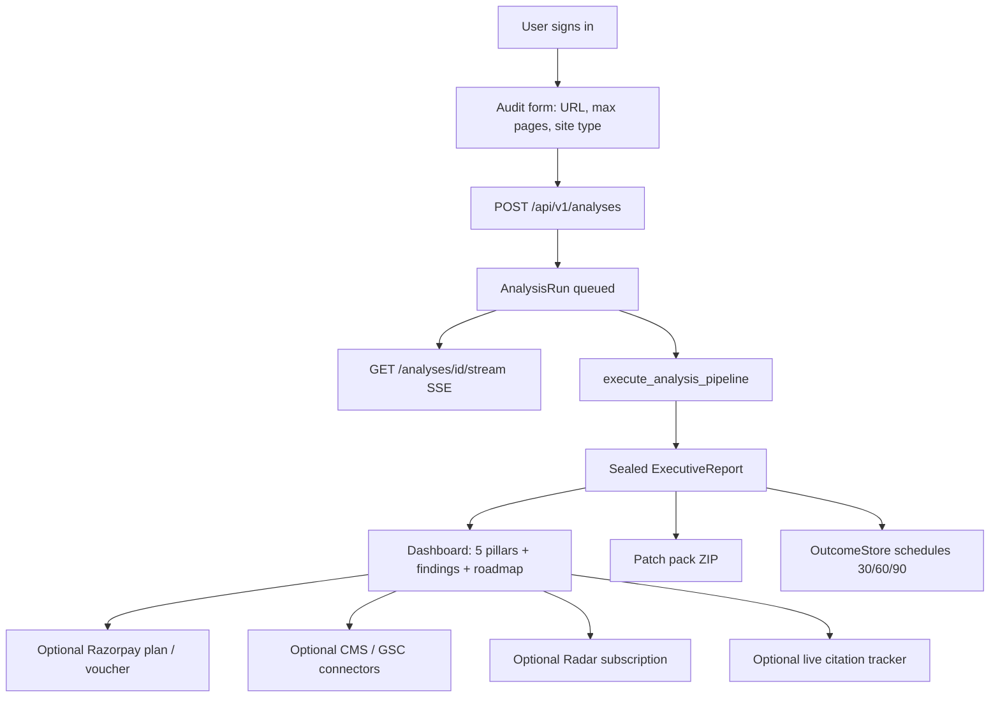

### 4.2 Cognitive planes (what actually runs)

```
Website URL
    │
    ▼
[Zero-Trust SSRF Guard]
    │
    ▼
[Crawler: httpx → Playwright/Firecrawl if thin]
    │
    ▼
[Deterministic analyzers] ──► PageEvidence + CrawlManifest
    │
    ▼
[EvidenceStore ev_NNN] + [SnapshotStore snap_<sha256>] + [EvidenceGraph]
    │
    ▼
[Wave-0 site_facts]  ($0 inference)
    │
    ▼
[ExternalEvidenceEnricher] ──► ext_NNN (DNS, TLS, headers, CrUX or NOT_CONFIGURED)
    │
    ▼
[Tier-1 deterministic capabilities]  (robots, schema, readability, …)
    │
    ▼
[BusinessUnderstandingOrchestrator]  (declared vs detected identity)
    │
    ▼
[AgentPool & Modular DAG: 105 specialists in 12 domains across 7 pipeline sections]
    │
    ▼
[PageIntelligenceAgent]  (per-URL SEO + 5 copywriters)
    │
    ▼
[Integrity gate + CERTAIN/LIKELY/GUESSING rubric]
    │     optional re-run of verification.adversarial.v3
    ▼
[Causal bottlenecks + hypotheses + opportunities]
    │
    ▼
[AI search simulation worker]  (6 commercial questions, labeled simulation)
    │
    ▼
[Synthesizer] → [ScoringEngine] → [RemediationPlanner] → [Roadmap]
    │
    ▼
[GEO readiness] + [Honest scores] + [character-safe copy] + [visual intelligence]
    │
    ▼
[Seal manifest.json] → ExecutiveReport → SSE completed
    │
    ▼
[OutcomeStore.schedule 30/60/90]
```

### 4.3 Analysis stages (emitted on SSE)

| Stage | Typical progress | What happens |
|---|---|---|
| `queued` | 0 | Run created |
| `ingesting` | 10–25 | Multi-page crawl |
| `deterministic_analysis` | 25–38 | Analyzers + Wave-0 facts + tier-1 caps |
| `planning` | ~38 | MissionDirector selects capabilities |
| `specialist_execution` | 42–85 | Identity → 105-agent DAG (7 workflow sections) → page intel → causal → AI sim |
| `adversarial_verification` | 82–83 | Integrity gate + optional adversarial re-run |
| `executive_synthesis` | 88 | Narrative |
| `scoring` | 93 | Category + honest scores, patches, roadmap, seal |
| `completed` / `failed` | 100 | Stream closes |

### 4.4 Evidence → claim → finding → score

```mermaid
flowchart LR
    DOM[Raw HTML / headers] --> EV[ev_NNN tokens]
    API[External APIs] --> EXT[ext_NNN tokens]
    EV --> BB[CognitiveBlackboard]
    EXT --> BB
    BB --> AG[SpecialistAgent]
    AG --> CL[Claim PROVISIONAL]
    CL --> GT[Ground-truth bind]
    GT --> RB[Rubric CERTAIN/LIKELY/GUESSING]
    RB --> ADV[Adversarial falsify]
    ADV --> CON[Contradiction route, no winner]
    CON --> GATE[Integrity gate]
    GATE --> DE[DecisionEngine findings]
    DE --> SC[ScoringEngine]
    SC --> EX[strategy.executive.v3 + report]
```

### 4.5 Two GEO systems (important product split)

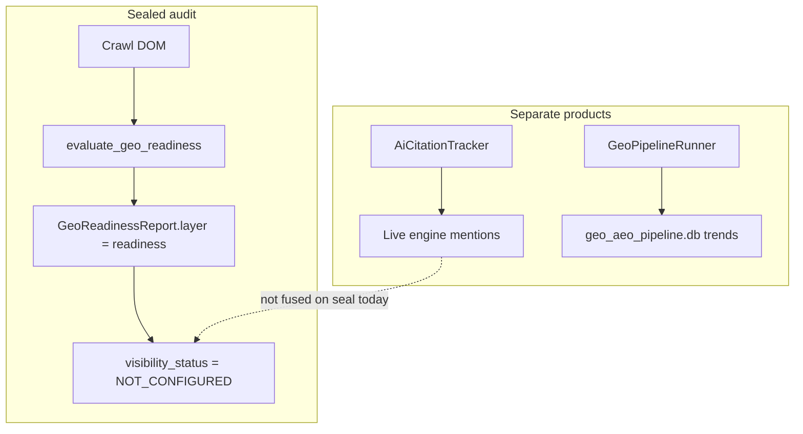

### 4.6 Total pipeline — every numbered step

This is the live `AnalysisOrchestrator.execute_analysis_pipeline` path. Each box is one real step. Progress percentages are the SSE values the UI shows.

```mermaid
flowchart TD
    S00["S00 · User submits URL + max_pages + site_type"]
    S01["S01 · POST /api/v1/analyses · require mission:create"]
    S02["S02 · create_run · AnalysisRun queued · SSE open"]
    S03["S03 · MissionDirector.create_mission · audit_type=standard_growth"]
    S04["S04 · SSRF guard is_safe_url"]
    S05["S05 · CrawlerService.crawl_site_and_analyze"]
    S05a["S05a · Fetch robots.txt + sitemap.xml"]
    S05b["S05b · httpx GET page · record_fetch snap_sha256"]
    S05c["S05c · Playwright / Firecrawl if thin SPA"]
    S05d["S05d · Analyzers: html meta DOM schema links perf security trust"]
    S05e["S05e · PageEvidence + crawl_health + EvidenceStore ev_NNN"]
    S06["S06 · EvidenceGraph populate pages / H1s / observations"]
    S07["S07 · extract_site_facts Wave-0 · $0 inference"]
    S07b["S07b · ExternalEvidenceEnricher · ext_NNN"]
    S08["S08 · MissionDirector.select_capabilities_for_mission"]
    S09["S09 · HypothesisEngine.generate_initial_hypotheses"]
    S10["S10 · Tier-1 deterministic capabilities 01-09 11 19 21"]
    S11["S11 · BusinessUnderstandingOrchestrator · identity vs declared type"]
    S12["S12 · AgentPool.execute_all · 105 specialists in 12 domains · 7 pipeline workflow sections"]
    S12w1["S12-W1 · 21 agents in parallel"]
    S12w2["S12-W2 · icp intent commercial knowledge_graph"]
    S12w3["S12-W3 · semantic_strategist + adversarial"]
    S12w4["S12-W4 · citation_readiness + discoverability + contradiction"]
    S12w5["S12-W5 · chatgpt perplexity google + executive"]
    S12w6["S12-W6 · cross_engine"]
    S13["S13 · PageIntelligenceAgent · per-URL SEO + 5 copywriters"]
    S14["S14 · Integrity gate + apply_rubric_to_claim"]
    S15["S15 · Optional re-run verification.adversarial.v3 for GUESSING+CRITICAL"]
    S16["S16 · EvidenceGapDetector"]
    S17["S17 · CausalReasoningEngine root-cause bottlenecks"]
    S18["S18 · HypothesisEngine.evaluate vs evidence"]
    S19["S19 · OpportunityDetector"]
    S20["S20 · worker_simulator ai_search_simulation · 6 commercial questions"]
    S21["S21 · Synthesizer worker if narrative empty"]
    S22["S22 · DecisionEngine.synthesize_findings"]
    S23["S23 · ScoringEngine.calculate_scores intent-adjusted"]
    S24["S24 · CalibratedConfidenceEngine"]
    S25["S25 · RemediationPlanner patches"]
    S26["S26 · RoadmapBuilder 7 / 30 / 90"]
    S27["S27 · WebsiteDigitalTwin + IntelligenceTimeline"]
    S28["S28 · NarrativeGenerator executive story"]
    S29["S29 · evaluate_geo_readiness visibility_measured=False"]
    S30["S30 · ScoringEngine.calculate_honest_scores"]
    S31["S31 · generate_character_safe_copy + WhatsApp 1-pager"]
    S32["S32 · EvidenceGraph re-sync + link findings/claims"]
    S33["S33 · build_run_manifest + seal_manifest"]
    S34["S34 · OutcomeStore.schedule 30/60/90"]
    S35["S35 · ExecutiveReport assembled · SSE completed"]
    S36["S36 · UI: 5 pillars · findings · roadmap · patch ZIP"]

    S00 --> S01 --> S02 --> S03 --> S04 --> S05
    S05 --> S05a --> S05b --> S05c --> S05d --> S05e
    S05e --> S06 --> S07 --> S07b --> S08 --> S09 --> S10 --> S11 --> S12
    S12 --> S12w1 --> S12w2 --> S12w3 --> S12w4 --> S12w5 --> S12w6
    S12w6 --> S13 --> S14 --> S15 --> S16 --> S17 --> S18 --> S19
    S19 --> S20 --> S21 --> S22 --> S23 --> S24 --> S25 --> S26
    S26 --> S27 --> S28 --> S29 --> S30 --> S31 --> S32 --> S33
    S33 --> S34 --> S35 --> S36
```

**Step table (same order as the diagram)**

| Step | Code | Inputs | Outputs |
|---|---|---|---|
| S00 | `AuditForm` / `startAnalysis` | URL, max pages, site type, notes | JSON body |
| S01 | `analyses.start_analysis` | `AnalysisRequest` | `AnalysisRun` id |
| S02 | `orchestrator.create_run` | URL, org_id | In-memory run + SSE queue |
| S03 | `MissionDirector.create_mission` | URL, `standard_growth` | `MissionState` |
| S04 | `security.ssrf.is_safe_url` | Target URL | Allow / deny |
| S05 | `CrawlerService` | URL, max_pages | `CrawlManifest` |
| S05a–e | analyzers + `record_fetch` | Raw HTML/headers | `PageEvidence`, `ev_NNN`, `snap_<sha>` |
| S06 | `EvidenceGraph.populate_from_evidence_store` | Store + manifest | Graph nodes/edges |
| S07 | `extract_site_facts` | Manifest | `blackboard.site_facts` |
| S07b | `ExternalEvidenceEnricher.enrich_domain` | Domain | `ext_NNN` (DNS/TLS/headers; CrUX/`NOT_CONFIGURED`) |
| S08 | `select_capabilities_for_mission` | Mission | Tier lists |
| S09 | `HypothesisEngine.generate_initial_hypotheses` | Domain + pages | Hypotheses |
| S10 | `TeamOrchestrator.execute_capability_wave` | Tier-1 cap IDs | Deterministic claims |
| S11 | `BusinessUnderstandingOrchestrator` | Blackboard | `BusinessProfile` + identity contradictions |
| S12 | `AgentPool.execute_all` | 35 defs | `agent_results` + claims |
| S13 | `PageIntelligenceAgent.run` | Each page | `page_reports` + suggested copy |
| S14 | `integrity_gate.validate_claims_and_evidence` | Claims + store | Purged / downgraded claims |
| S15 | `verification.adversarial.v3` re-run | Held GUESSING+CRITICAL | `adversarial_reviewed` |
| S16 | `EvidenceGapDetector` | Claims + pages | `evidence_gaps` |
| S17 | `CausalReasoningEngine` | Claims + profile | Bottlenecks |
| S18 | `evaluate_hypotheses_against_evidence` | Hypotheses + claims | Evaluated hypotheses |
| S19 | `OpportunityDetector` | Profile + pages + claims | Opportunities |
| S20 | `CognitiveSimulatorWorker` | Blackboard | `commercial_evaluations` / AI matrix |
| S21 | `CognitiveSynthesizerWorker` | Verified claims | `executive_narrative` |
| S22 | `DecisionEngine.synthesize_findings` | Claims | `Finding[]` |
| S23 | `ScoringEngine.calculate_scores` | Findings + intent | Category scores |
| S24 | `CalibratedConfidenceEngine` | Claims + pages | `overall_confidence` |
| S25 | `RemediationPlanner` | Findings | `CodePatch[]` |
| S26 | `RoadmapBuilder` | Findings + narrative | 7/30/90 items |
| S27 | Twin + Timeline | Scores + findings | In-memory domain state |
| S28 | `NarrativeGenerator` | Profile + findings + scores | Story fields |
| S29 | `evaluate_geo_readiness` | Pages + profile | `GeoReadinessReport` |
| S30 | `calculate_honest_scores` | Findings + commercial evals | Honest 3-Scores |
| S31 | `generate_character_safe_copy` | Profile | Title/meta/hero + WhatsApp |
| S32 | Graph re-sync | Findings + claims | Graph snapshot |
| S33 | `build_run_manifest` / `seal_manifest` | Store + telemetry | `manifest.json` |
| S34 | `OutcomeStore.schedule` | analysis_id | 30/60/90 jobs |
| S35 | `ExecutiveReport(...)` + visual intelligence | All of the above | Sealed report |
| S36 | Frontend tabs / pillars | Report JSON | User-facing UI |

Crawl internals (S05) expanded:

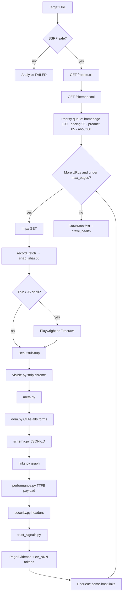

---

## 5. Class diagrams

### 5.1 Domain core

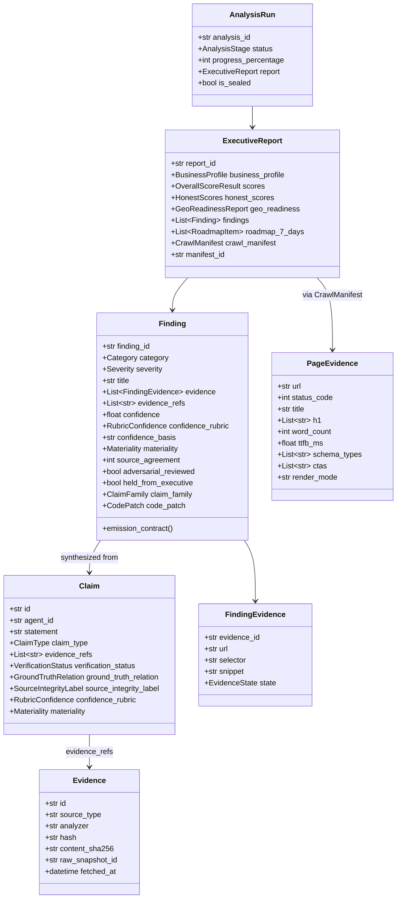

### 5.2 Blackboard and orchestration

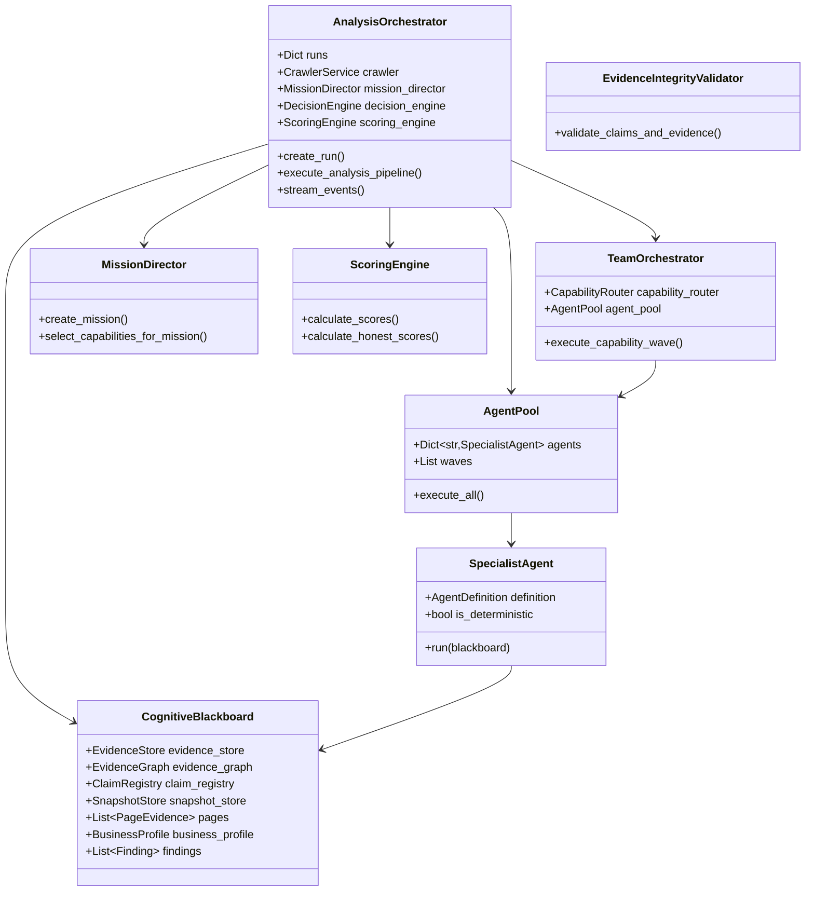

### 5.3 Evidence, snapshots, ground truth

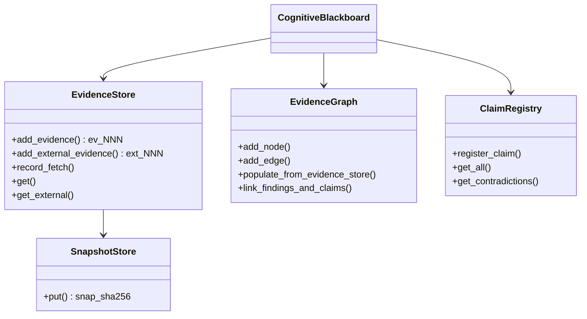

### 5.4 GEO / outcomes / radar

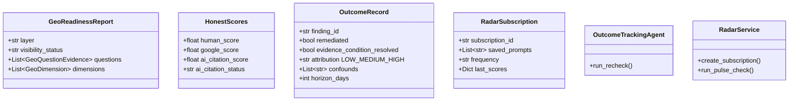

### 5.5 Identity, tenancy, remediation

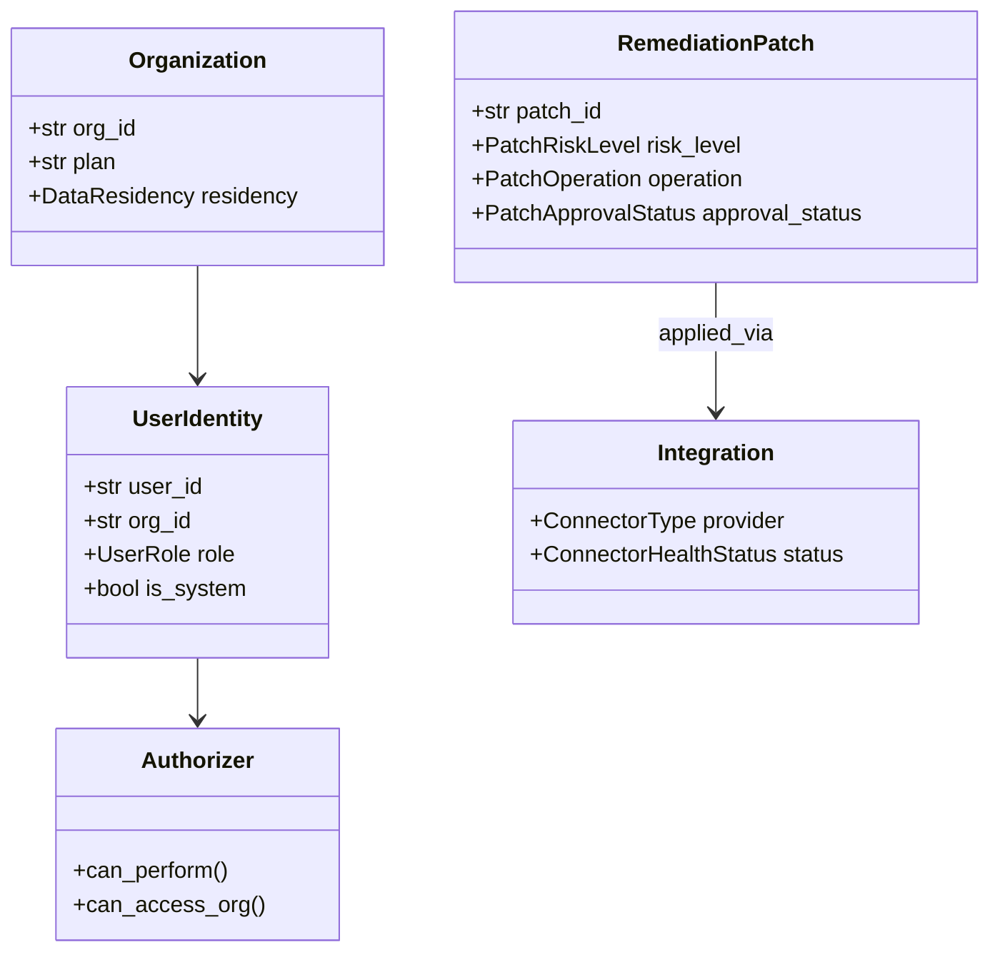

---

## 6. AI agent list

### 6.1 Baseline specialists (`SPECIALIST_AGENTS_V3`) and full 105 specialist workforce (`AGENT_REGISTRY`)

Runtime class for all specialist agents: `SpecialistAgent` in `backend/app/orchestration/runtime/specialist.py`.  
The core base suite requires `specialist_count() == 35`, while the extended active workforce features 105 specialist agents across 12 domains.

Modes: **DET** = crawl-only, no LLM; **HYBRID** = deterministic pass then LLM merge; **LLM** = structured generation with `allow_fallback=False` (missing key → `unavailable`, never a canned audit).

#### Domain 1 — Business intelligence

| ID | Name | Worker | Mode | Depends on | Required evidence | What it does |
|---|---|---|---|---|---|---|
| `business.discovery.v3` | Business Discovery | analyst | LLM | — | homepage_dom, header_nav, hero_text, footer_text | Legal/brand name, offerings, industry, stated audience, model, value prop. No guessed pricing. |
| `business.icp.v3` | ICP Intelligence | analyst | LLM | discovery | homepage_dom, use_cases, case_studies, **external_ground_truth** | Buyer roles, B2B/B2C, size, pain. Ground-truth gated (ICP). |
| `business.intent.v3` | Search Intent | analyst | LLM | discovery | headings, meta_descriptions, urls | Intent per URL: informational / commercial / transactional / navigational / comparison. |
| `business.commercial.v3` | Commercial Intelligence | analyst | LLM | discovery | pricing_table, cta_elements, terms_of_sale, **external_ground_truth** | Plans, checkout, friction. Missing prices = `NOT_IN_EVIDENCE`. Gated (PRICING). |
| `business.semantic_strategist.v3` | Semantic Strategist | strategist | LLM | discovery, icp, intent, commercial | claims | Reconciles identity/positioning conflicts. No new facts. |

#### Domain 2 — Technical SEO

| ID | Name | Worker | Mode | Required evidence | What it does |
|---|---|---|---|---|---|
| `seo.crawl.v3` | Crawl Intelligence | extractor | DET | robots_txt, sitemap_xml, http_status_codes | robots, sitemap, status, redirects, depth |
| `seo.indexability.v3` | Indexability | analyst | HYBRID | canonical_url, meta_robots, x_robots_tag | Canonical / noindex. Homepage noindex = CRITICAL |
| `seo.html.v3` | Technical HTML | extractor | DET | raw_dom, headings_tree, meta_tags | Title, meta length, H1–H6, landmarks |
| `seo.internal_links.v3` | Internal Linking | analyst | HYBRID | internal_link_graph, anchor_texts | Orphans, generic anchors, concentration |
| `seo.performance.v3` | Performance | analyst | DET | ttfb_ms, resource_timings, payload_size, **external_ground_truth** | Measured TTFB/weight only. **Forbidden:** invent LCP/CLS/INP |
| `seo.security.v3` | Security SEO | extractor | DET | response_headers, protocol_scheme | HTTPS, HSTS, CSP, X-Frame |
| `seo.assets.v3` | Media & Assets | extractor | HYBRID | img_tags, media_elements | Alt text, WebP/AVIF, lazy load |

#### Domain 3 — Structured data / entity

| ID | Name | Mode | Depends on | What it does |
|---|---|---|---|---|
| `schema.validation.v3` | Schema Intelligence | HYBRID | — | JSON-LD / microdata types and required fields |
| `entity.graph.v3` | Entity Intelligence | LLM | — | Organization, Person, Product, Service, Place |
| `entity.knowledge_graph.v3` | Knowledge Graph | LLM | entity.graph | `sameAs`, disambiguation. **Forbidden:** claim live KG inclusion without proof |

#### Domain 4 — Content

| ID | Name | Mode | Required evidence | What it does |
|---|---|---|---|---|
| `content.depth.v3` | Content Depth | LLM | body_copy, headings, word_counts | Thin vs substantive coverage |
| `content.eeat.v3` | E-E-A-T | LLM | author_bios, citations, about_page, editorial_policy, **external_ground_truth** | Observable credentials only. Gated (AUTHORSHIP) |
| `content.quality.v3` | Content Quality | LLM | clean_text, readability_metrics | Clarity, fluff (`cutting-edge`, `seamless`, …) |
| `content.topic_coverage.v3` | Topic Coverage | LLM | headings, body_text | Topic tree and gaps |
| `content.cannibalization.v3` | Cannibalization | LLM | page_manifest, all_page_titles, canonical_links | Title/intent collisions across pages |

#### Domain 5 — GEO (Generative Engine Optimization)

| ID | Name | Mode | Depends on | What it does |
|---|---|---|---|---|
| `geo.extractability.v3` | Answer Extractability | LLM | — | 40–60 word definitions, lists, tables, FAQs |
| `geo.information_gain.v3` | Information Gain | LLM | — | Original stats / methodology vs rehashed copy |
| `geo.citation_readiness.v3` | Citation Readiness | LLM | strategist, entity.graph, content.quality | Claim → evidence mapping |
| `geo.structure.v3` | Generative Structure | LLM | — | Answer-first openings, TL;DR, FAQ blocks |

#### Domain 6 — AI search (simulation unless live tracker)

| ID | Name | Mode | Depends on | What it does |
|---|---|---|---|---|
| `ai_search.discoverability.v3` | AI Discoverability | LLM | strategist | Synthetic buyer prompt matrix |
| `ai_search.chatgpt.v3` | ChatGPT Visibility | LLM | discoverability | DOM answerability. **SIMULATION_ONLY.** Forbidden: fake live citations |
| `ai_search.perplexity.v3` | Perplexity Visibility | LLM | discoverability | Citation eligibility. Same prohibition |
| `ai_search.google.v3` | Google AI Search | LLM | discoverability | AI Overview / snippet readiness from schema + definitions |
| `ai_search.cross_engine.v3` | Cross-Engine | LLM | chatgpt, perplexity, google | Compare simulated visibility |

Capability map note: `29_gemini_scenario` routes to `ai_search.google.v3`; `30_claude_scenario` routes to `ai_search.cross_engine.v3`. There is no dedicated Gemini or Claude specialist class.

#### Domain 7 — UX / CRO / Trust

| ID | Name | Mode | Required evidence | What it does |
|---|---|---|---|---|
| `ux.experience.v3` | UX Intelligence | HYBRID | dom_elements, nav_structure, viewport | Nav, readability, mobile friction |
| `cro.conversion.v3` | Conversion Intelligence | LLM | cta_elements, form_fields, hero_section | CTA copy/placement, form friction |
| `trust.authority.v3` | Trust Authority | LLM | footer_links, trust_badges, contact_info, **external_ground_truth** | Testimonials, NAP, privacy, badges. Gated (TRUST) |

#### Domain 8 — Verification / executive

| ID | Name | Worker | Mode | Depends on | What it does |
|---|---|---|---|---|---|
| `verification.adversarial.v3` | Adversarial Verification | critic | LLM + code falsify | — | Drops unbacked claims; reviews GUESSING+CRITICAL |
| `verification.contradiction.v3` | Contradiction & Causal | critic | LLM + code route | adversarial, icp, commercial, performance, eeat, trust | Records contests. **Never picks a DOM vs ext winner** |
| `strategy.executive.v3` | Executive Intelligence | synthesizer | LLM | contradiction | Narrative + 7/30/90 from **executive-eligible** claims only |

### 6.2 Copywriting fleet (5) — not in AgentPool

Invoked inside `PageIntelligenceAgent` after the specialist DAG, once per crawled URL.

| ID | Name | Output |
|---|---|---|
| `copywriting.seo.v3` | SERP Copywriter | Title 50–60, meta 140–160 |
| `copywriting.geo.v3` | GEO Citation Copywriter | 40–60 word definition + FAQ pairs |
| `copywriting.cro.v3` | CRO Copywriter | 3-second hook + active-verb CTAs |
| `copywriting.clarity.v3` | Clarity & Voice | Grade 7–9, fluff ban, ICP callouts |
| `copywriting.section.v3` | Section Architect | Hero / Problem / Solution / Proof / FAQ / CTA rewrites |

### 6.3 Around the DAG (not in the 35)

| ID / class | When it runs | Role |
|---|---|---|
| `BusinessUnderstandingOrchestrator` (5 prompt workers) | Before AgentPool | Declared vs detected identity |
| `PageIntelligenceAgent` | After AgentPool | Per-page SEO + copy |
| `CognitiveSimulatorWorker` (`ai_search_simulation`) | After verification | 6 commercial questions |
| `CognitiveSynthesizerWorker` | If narrative empty | Executive story |
| `outcome.tracking.v1` (`OutcomeTrackingAgent`) | Post-seal 30/60/90 | Finding rechecks |
| `ExternalEvidenceEnricher` | After Wave-0 site facts | DNS/TLS/headers `ext_`; CrUX/firmographics `NOT_CONFIGURED` without keys |
| `apply_ground_truth_feed` | On claim register + integrity gate | Bind `ext_` to gated families |

### 6.4 Reusable cognitive workers

| Class | Default id | Typical domain |
|---|---|---|
| `CognitiveExtractorWorker` | `worker_extractor` | Structured data / deterministic-adjacent |
| `CognitiveAnalystWorker` | `worker_analyst_1/2` | Business, content, GEO, UX |
| `CognitiveResearchWorker` | `worker_researcher` | Research tasks |
| `CognitiveCriticWorker` | `worker_critic` | Verification |
| `CognitiveStrategistWorker` | `worker_strategist` | Competitive differentiation |
| `CognitiveSimulatorWorker` | `worker_simulator` | AI search |
| `CognitiveSynthesizerWorker` | `worker_synthesizer` | Executive narrative |
| `CognitiveRemediationWorker` | `worker_remediation` | Patch synthesis |

### 6.5 35-capability taxonomy ↔ agent

| Cap ID | Name | Agent |
|---|---|---|
| 01_discovery | Crawlability | `seo.crawl.v3` |
| 02_semantic_structure | Heading / landmarks | `seo.html.v3` |
| 03_indexability | Canonical / robots | `seo.indexability.v3` |
| 04_link_architecture | Link graph | `seo.internal_links.v3` |
| 05_performance | TTFB / weight | `seo.performance.v3` |
| 06_security | Headers / TLS | `seo.security.v3` |
| 07_asset_optimization | Images / media | `seo.assets.v3` |
| 08_mobile_readiness | Viewport | `ux.experience.v3` |
| 09_schema_syntax | JSON-LD | `schema.validation.v3` |
| 10_entity_graph | Entities | `entity.graph.v3` |
| 11_opengraph_metadata | OG / Twitter | `entity.knowledge_graph.v3` |
| 12_positioning | Value narrative | `business.discovery.v3` |
| 13_icp_alignment | ICP | `business.icp.v3` |
| 14_value_prop_strength | 5-second test | `business.intent.v3` |
| 15_commercial_clarity | Pricing | `business.commercial.v3` |
| 16_competitive_differentiation | Moat | `business.semantic_strategist.v3` |
| 17_content_depth | Depth | `content.depth.v3` |
| 18_eeat_authority | E-E-A-T | `content.eeat.v3` |
| 19_readability | Fluency | `content.quality.v3` |
| 20_topic_coverage | Topic tree | `content.topic_coverage.v3` |
| 21_cannibalization | Collisions | `content.cannibalization.v3` |
| 22_direct_extractability | Answers | `geo.extractability.v3` |
| 23_information_gain | Originality | `geo.information_gain.v3` |
| 24_summarizability | TL;DR | `geo.structure.v3` |
| 25_citation_readiness | Quotability | `geo.citation_readiness.v3` |
| 26_ai_discoverability | Query matrix | `ai_search.discoverability.v3` |
| 27_chatgpt_scenario | ChatGPT | `ai_search.chatgpt.v3` |
| 28_perplexity_scenario | Perplexity | `ai_search.perplexity.v3` |
| 29_gemini_scenario | Gemini / AIO | `ai_search.google.v3` |
| 30_claude_scenario | Claude | `ai_search.cross_engine.v3` |
| 31_ux_friction | UX | `ux.experience.v3` |
| 32_trust_signals | Trust | `trust.authority.v3` |
| 33_conversion_cro | CRO | `cro.conversion.v3` |
| 34_adversarial_verification | Falsify | `verification.adversarial.v3` |
| 35_contradiction_resolution | Arbitrate | `verification.contradiction.v3` |

---

## 7. AI agent flow

### 7.1 Live pipeline order (`AnalysisOrchestrator.execute_analysis_pipeline`)

1. `MissionDirector.create_mission` (`audit_type=standard_growth`)
2. Crawl + populate Evidence Graph + Wave-0 `extract_site_facts`
3. `ExternalEvidenceEnricher.enrich_domain` → `ext_NNN`
4. Tier-1 **deterministic** capabilities (`01`–`09`, `11`, `19`, `21`) via `TeamOrchestrator`
5. `BusinessUnderstandingOrchestrator` (identity conflict event if declared ≠ detected)
6. **`AgentPool.execute_all`** — 105 specialists across 12 domains and 7 pipeline workflow sections
7. `PageIntelligenceAgent` — SEO + 5 copywriters per URL
8. Integrity gate + rubric; if any GUESSING+CRITICAL unreviewed → re-run `verification.adversarial.v3`
9. Causal bottlenecks, hypothesis evaluation, opportunity detector
10. `worker_simulator.execute_task("ai_search_simulation")`
11. Synthesizer if narrative empty
12. `DecisionEngine.synthesize_findings` → `ScoringEngine` → patches → 7/30/90
13. Digital twin + timeline snapshot
14. `evaluate_geo_readiness(visibility_measured=False)` + Honest Scores + character-safe copy + visual intelligence
15. Seal `manifest.json`, emit report, `OutcomeStore.schedule`

### 7.2 Kahn waves (actual DAG)

Computed from `AgentDefinition.dependencies` by `topological_waves()`. Independent agents in a wave run concurrently (`asyncio.gather`).

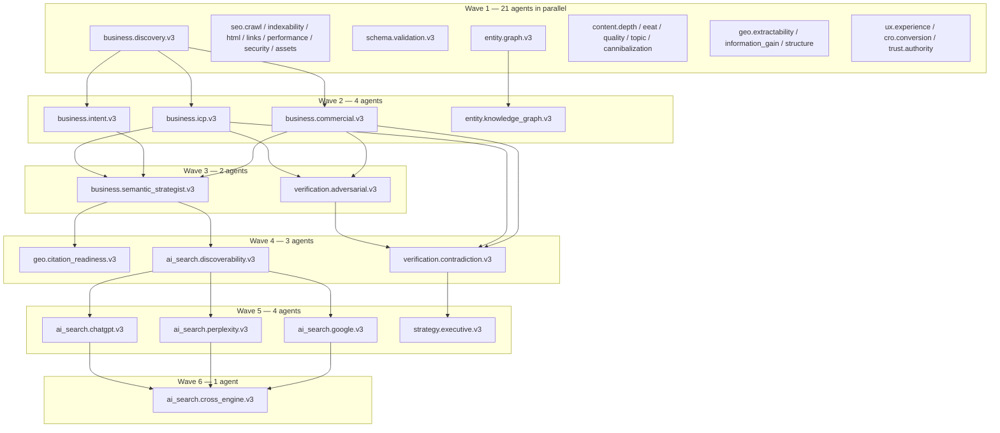

**Non-empty dependency edges only:**

```
business.discovery.v3 → business.icp.v3, business.intent.v3, business.commercial.v3
{discovery, icp, intent, commercial} → business.semantic_strategist.v3
entity.graph.v3 → entity.knowledge_graph.v3
{strategist, entity.graph, content.quality} → geo.citation_readiness.v3
strategist → ai_search.discoverability.v3
discoverability → chatgpt, perplexity, google
{chatgpt, perplexity, google} → ai_search.cross_engine.v3
{icp, commercial, eeat, trust} → verification.adversarial.v3
  (stale IDs seo.technical/onpage/schema.v3 are not in the registry and are ignored)
{adversarial, icp, commercial, performance, eeat, trust} → verification.contradiction.v3
contradiction → strategy.executive.v3
```

All other specialists have `dependencies=[]` and sit in wave 1.

Live wave counts (verified against `topological_waves(SPECIALIST_AGENTS_V3)`): **21 + 4 + 2 + 3 + 4 + 1 = 35**.

### 7.3 DAG notes (architecture markdown now matches live code)

| Topic | Live code |
|---|---|
| Agent count | 105 in `AGENT_REGISTRY` across 12 domains; 7 modular workflow sections (33 DAG nodes) |
| Adversarial | Wave **3** (after ICP/commercial). Orchestrator **re-runs** it after the pool for held GUESSING+CRITICAL |
| Executive | Wave **5**, in parallel with ChatGPT/Perplexity/Google, **before** `ai_search.cross_engine.v3` (wave 6). Post-pool synthesizer/scoring still run after the DAG |
| Copywriting | Runs **after** the specialist pool, then integrity gate |
| External ground truth | `ExternalEvidenceEnricher` runs on the production crawl path (DNS/TLS/headers always; CrUX/firmographics `NOT_CONFIGURED` without keys). Not a registry agent |
| `dag.py` | Unused by the main orchestrator; real DAG is `agent_pool.topological_waves` |
| Duplicate business fleet | `BusinessUnderstandingOrchestrator` also runs **before** the 35 |

### 7.4 How a specialist is invoked

1. `EvidenceRetriever` slices up to 30 evidence items (falls back to first 30 in the store).
2. If all dependencies missing and domain ≠ VERIFICATION → `status=unavailable`.
3. DET / HYBRID / LLM as above.
4. LLM prompt = `specialist_system.txt` + task card + forbidden operations + prior blackboard context.
5. `ModelRouter.generate_structured(..., allow_fallback=False, max_claims=3)`.
6. Claims **without real `evidence_refs` are dropped**.
7. `register_claim` → ground-truth bind → rubric.
8. Result stored on `blackboard.blackboard_state["agent_results"]`.

Model routing is coarse: capabilities named `synthesizer`, `geo_analysis`, `ai_search_simulation`, `critic` get `model_reasoning`; most specialists get `model_fast`. Registry `allowed_models` (`reasoning_model` / `fast_slm` / `judge_model`) are contracts, not hard-wired model IDs.

### 7.5 Claim lifecycle

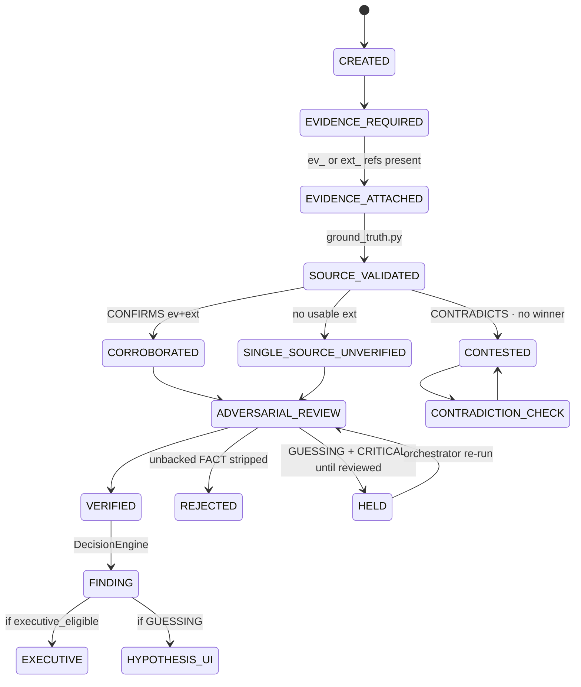

```
CREATED
  → EVIDENCE_ATTACHED (ev_/ext_ refs)
  → SOURCE_VALIDATED (ground_truth.py)
       CONFIRMS  → CORROBORATED, confidence HIGH
       CONTRADICTS → CONTESTED, routed to verification.contradiction.v3, no winner
       missing usable ext → SINGLE_SOURCE_UNVERIFIED, MEDIUM cap
  → ADVERSARIAL_REVIEW (unbacked FACT stripped / GUESSING+CRITICAL reviewed)
  → CONTRADICTION_CHECK
  → Integrity gate (dangling refs purged, synthetic markers flagged)
  → VERIFIED | PARTIALLY_VERIFIED | REJECTED | CONTESTED | INSUFFICIENT_EVIDENCE
  → DecisionEngine findings
  → executive_eligible_claims filter (held guesses out)
  → strategy.executive.v3 + ScoringEngine
```

### 7.6 One-agent internal flow (`SpecialistAgent.run`)

Every one of the 105 specialists is the same class. This is the exact branch order in `backend/app/orchestration/runtime/specialist.py`.

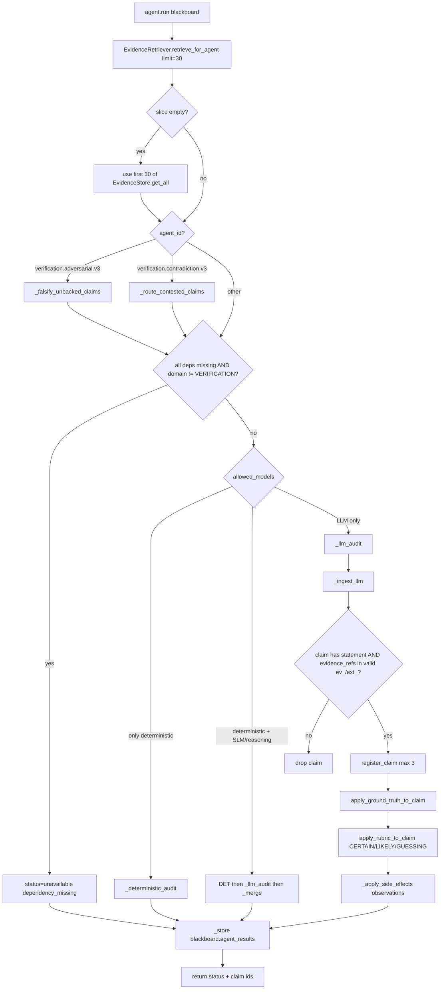

LLM call inside `_llm_audit`:

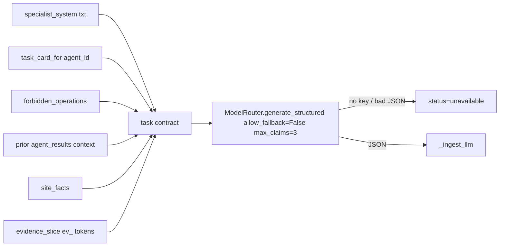

### 7.7 Per-agent diagrams (all 35 + copywriters)

Read each diagram left → right: **evidence in** → **agent** → **claims / side-effects out**. Parallel agents in the same wave have no edge between them.

#### Domain 1 — Business (wave 1 discovery, then wave 2, then wave 3 strategist)

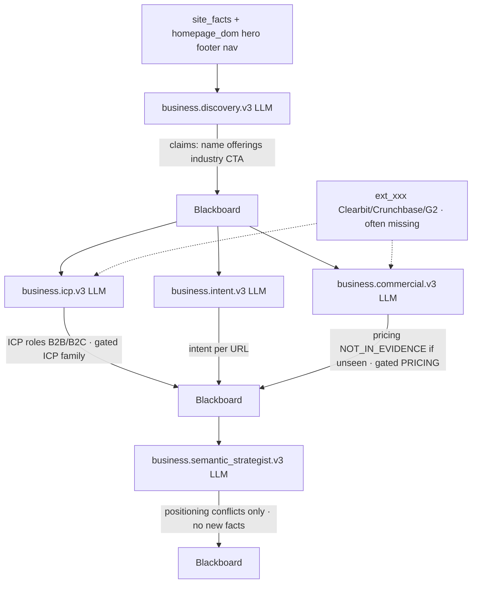

| Agent | Wave | Mode | Reads | Writes |
|---|---|---|---|---|
| `business.discovery.v3` | 1 | LLM | homepage DOM, nav, hero, footer | Brand/offer claims; may set `business_name` |
| `business.icp.v3` | 2 | LLM | discovery + `ext_` ICP | Buyer/ICP claims; CONTESTED if ext contradicts |
| `business.intent.v3` | 2 | LLM | titles, H1, URLs, meta | One intent tag per crawled URL |
| `business.commercial.v3` | 2 | LLM | pricing table, CTAs, terms + `ext_` | Plan/friction claims; never invents a price |
| `business.semantic_strategist.v3` | 3 | LLM | prior business claims | Conflict claims only |

#### Domain 2 — Technical SEO (all wave 1 except none wait on each other)

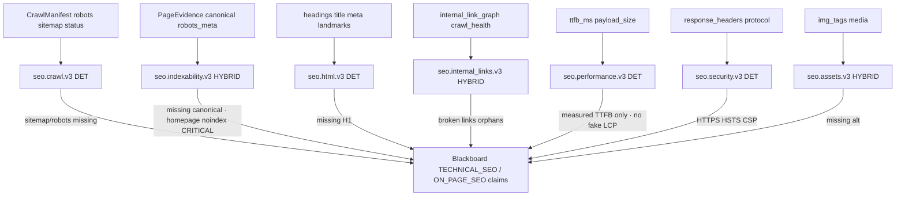

| Agent | Wave | Mode | Deterministic check | LLM adds |
|---|---|---|---|---|
| `seo.crawl.v3` | 1 | DET | sitemap / robots presence | — |
| `seo.indexability.v3` | 1 | HYBRID | missing canonical | noindex / X-Robots interpretation |
| `seo.html.v3` | 1 | DET | missing H1 | — |
| `seo.internal_links.v3` | 1 | HYBRID | broken_links_count | orphan / weak-anchor narrative |
| `seo.performance.v3` | 1 | DET | TTFB + payload | — (forbidden: invent CWV) |
| `seo.security.v3` | 1 | DET | HTTPS / headers | — |
| `seo.assets.v3` | 1 | HYBRID | images without alt | format / lazy-load notes |

#### Domain 3 — Schema / entity

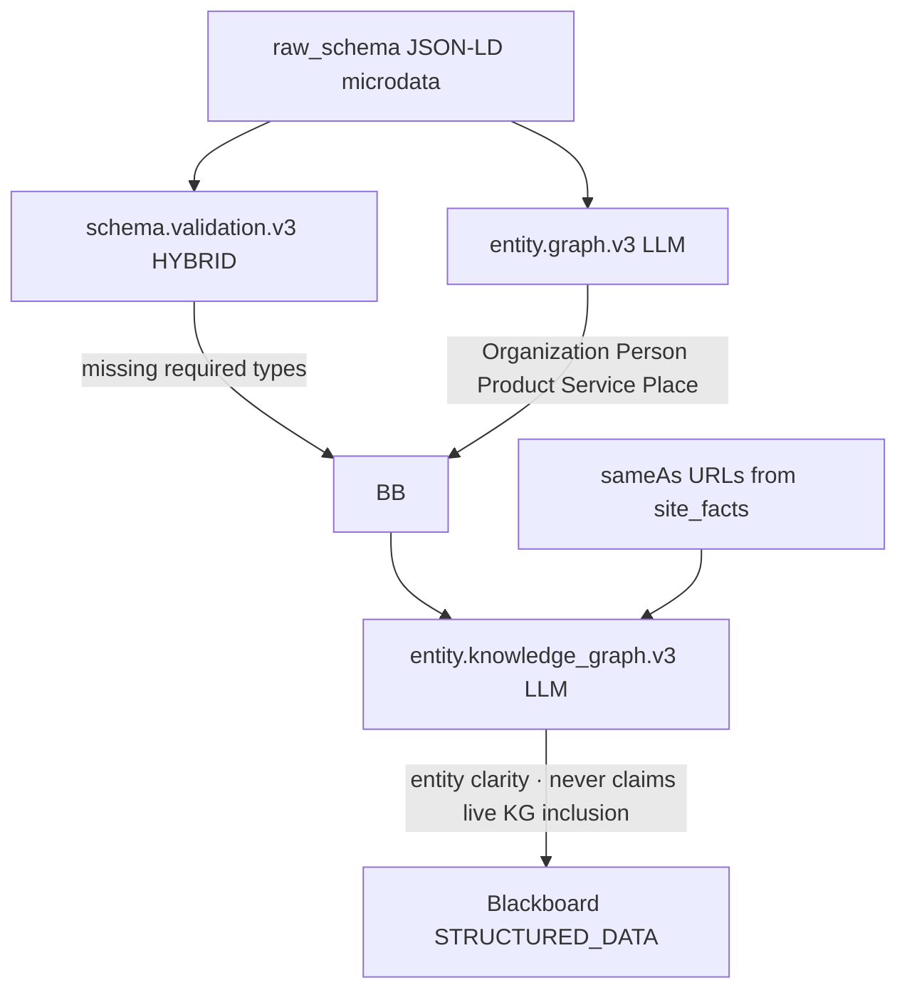

#### Domain 4 — Content (all wave 1, parallel)

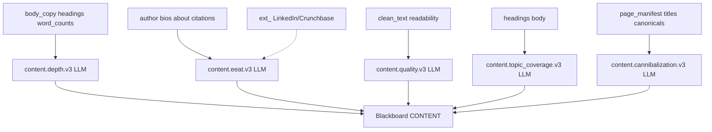

#### Domain 5 — GEO

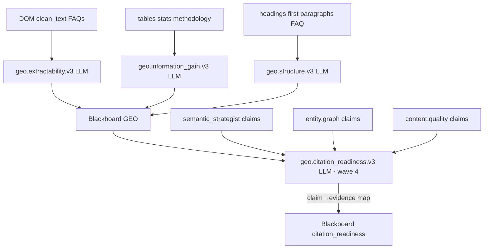

#### Domain 6 — AI search (waves 4 → 5 → 6)

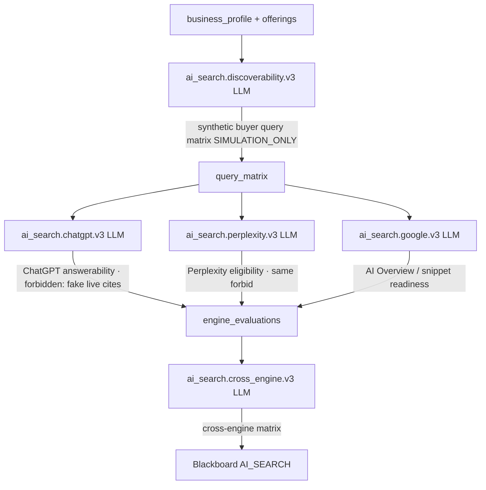

#### Domain 7 — UX / CRO / Trust (wave 1)

```mermaid
flowchart TD
    NAV[nav viewport readability] --> UX[ux.experience.v3 HYBRID]
    CTA[cta_elements forms hero] --> CRO[cro.conversion.v3 LLM]
    FT[footer badges contact privacy] --> TR[trust.authority.v3 LLM]
    EXT[ext_ G2 Trustpilot GBP] -.-> TR
    UX -->|missing viewport / IA friction| BB
    CRO -->|CTA friction form barriers| BB
    TR -->|trust proof · gated TRUST family| BB
    BB[Blackboard EXPERIENCE]
```

#### Domain 8 — Verification / executive

```mermaid
flowchart TD
    ICP[business.icp.v3] --> ADV
    COM[business.commercial.v3] --> ADV
    EEAT[content.eeat.v3] --> ADV
    TR[trust.authority.v3] --> ADV
    ALL[claims + evidence_store + graph] --> ADV[verification.adversarial.v3 · wave 3 + optional re-run]
    ADV -->|strip unbacked FACT · mark GUESSING+CRITICAL reviewed| BB
    ICP --> CONT
    COM --> CONT
    PERF[seo.performance.v3] --> CONT
    EEAT --> CONT
    TR --> CONT
    ADV --> CONT[verification.contradiction.v3 · wave 4]
    CONT -->|CONTESTED rows · winner_claim_id = None| BB2
    BB2 --> EXEC[strategy.executive.v3 · wave 5]
    ELIG[executive_eligible_claims · held guesses filtered] --> EXEC
    SCORES[later ScoringEngine] -.-> EXEC
    EXEC -->|story_summary root causes 7/30/90 seed| NAR[blackboard.executive_narrative]
```

Adversarial + contradiction extra hooks (code, not just LLM):

```mermaid
flowchart TD
    ADV[verification.adversarial.v3] --> F["_falsify_unbacked_claims"]
    F --> F1{claim.evidence_refs still in store?}
    F1 -->|no| F2[drop / downgrade FACT]
    F1 -->|yes| F3[keep]
    F2 --> F4[GUESSING+CRITICAL → adversarial_reviewed]
    CONT[verification.contradiction.v3] --> R["_route_contested_claims"]
    R --> R1[register Contradiction]
    R1 --> R2[winner_claim_id = None]
    R2 --> R3[routed_to = verification.contradiction.v3]
```

#### Domain 9 — Copywriting (after the 35, inside `PageIntelligenceAgent`)

```mermaid
flowchart TD
    PAGE[One crawled PageEvidence] --> SEO[copywriting.seo.v3]
    PAGE --> GEO[copywriting.geo.v3]
    PAGE --> CRO[copywriting.cro.v3]
    PAGE --> CLR[copywriting.clarity.v3]
    PAGE --> SEC[copywriting.section.v3]
    SEO -->|title 50-60 · meta 140-160| PR[PageReport.copywriting]
    GEO -->|40-60 word definition + FAQ| PR
    CRO -->|3-sec hook + CTA verbs| PR
    CLR -->|grade 7-9 · fluff ban| PR
    SEC -->|Hero Problem Solution Proof FAQ CTA| PR
    PR --> LIST[blackboard.page_reports]
```

`PageIntelligenceAgent` also writes deterministic `PageSeoAudit` (title/meta/H1/canonical/OG/schema status) and `PageUxSignals` (CTA count, alts, TTFB, readability) without those five cards.

### 7.8 Full DAG with every node and 7 workflow sections

Parallel boxes in a wave run at the same time (`asyncio.gather`). Arrows are registry `dependencies` only.

```mermaid
flowchart TD
    subgraph W1 ["Wave 1 — 21 agents concurrent"]
        A01[business.discovery.v3]
        A02[seo.crawl.v3]
        A03[seo.indexability.v3]
        A04[seo.html.v3]
        A05[seo.internal_links.v3]
        A06[seo.performance.v3]
        A07[seo.security.v3]
        A08[seo.assets.v3]
        A09[schema.validation.v3]
        A10[entity.graph.v3]
        A11[content.depth.v3]
        A12[content.eeat.v3]
        A13[content.quality.v3]
        A14[content.topic_coverage.v3]
        A15[content.cannibalization.v3]
        A16[geo.extractability.v3]
        A17[geo.information_gain.v3]
        A18[geo.structure.v3]
        A19[ux.experience.v3]
        A20[cro.conversion.v3]
        A21[trust.authority.v3]
    end

    subgraph W2 ["Wave 2 — 4 agents concurrent"]
        B01[business.icp.v3]
        B02[business.intent.v3]
        B03[business.commercial.v3]
        B04[entity.knowledge_graph.v3]
    end

    subgraph W3 ["Wave 3 — 2 agents concurrent"]
        C01[business.semantic_strategist.v3]
        C02[verification.adversarial.v3]
    end

    subgraph W4 ["Wave 4 — 3 agents concurrent"]
        D01[geo.citation_readiness.v3]
        D02[ai_search.discoverability.v3]
        D03[verification.contradiction.v3]
    end

    subgraph W5 ["Wave 5 — 4 agents concurrent"]
        E01[ai_search.chatgpt.v3]
        E02[ai_search.perplexity.v3]
        E03[ai_search.google.v3]
        E04[strategy.executive.v3]
    end

    subgraph W6 ["Wave 6 — 1 agent"]
        F01[ai_search.cross_engine.v3]
    end

    A01 --> B01
    A01 --> B02
    A01 --> B03
    A10 --> B04
    B01 --> C01
    B02 --> C01
    B03 --> C01
    B01 --> C02
    B03 --> C02
    A12 --> C02
    A21 --> C02
    C01 --> D01
    A10 --> D01
    A13 --> D01
    C01 --> D02
    C02 --> D03
    B01 --> D03
    B03 --> D03
    A06 --> D03
    A12 --> D03
    A21 --> D03
    D02 --> E01
    D02 --> E02
    D02 --> E03
    D03 --> E04
    E01 --> F01
    E02 --> F01
    E03 --> F01
```

### 7.9 Sequence of one full audit (agents + post-steps)

```mermaid
sequenceDiagram
    autonumber
    actor User
    participant API as FastAPI analyses
    participant Orch as AnalysisOrchestrator
    participant Crawl as CrawlerService
    participant BB as CognitiveBlackboard
    participant Pool as AgentPool 35
    participant Page as PageIntelligenceAgent
    participant Gate as IntegrityGate
    participant Score as ScoringEngine
    participant UI as React dashboard

    User->>API: POST /analyses URL max_pages site_type
    API->>Orch: create_run + background execute
    API-->>User: analysis_id + SSE
    Orch->>Crawl: crawl_site_and_analyze
    Crawl->>BB: pages, ev_NNN, snap_sha256
    Orch->>BB: site_facts + EvidenceGraph
    Orch->>BB: ExternalEvidenceEnricher ext_NNN
    Orch->>BB: tier-1 deterministic claims
    Orch->>BB: BusinessUnderstandingOrchestrator
    Orch->>Pool: execute_all waves 1..6
    Pool->>BB: 35 × agent_results + claims
    Orch->>Page: run per URL
    Page->>BB: page_reports + copy cards
    Orch->>Gate: validate_claims_and_evidence
    Gate->>Pool: optional adversarial re-run
    Orch->>BB: causal + hypotheses + opportunities
    Orch->>BB: ai_search_simulation worker
    Orch->>Score: findings → category + honest scores
    Orch->>BB: patches + 7/30/90 + GEO readiness
    Orch->>BB: seal manifest + ExecutiveReport
    Orch-->>UI: SSE completed
    UI-->>User: pillars findings roadmap patches
```

### 7.10 Post-DAG workers that are not in the 35

```mermaid
flowchart TD
    POOL[AgentPool finished] --> PI[PageIntelligenceAgent]
    PI --> COPY1[copywriting.seo.v3]
    PI --> COPY2[copywriting.geo.v3]
    PI --> COPY3[copywriting.cro.v3]
    PI --> COPY4[copywriting.clarity.v3]
    PI --> COPY5[copywriting.section.v3]
    COPY1 --> GATE[Integrity gate]
    COPY2 --> GATE
    COPY3 --> GATE
    COPY4 --> GATE
    COPY5 --> GATE
    GATE --> ADV2[optional verification.adversarial.v3]
    ADV2 --> GAP[EvidenceGapDetector]
    GAP --> CAU[CausalReasoningEngine]
    CAU --> HYP[HypothesisEngine.evaluate]
    HYP --> OPP[OpportunityDetector]
    OPP --> SIM[CognitiveSimulatorWorker ai_search_simulation]
    SIM --> SYN[CognitiveSynthesizerWorker]
    SYN --> DEC[DecisionEngine]
    DEC --> SC[ScoringEngine]
    SC --> REM[RemediationPlanner]
    REM --> RM[RoadmapBuilder]
    RM --> GEO[evaluate_geo_readiness]
    GEO --> HON[HonestScores]
    HON --> VIS[visual_intelligence_engine]
    VIS --> SEAL[seal_manifest]
    SEAL --> OUT[outcome.tracking.v1 scheduled 30/60/90]
```

`outcome.tracking.v1` does **not** run during the live audit. On the due date it re-crawls, rebuilds a `SiteSnapshot`, and emits `OUTCOME_RECORD` rows per original `finding_id`.

---

## 8. Where it needs improvement, and features to add

### 8.1 What is already strong

- Real multi-page crawl with SSRF, Playwright, visible-text extraction, content-addressed snapshots
- External enrichment on the live path: DNS/TLS/headers as `ext_NNN`; CrUX/firmographics fail closed
- Immutable `ev_` tokens, sealed `manifest.json`, hash-mismatch refuse
- Exactly 105 specialists across 12 domains and 7 workflow sections, no canned specialist fallback (`allow_fallback=False`)
- CERTAIN / LIKELY / GUESSING split in UI; Big-4 counts use grounded findings
- GEO **readiness** is deterministic and honest; visibility is modeled as a separate layer
- Radar refuses fake baselines; outcomes refuse causation without confounds
- Production config refuses default admin password, weak `AUTH_SECRET`, payment mocks
- Large pytest suite: zero-fake, ground-truth, rubric, GEO, reproducibility, SSRF, RBAC, 105-agent workforce

### 8.2 Integrity gaps that still leak synthetic numbers

| Surface | Problem | Fix |
|---|---|---|
| `integrations/dataforseo_provider.py` `fetch_keywords` | Returns invented search volume / CPC / KD **whether or not credentials exist** | Return empty + `connected=false` / `NOT_CONFIGURED` |
| `integrations/google_connectors.py` GSC | `gsc_sandbox_fixture` query metrics even when disconnected | Fail closed like `intelligence/search_console.py` |
| `integrations/google_connectors.py` GA4 | Hardcoded sessions / bounce / conversions after a property-id “connect” | Call GA4 Data API or return UNAVAILABLE |
| `POST /integrations/gsc\|ga4/connect` | Sets `_connected=True` without verifying tokens | Verify OAuth / SA first |
| Google OAuth without `GOOGLE_CLIENT_ID` | `mock_code_*` callback | Dev-only gate; forbidden in prod |
| Honest `ai_citation_score` | On-page heuristic, not live citations | Null unless `AiCitationTracker.is_live`; rename to “on-page AI readiness” |
| Sealed GEO visibility | Orchestrator always passes `visibility_measured=False` | Fuse citation tracker / geo pipeline when they actually ran |
| `Intro.tsx` | Marketing still implies live engine querying on the main audit path | Label simulation vs live |

### 8.3 Designed but not produced

| Feature | Status |
|---|---|
| **External Ground-Truth Enrichment Agent** | `ExternalEvidenceEnricher` **does** run on the production crawl path and writes `ext_NNN` for DNS, TLS, and security headers. CrUX / Clearbit / BuiltWith / G2 still emit `NOT_CONFIGURED` stubs unless keys exist. Gated ICP/pricing/performance/trust/authorship claims stay `SINGLE_SOURCE_UNVERIFIED` until those APIs are wired. |
| CrUX / real CWV | Forbidden to invent. Enricher attempts CrUX; missing key → `NOT_CONFIGURED`, not a lab substitute. |
| Ahrefs / Semrush / Clearbit / BuiltWith / Crunchbase / G2 | Expected in `FAMILY_EXT_SOURCES`. No Settings fields, no connectors. |
| Live GEO visibility on the sealed report | Separate endpoints exist; not fused into `GeoReadinessReport` |
| Plan / voucher enforcement on `POST /analyses` | Catalog and vouchers exist; start_analysis does not check entitlement |
| Durable connector store | In-memory; process restart wipes integrations |
| Email delivery | Password reset and radar alerts have no mailer (`delivery_status: not_configured`) |
| Outcome external metric deltas | Designed for enrichment snapshots that never arrive |

### 8.4 Architecture weaknesses

1. **Two connector worlds:** `connectors/` (CMS remediation) vs `integrations/` (analytics fixtures) with different honesty rules.
2. **Two GEO systems:** readiness in the audit DAG vs visibility on side endpoints. Product story fragments.
3. **In-memory analysis runs:** `AnalysisOrchestrator.runs` dies with the process. Auth/outcomes/geo_pipeline have SQLite; audits mostly do not.
4. **Duplicate business intelligence:** 5-worker `BusinessUnderstandingOrchestrator` plus 5 v3 business specialists — overlapping cost and claims.
5. **DAG timing:** adversarial is now wave 3 (after ICP/commercial), which is better than wave 1, but `strategy.executive.v3` is still wave 5 — in parallel with ChatGPT/Perplexity/Google and **before** `ai_search.cross_engine.v3`. Orchestrator re-runs adversarial after the pool for held guesses; post-pool synthesizer/scoring still assemble the report.
6. **Coarse model routing:** registry promises `judge_model` / `reasoning_model`; router mostly uses `model_fast`.
7. **Page vectors keyed by domain/url, not `analysis_id`:** cross-audit contamination risk.
8. **Default insecure bootstrap** (`DEBUG=True`, default admin) conflicts with the “enterprise evidence” brand — blocked in production, still the local default.
9. **Complexity vs shipping:** mission planes, unused `dag.py`, leftover v2 agents, `simulator.py` — high cognitive load for maintainers.
10. **No Docker/Compose** in tree for a production deploy.

### 8.5 Features that should be added (vs the intended product)

Positioning: **SEO + GEO/AEO + agent readiness + CRO + brand intelligence**, sold as **evidence-backed reports and roadmaps**, not vanity scores.

#### Must-have (integrity of the current product)

1. **External enrichment agent** that emits real `EXTERNAL_EVIDENCE` (`ext_001+`) from CrUX, company databases, review sites, optional DataForSEO — and writes explicit `NOT_CONFIGURED` once per family when keys are missing. Never invent metrics.
2. **Settings UI + `config.py` fields** for those connectors.
3. **Fail-closed integrations API:** disconnected → empty lists + status, never calibrated clicks/volumes.
4. **Fuse live visibility** into sealed `GeoReadinessReport` when the citation tracker or geo pipeline actually measured; otherwise keep `NOT_CONFIGURED`.
5. **Relabel Honest AI score** (or null it) unless live engines ran.
6. **Server-side voucher / plan enforcement** on crawl depth and paid features.
7. **Persist connectors and analysis runs** in SQLite/Postgres.
8. **Fix DAG order:** run adversarial after specialists; run executive after AI-search + contradiction.

#### Should-have (complete the five pillars)

9. **Brand intelligence:** sameAs / Wikidata / LinkedIn / Crunchbase entity resolution beyond DOM.
10. **CRO with first-party data:** real GA4 funnels, or stay explicitly qualitative from DOM CTAs.
11. **Agent readiness as a scored dimension:** `llms.txt`, AI bot robots, FAQ schema, extractable definitions — already in the patch pack, not first-class in scoring copy.
12. **Live citation monitoring productized:** Radar should consume `AiCitationTracker` snapshots, not only DOM diffs.
13. **Competitor bakeoff at plan entitlement:** discovery + 5-pillar homepage compare exists; wire it to paid tiers and real crawled peers only.
14. **White-label / agency:** workspace UI exists; needs durable multi-tenant storage, branding, and PDF export that is actually implemented end-to-end.
15. **Notifications:** email/Slack/WhatsApp for radar regressions and outcome due jobs.
16. **Production packaging:** Docker, migrations, secret management, no default admin.

#### Nice-to-have

17. Per-page Core Web Vitals via CrUX API (field data, not lab guesses).
18. Continuous GitHub PR remediation with closed-loop verify against a staging URL.
19. Multi-language / multi-market GEO (request already has `country` / `language` unused).
20. Collapse leftover v2 agent classes and unused workers to one execution path.
21. Bind page embeddings to `analysis_id`.
22. Use registry `token_budget` / `timeout_sec` / `allowed_models` for real routing instead of a 4-string capability check.

### 8.6 Recommended implementation order

| Priority | Work | Why |
|---|---|---|
| P0 | Kill fabricated keyword/GSC/GA4 returns | Directly contradicts “zero fake numbers” |
| P0 | External enrichment agent + Settings | Unlocks CERTAIN corroboration the rubric already encodes |
| P0 | Fuse or honestly label AI citation / GEO visibility | Stops selling a live rank the HTML path cannot produce |
| P1 | Entitlement on `POST /analyses` | Payments otherwise do not gate the product |
| P1 | Durable run + connector storage | Restarts currently lose audits and integrations |
| P1 | DAG wave order (adversarial late, executive last) | Executive currently synthesizes before AI-search finishes |
| P2 | Real CrUX + GSC OAuth | Completes SEO with field data |
| P2 | Agency / white-label durability | Unlocks the retainer SKU |
| P3 | Collapse duplicate agent paths | Cost and maintainability |

---

## 9. API catalog

All analysis routers are mounted at both `/api/v1` and `/api`.

| Method | Path | Purpose |
|---|---|---|
| GET | `/health` | App, provider, models |
| GET | `/` | Welcome |
| POST | `/analyses` | Start audit |
| GET | `/analyses/{id}` | Poll run |
| GET | `/analyses/{id}/report` | ExecutiveReport |
| GET | `/analyses/{id}/stream` | SSE |
| GET | `/analyses/{id}/manifest` | Sealed manifest |
| GET | `/analyses/{id}/snapshots/{sid}` | Raw snapshot |
| GET | `/analyses/{id}/findings` | Finding list |
| GET | `/analyses/{id}/twin` | Digital twin |
| GET | `/analyses/{id}/intent-graph` | Intent paths |
| GET | `/analyses/{id}/remediation` | Patch plan |
| GET | `/analyses/{id}/timeline` | Audit deltas |
| GET | `/analyses/{id}/patch-pack/zip` | ZIP |
| GET | `/analyses/{id}/patch-pack/files` | File list |
| GET | `/analyses/{id}/patch-pack/notion` | Notion block |
| POST | `/analyses/{id}/simulate-ai-search` | Re-run simulation |
| POST | `/analyses/{id}/re-query` | Before/after commercial scores |
| POST | `/analyses/{id}/competitor-bakeoff` | Head-to-head |
| GET | `/analyses/{id}/whatsapp-summary` | 1-pager |
| GET | `/analyses/{id}/evidence-graph` | Graph export |
| POST | `/auth/signup` `/login` `/logout` `/forgot-password` `/reset-password` `/delete-account` | Auth |
| GET | `/auth/me` | Current user |
| GET/POST/PATCH/DELETE | `/orgs/...` | Members |
| GET | `/payments/config` `/plans` | Catalog |
| POST | `/payments/create-order` `/verify-payment` `/invoice` | Razorpay + GST |
| GET/POST | `/connectors` | CMS/GitHub/GSC |
| GET/POST | `/remediation/patches/...` | HITL patch flow |
| GET/POST | `/intelligence/competitors` `/ai-citations` `/lead-gen` `/search-console` `/agency` | Side products |
| GET/POST | `/radar/subscriptions/...` | Pulse |
| GET/POST | `/outcomes/...` | 30/60/90 |
| GET/POST | `/geo-pipeline/...` | Live GEO trends |
| GET/POST | `/integrations/...` | GSC/GA4/keywords/backlinks |
| GET | `/scoring-rubric` | Rubric JSON |
| GET/POST | `/contact` | Inbox |
| GET/PATCH/DELETE | `/system/...` | Super-admin |

---

## 10. Commercial plans

### One-time audits

| ID | Name | INR | USD | Max pages |
|---|---|---|---|---|
| `free_scan` | Free Scan | 0 | 0 | 1 |
| `starter` | Starter | 1,499 | 19 | 3 |
| `professional` | Professional | 3,499 | 49 | 10 |
| `diagnostic` | Diagnostic Sprint (flagship) | 4,999 | 69 | 15 |
| `business` | Business Intelligence | 9,999 | 129 | 35 |
| `diagnostic_bakeoff` | Competitor Bake-Off | 14,999 | 189 | 50 |
| `growth` | Growth Intelligence | 24,999 | 319 | 100 |
| `enterprise` | Enterprise Custom | 49,999+ | 649 | 200+ |

### Continuous monitoring

| ID | Name | INR / mo |
|---|---|---|
| `monitoring-starter` | Sentinel Radar | 1,499 |
| `monthly_pulse` | AI Citation Monitoring | 3,999 |
| `monitoring-growth` | Intelligence Radar | 7,999 |
| `monitoring-agency` | Agency Multi-Domain Guard | 14,999 |
| `monitoring-enterprise` | Enterprise Continuous | 25,000+ |

Vouchers look like `DRISTIK-{PLAN}-{HEX}` and are meant to bind domain + page limit. Enforcement on the analysis start path is still missing (§8).

---

## 11. Test coverage map

All under `backend/tests/`:

| Test | Guards |
|---|---|
| `test_agent_pool_35.py` | Core specialist execution; waves; no canned fallback |
| `test_zero_fake_data_and_fail_closed.py` | Nullable unmeasured scores; refuse fabricate |
| `test_ci_guardrails.py` | Bans payment mocks, fake radar formula, connector seeding |
| `test_ground_truth_v4.py` | CONFIRMS / CONTRADICTS / NOT_CONFIGURED |
| `test_finding_rubric.py` | CERTAIN / LIKELY / GUESSING + hold |
| `test_geo_readiness.py` | Readiness vs visibility; conflicting prices |
| `test_reproducibility.py` | Snapshots, manifests, hash integrity |
| `test_outcome_tracking.py` | Rechecks, attribution, confounds |
| `test_radar_pulse.py` | Real snapshot required |
| `test_ssrf_egress.py` | Private IP / scheme block |
| `test_auth_rbac.py` / `test_tenancy_isolation.py` | Auth and org walls |
| `test_payments.py` / `test_gst_invoice.py` | Billing |
| `test_prompt_injection_corpus.py` | Untrusted web input |
| Plus crawler, pipeline, copywriting, connectors, bakeoff, embeddings, mission resume, providers | |

---

## Bottom line

Dristik is already a real **evidence-first website auditor**: crawl → hashed DOM tokens → 105 specialists in 12 domains across 7 workflow sections → adversarial filter → intent-weighted scores → executive report + patches. The differentiator that is actually implemented is honesty about what was measured.

The differentiator that is **not** finished is the second evidence plane: **live external ground truth and live GEO visibility**. Until an enrichment agent writes real `ext_` tokens, until GSC/GA4/keyword endpoints stop returning fixtures, and until sealed reports stop calling an on-page heuristic an “AI citation score,” the product still has vanity-score surfaces that contradict its own constitution.

Build those, fuse visibility when it is truly measured, enforce paid entitlements, and persist runs — and the architecture already in the repo is the right shape for the SEO + GEO/AEO + CRO + brand-intelligence product.
)
