# Dristik AI
## Evidence-driven website intelligence, search visibility, and growth remediation

[](https://www.python.org/)
[](https://fastapi.tiangolo.com/)
[](https://react.dev/)
[](https://www.docker.com/)
[](LICENSE)

> **Dristik helps teams understand what prevents a website from being discovered, understood, trusted, cited, and converted — then turns verified findings into prioritized remediation work.**

Dristik is an evidence-led website audit and growth intelligence platform. Its documented product areas span technical and on-page SEO, content quality, structured data and entities, Generative Engine Optimization (GEO), Answer Engine Optimization (AEO), AI-search readiness, conversion experience (CRO), competitor comparisons, external search/analytics/authority data, remediation planning, and executive reporting.

**Important integrity principle:** a feature being documented does not mean every provider is connected or every external measurement is available in every deployment. Dristik should distinguish observed facts, calculated values, inferences, simulations, and unavailable data. Never treat an unconnected provider as a zero or present simulated AI-search results as live visibility.

**Repository:** [alienhousenetworks/dristik](https://github.com/alienhousenetworks/dristik)  
**Related technical references:** [Architecture and features](AI_ARCHITECTURE_AND_AGENTS.md) · [Agent catalog](DRISTIK_AGENTS_AND_SYSTEM_PROMPTS.md) · [Product report and API map](DRISTIK_PRODUCT_REPORT.md) · [Orchestrator diagrams](docs/ORCHESTRATOR_AGENT_FLOW.md) · [External authority](docs/external-authority.md) · [Integrity remediation contract](docs/ENTERPRISE_AUDIT_INTEGRITY_REMEDIATION.md)

---

## Contents

- [1. Product at a glance](#1-product-at-a-glance)
- [2. Feature map](#2-feature-map)
- [3. End-to-end workflow](#3-end-to-end-workflow)
- [4. Architecture and data flow](#4-architecture-and-data-flow)
- [5. Audit domains and sub-features](#5-audit-domains-and-sub-features)
- [6. Agent workforce and execution model](#6-agent-workforce-and-execution-model)
- [7. Evidence, verification, and scoring](#7-evidence-verification-and-scoring)
- [8. Remediation and delivery workflow](#8-remediation-and-delivery-workflow)
- [9. Integrations and external data](#9-integrations-and-external-data)
- [10. Reports and deliverables](#10-reports-and-deliverables)
- [11. Repository structure](#11-repository-structure)
- [12. Local development](#12-local-development)
- [13. Docker and deployment](#13-docker-and-deployment)
- [14. Environment configuration](#14-environment-configuration)
- [15. API overview](#15-api-overview)
- [16. Testing and verification](#16-testing-and-verification)
- [17. Security and operational notes](#17-security-and-operational-notes)
- [18. Limitations and interpretation](#18-limitations-and-interpretation)
- [19. License and usage restrictions](#19-license-and-usage-restrictions)
- [20. Documentation index](#20-documentation-index)

---

## 1. Product at a glance

### The problem

Website audits often combine unverified numbers, generic recommendations, and long reports that do not translate into shipped fixes. Teams need to know:

- Can search engines discover and index the right pages?
- Is the website technically accessible, performant, semantically structured, and secure?
- Does each page clearly answer the intended visitor's question?
- Can an answer engine extract a useful, attributable answer from the content?
- Is the business identity, offering, audience, and proof clear?
- Where are users likely to encounter friction before converting?
- What is supported by evidence, what is an inference, and what could not be measured?
- Which fixes matter most, who should implement them, and how can the result be checked?

### The Dristik approach

Dristik combines deterministic crawling and analysis, a shared evidence store, dependency-aware specialist agents, verification gates, prioritization, report generation, and developer-oriented remediation outputs.

```mermaid
flowchart LR
    A[Website + optional business context] --> B[Secure crawl]
    B --> C[Deterministic observations]
    C --> D[Evidence store + snapshots]
    D --> E[Business understanding]
    E --> F[Specialist agent DAG]
    F --> G[Claim verification]
    G --> H[Causal prioritization]
    H --> I[Scores + findings + roadmap]
    I --> J[Report + patch pack]
    J --> K[Human review]
    K --> L[Approved deployment / follow-up]
```

### Technology overview

| Layer | Documented implementation |
|---|---|
| Frontend | React, TypeScript, Vite, Tailwind CSS |
| Backend API | Python and FastAPI |
| Crawl and rendering | HTTP client / HTML parsing; Playwright for JavaScript-rendered pages where configured; optional crawl integrations as available |
| Orchestration | Asynchronous pipeline and dependency-resolved agent DAG |
| Persistence | SQLite and file-based run artifacts in the documented baseline; verify the deployed configuration before production use |
| AI inference | Configurable provider gateway; supported providers depend on credentials and current adapter implementation |
| Evidence integrity | Evidence identifiers, content hashes, snapshots, claim checks, and run manifest |
| Reporting | Structured report, PDF/visual outputs where enabled, roadmap, and downloadable remediation artifacts |
| Deployment | Local development and Docker-based options |

---

## 2. Feature map

This is a product-level map. Exact availability depends on the checked-out code, configuration, provider credentials, permissions, and deployment. The linked technical documents provide implementation detail and known gaps.

| Module | Main capabilities | Typical output |
|---|---|---|
| Website crawl | URL intake, page discovery, sitemap/robots review, HTTP status and rendering observations | Crawl inventory and per-page observations |
| Technical SEO | Crawlability, indexability signals, canonical/redirect checks, HTML semantics, internal links, international SEO signals | Technical findings and fixes |
| On-page SEO | Titles, descriptions, headings, content structure, images/assets, internal linking | Page-specific findings and copy recommendations |
| Content intelligence | Depth, topic coverage, quality, freshness, cannibalization signals, expertise/trust signals | Content gaps and improvement plan |
| Structured data | JSON-LD and other supported markup extraction/validation, entity and schema checks | Schema findings and proposed structured data |
| GEO readiness | Answer extractability, information gain, citation-friendly structure, source freshness | Readiness findings; not proof of live AI ranking |
| AEO | Direct-answer formatting, conversational intent, entity consensus signals | Answer-focused content recommendations |
| AI-search analysis | Discoverability and engine-oriented analysis; live visibility only where an actual live measurement source runs | Clearly labeled readiness, simulation, or live measurement |
| Business intelligence | Business identity, audience/ICP, offer, positioning, commercial intent | Business profile and contextual audit priorities |
| UX and CRO | Value proposition clarity, CTA hierarchy, forms, pricing clarity, trust evidence, conversion friction | UX/CRO findings and experiments to consider |
| Competitor intelligence | Comparison and gap analysis when competitors and data sources are available | Comparison matrix and opportunity list |
| External authority | Search Console, analytics, webmaster, backlink and local profile data where connected | Provider-attributed measurements and coverage states |
| Evidence and verification | Evidence linking, snapshots, confidence states, contradiction checks, integrity gates | Auditable claims and sealed run artifacts |
| Prioritization | Severity, impact/effort, dependencies, root-cause/bottleneck reasoning | Ordered backlog and 7/30/90-day roadmap |
| Page copy assistance | Proposed title, description, hero, FAQ, and other page-level copy where enabled | Drafts for review; not automatically factual |
| Patch generation | Developer-oriented markup, metadata, FAQ, crawler guidance, and install notes | Downloadable patch package |
| Integrations | OAuth/API credential flows and supported publishing or code workflows | Connected-provider status and approved actions |
| Reports | Executive synthesis, domain findings, charts, roadmap, evidence references | Shareable report and supporting artifacts |
| Application administration | Authentication, workspace/tenant concepts, provider status, configuration and billing components where enabled | Access-controlled application operations |

---

## 3. End-to-end workflow

### 3.1 Audit lifecycle

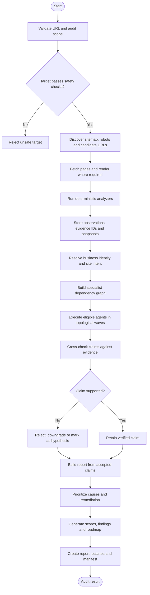

### 3.2 Stage-by-stage description

1. **Intake and safety checks** — validate the requested URL and enforce configured network-target restrictions before fetching.
2. **Discovery** — identify candidate URLs from the requested scope, sitemap and crawlable links, subject to crawl limits.
3. **Fetch and render** — collect HTTP responses and use browser rendering when configured and required for client-rendered content.
4. **Deterministic analysis** — extract observable facts from HTML/DOM, headers, links, structured data, and timing information.
5. **Evidence registration** — attach stable evidence identifiers and content hashes to observations and store snapshots when configured.
6. **Business grounding** — derive a working business/site profile from observed content and any explicitly supplied context; surface disagreement rather than silently assuming.
7. **Specialist orchestration** — run agents only when their dependencies and required inputs are available. Independent agents can run concurrently within a dependency wave.
8. **Verification** — validate evidence references, check contradictions, separate hypotheses from verified claims, and prevent unsupported claims from being presented as facts.
9. **Prioritization** — group related defects, identify upstream blockers, and order work by impact, effort, severity, and dependencies.
10. **Report assembly** — create domain findings, summaries, score explanations, page-level details, and a roadmap.
11. **Remediation packaging** — prepare suggested code/content artifacts and installation notes. Changes should be reviewed before production deployment.
12. **Seal and retrieval** — package the run metadata and hashes into the available manifest/report artifacts.

### 3.3 Failure and unavailable-data path

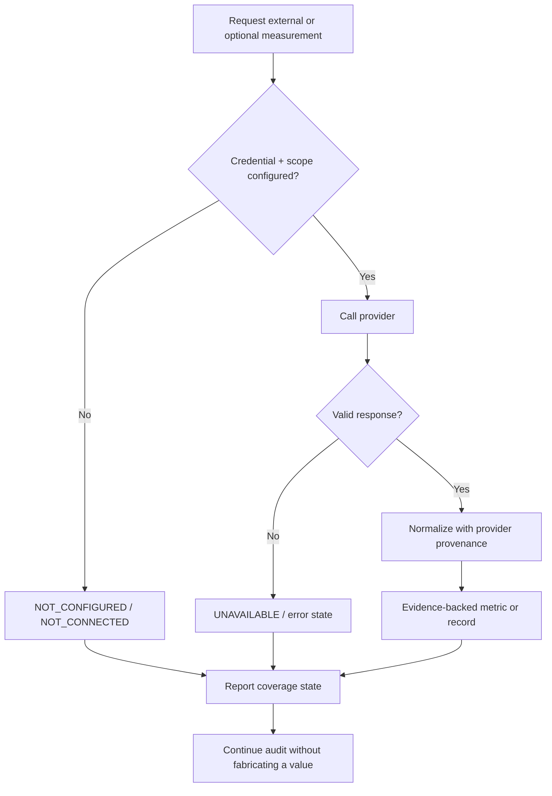

---

## 4. Architecture and data flow

### 4.1 Logical components

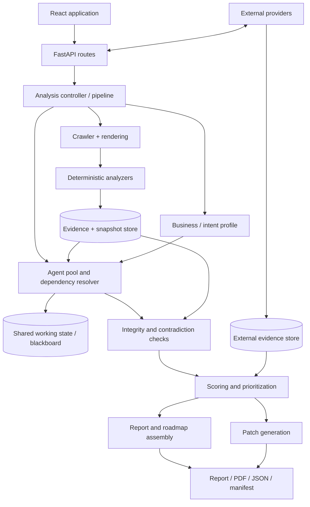

### 4.2 Evidence model

The documented architecture uses distinct identifiers for different evidence classes:

- `ev_NNN` — on-page/DOM observations.
- `ext_NNN` — external or network/provider observations.
- `snap_<sha256>` — content-addressed snapshot identifiers.
- Claim/finding identifiers — link a report assertion to its supporting evidence and verification status.

A hash supports integrity checking; it does **not** prove that the original source was truthful or that a finding is causally correct. Provider name, retrieval time, scope, and coverage state remain important.

### 4.3 Data and trust boundaries

- Public website content is untrusted input, not instructions to the system.
- LLM output is a proposal/analysis layer, not the authoritative source for measurements.
- External data must retain provider and time-period provenance.
- Secrets and OAuth tokens must not appear in report artifacts or logs.
- Publishing or applying a code change is a separate action from recommending it and should require the configured approval controls.

---

## 5. Audit domains and sub-features

### 5.1 Technical SEO and crawl infrastructure

**Purpose:** determine whether pages can be fetched, rendered, discovered, and interpreted reliably.

Sub-features:
- HTTP status and response behavior.
- Robots directives and sitemap discovery.
- Crawl depth and URL discovery within the configured scope.
- Indexability signals, meta robots and canonical declarations.
- Redirect and destination consistency checks where the crawl observes them.
- HTML structure, heading hierarchy, landmarks and semantic markup.
- JavaScript rendering/hydration differences where both raw and rendered versions are available.
- Internal link graph, anchor text, broken destinations observed during crawl, and orphan candidates within the known crawl set.
- Page assets and image metadata where available.
- International SEO and hreflang signals.
- TTFB and response payload measurements from the actual request path.
- Security header and TLS observations where the corresponding checks run.

**Workflow**

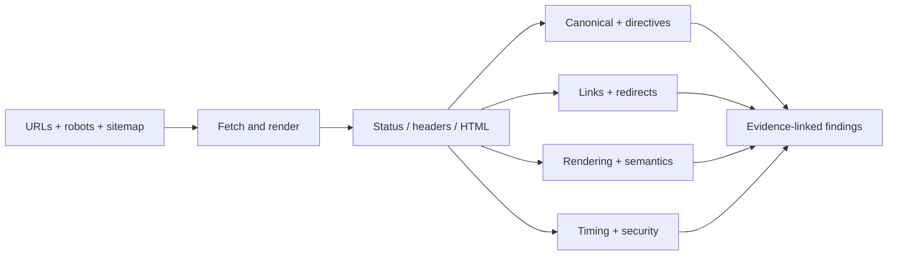

**Interpretation caution:** a crawler only knows what it successfully observed within its scope. A URL not found in a limited crawl is not automatically proven absent from the entire website or deindexed by a search engine.

### 5.2 On-page SEO

Sub-features:
- Title tags and meta descriptions.
- H1–H6 hierarchy and topic alignment.
- Canonical and indexability consistency.
- Main-content visibility and page purpose.
- Internal link context and anchor wording.
- Image alt text and discoverable asset metadata.
- Page-specific intent and duplicate/overlapping content signals.
- Metadata and social-preview markup where observed.

Outputs: page-level findings, explanation of impact, recommended changes, and draft copy where supported.

### 5.3 Content quality and topical coverage

Sub-features:
- Content depth and completeness relative to the page's apparent intent.
- Topic/subtopic coverage and information gaps.
- Content freshness signals and dated claims.
- Expertise, experience, authority and trust signals visible on-page.
- Similarity and possible cannibalization between pages in the collected set.
- Boilerplate and thin-content signals.
- Source citations and support for factual claims where inspectable.

Outputs should distinguish deterministic observations from qualitative model judgments. Similarity is a signal to review, not by itself proof that pages cannibalize rankings.

### 5.4 Structured data and entity intelligence

Sub-features:
- JSON-LD, Microdata and RDFa extraction where supported.
- Schema syntax/shape validation and missing-property checks.
- Organization, WebSite, Product, FAQ, Breadcrumb and other types only where relevant to the actual page.
- Business name, sameAs references, offering and entity consistency.
- Knowledge-graph/entity signals where supported by a connected source.

Outputs: schema findings, evidence references, and proposed structured-data artifacts. Generated schema must be checked against real business facts before deployment.

### 5.5 GEO — Generative Engine Optimization readiness

Sub-features:
- Whether the page states a clear answer near the relevant question.
- Extractable definitions, concise explanations and explicit entities.
- Evidence, sources, dates and specific proof points.
- Clear section structure and answer-oriented headings.
- Information gain beyond generic copy.
- Multimodal/visual context and accessible descriptions where observed.
- Freshness and temporal context.
- Citation-readiness signals.

**GEO readiness is not the same as live AI-search visibility.** A content audit can assess extractability; it cannot prove that ChatGPT, Perplexity, Gemini, Claude, or a search engine cited the website unless an actual, recorded measurement workflow supplies that evidence.

### 5.6 AEO — Answer Engine Optimization

Sub-features:
- Direct-answer and featured-snippet-oriented formatting.
- Conversational and long-tail query coverage.
- Question-to-answer alignment.
- Entity and terminology consistency.
- Concise, self-contained answer passages.
- FAQ opportunities when genuine user questions exist.

Outputs: answer-format recommendations, content gaps, and draft FAQ content where appropriate. Markup alone does not guarantee rich results or citations.

### 5.7 AI search and visibility

Sub-features:
- Engine-specific analysis and discoverability checks where implemented.
- Commercial-question testing and comparison workflows where enabled.
- Live visibility/citation measurement only when a real provider or live collection path returns results.
- Explicit labeling for synthetic tests and simulations.

Never convert an LLM's answer to a hypothetical prompt into a live rank, citation count, share of voice, or visibility score.

### 5.8 Business and commercial understanding

Sub-features:
- Business/entity name candidates and positioning.
- Apparent audience/ideal customer profile (ICP).
- Offer and product/service clarity.
- Pricing and commercial model signals when actually present.
- CTA and conversion path discovery.
- Declared site type versus detected signals.
- Business context used to adapt audit priorities.

Inferences should remain labeled as inferences when the site does not state a fact explicitly.

### 5.9 UX and conversion rate optimization (CRO)

Sub-features:
- Above-the-fold value proposition and audience clarity.
- Primary/secondary CTA hierarchy.
- Form length and observable input friction.
- Pricing, packaging and plan comparison clarity.
- Trust signals, case studies and social proof depth.
- Navigation and task-flow clarity.
- Obvious conversion blockers and competing actions.
- Experiment ideas tied to an observed issue.

CRO recommendations are hypotheses unless validated by analytics, user research, or controlled experiments. Do not claim conversion uplift without measured outcomes.

### 5.10 Competitor intelligence

Sub-features when competitor URLs and/or data sources are available:
- Technical and on-page parity comparisons.
- Content and answer coverage gaps.
- Feature/offer/pricing comparisons based on publicly observed evidence.
- Search/authority comparisons using the relevant provider's own metrics.
- Citation-gap or AI-answer bake-off workflows where implemented.

Competitor findings should include the source, retrieval date, and evidence basis. A missing observation is not proof a competitor lacks a feature.

### 5.11 External search, analytics and authority data

Depending on configuration and provider support, this domain may include:
- Google Search Console clicks, impressions, CTR, average position, query/page/country/device breakdowns, and supported inspection/sitemap data.
- Google Analytics 4 sessions, users, engagement, landing pages, key events and revenue only when returned by the connected property.
- Bing Webmaster query, traffic and crawl data.
- Ahrefs, Semrush, Majestic, DataForSEO or SerpAPI data where configured and supported.
- Google Business Profile metrics for eligible local businesses and properties.
- Citation/listing comparisons against the directories and business profile supplied.
- Brand mention records where a supported source is configured.

Keep each vendor's authority metric under that vendor's own name. Do not merge vendor scores into a fictional universal authority metric. See [External authority architecture](docs/external-authority.md).

### 5.12 Prioritization and roadmap

Sub-features:
- Severity and materiality.
- Impact-versus-effort prioritization.
- Dependency and root-cause grouping.
- Primary bottleneck hypotheses.
- 7/30/90-day work sequencing.
- Finding IDs carried into roadmap items.

Prioritization is a decision aid, not a guarantee of ranking, revenue, or conversion results.

---

## 6. Agent workforce and execution model

Dristik features an active workforce of **105 specialist agents across 12 domains** executed through **7 modular pipeline workflow sections (33 DAG nodes)** and dependency-aware topological waves. Companion documents also describe extended catalogs, page-copy specialists, and presentation/reporting agents. Treat the live registry in the checked-out code as the authority for the exact agents enabled in a deployment.

### 6.1 Core specialist domains

| Domain | Responsibilities |
|---|---|
| Business intelligence | Discover business identity, audience, intent, offers and semantic positioning |
| Technical SEO/crawl | Crawl, indexability, HTML, internal links, performance, security, assets, rendering and international signals |
| Schema and entities | Validate structured data and analyze entity consistency |
| Content intelligence | Assess depth, quality, expertise/trust, topical coverage and cannibalization signals |
| GEO | Evaluate extractability, information gain, citation readiness, content structure, multimodal signals and freshness |
| AEO | Evaluate direct answers, entity consensus and conversational intent |
| AI search readiness | Assess discoverability and engine-oriented signals; live measurement requires a real source |
| UX/CRO | Assess experience, conversion paths, trust, forms, pricing, hero messaging and social proof |
| Competitor intelligence | Compare technical parity, answers, offers/pricing and citation gaps |
| Verification/strategy | Challenge claims, surface contradictions, reason about causes and synthesize the executive view |

The exact identifiers, prompts, input/output contracts and dependency lists are maintained in [DRISTIK_AGENTS_AND_SYSTEM_PROMPTS.md](DRISTIK_AGENTS_AND_SYSTEM_PROMPTS.md) and [AI_ARCHITECTURE_AND_AGENTS.md](AI_ARCHITECTURE_AND_AGENTS.md).

### 6.2 Kahn topological-wave execution

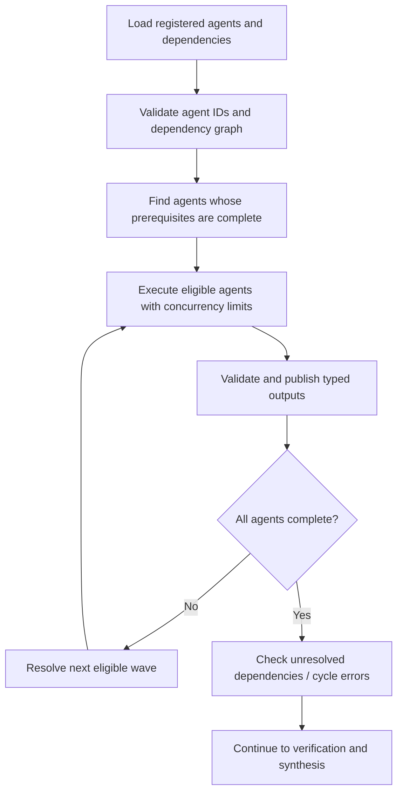

- Agents in the same eligible wave may run concurrently.
- Downstream agents consume only the upstream outputs made available to them.
- A missing prerequisite, provider error, or invalid output should be represented as a failure/unavailable state, not hidden by fabricated results.
- Parallel execution does not mean all agents run successfully on every audit.
- The live code's registered dependency graph determines the actual wave membership.

### 6.3 Internal specialist workflow

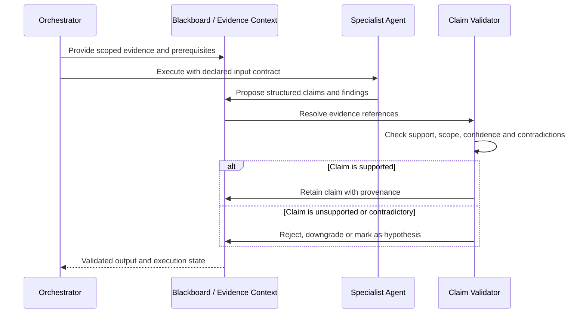

### 6.4 Agent governance rules

1. Evidence-backed claims must reference evidence that exists in the run.
2. Model-generated hypotheses must not be presented as directly measured facts.
3. Contradictions should be visible and resolved through evidence or retained as contested.
4. The report must not count unavailable external metrics as zero.
5. Agent failures must not be disguised as successful analysis.
6. Page-specific recommendations should retain the URL and the observation that motivated them.

---

## 7. Evidence, verification, and scoring

### 7.1 Value states

Use explicit states to make measurement limits visible:

| State | Meaning |
|---|---|
| `MEASURED` | Direct observation or a provider response exists |
| `DERIVED` | Calculated from identified inputs and a documented formula |
| `ESTIMATED` | Statistical estimate; explicitly labeled as such |
| `SIMULATION_ONLY` | Synthetic or simulated result, not a live measurement |
| `NOT_CONFIGURED` / `NOT_CONNECTED` | Required connector or configuration is absent |
| `UNAVAILABLE` | The provider or measurement could not supply a usable result |
| `NOT_APPLICABLE` | The metric does not apply to the current business/site context |

Do not replace missing values with zero, and do not compare numbers whose definitions, provider, or periods differ without explaining the difference.

### 7.2 Confidence rubric

The documented rubric distinguishes:
- **CERTAIN** — supported by at least two independent evidence items, according to the project's rubric.
- **LIKELY** — supported by one verifiable evidence item.
- **GUESSING** — inferred from absence, simulation, or insufficient direct evidence.

Confidence is not a substitute for severity, and two copied values from the same source are not necessarily independent corroboration. Critical unsupported claims should be held from definitive executive presentation until reviewed.

### 7.3 Integrity and snapshots

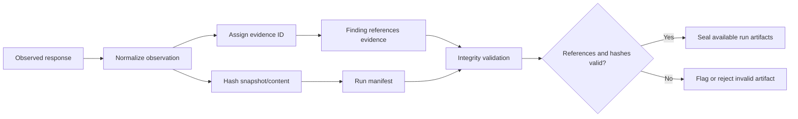

A hash can help detect later modification; it does not certify that a recommendation is correct, that a third-party provider is accurate, or that a website owner authorized a deployment.

### 7.4 Scoring principles

Dristik's documented scoring design adapts category weights to business/site intent and separates:
- Human experience and conversion readiness.
- Search-engine technical/content readiness.
- AI answer/citation readiness.

External visibility is a separate measurement concern. A readiness score must not be described as a live engine ranking. Every score should explain its inputs, weighting, coverage and limitations; avoid a universal authority score assembled from incompatible vendor metrics.

---

## 8. Remediation and delivery workflow

### 8.1 From finding to fix

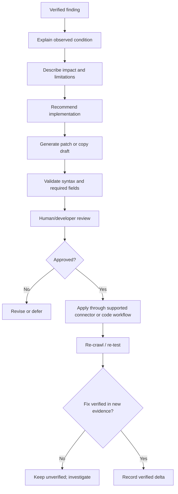

### 8.2 Documented patch-pack artifacts

The architecture documents describe a developer package that may include:

| Artifact | Purpose |
|---|---|
| `schema.jsonld` | Proposed Schema.org JSON-LD for validated business/page facts |
| `metadata.html` | Proposed title, description, canonical and social metadata |
| `faq.html` | Semantic FAQ markup based on actual questions and supported answers |
| `llms.txt` | Proposed machine-readable site guidance where the team chooses to publish it |
| `robots.txt` | Proposed crawler directives; must preserve required access and site-owner intent |
| `README_DEV_INSTALL.md` | Integration and installation notes for supported stacks |

The exact files available depend on the run and current implementation. Generated files are proposals until reviewed and deployed. Never publish fabricated pricing, contact details, testimonials, legal statements, product facts, or unsupported schema properties.

### 8.3 Fix status vocabulary

- **Proposed** — a recommendation or patch exists.
- **Approved** — a permitted reviewer approved the change.
- **Applied** — a deployment or code action reported success.
- **Verified** — a new observation demonstrates the intended condition.
- **Unverified** — the post-change check did not run or did not prove the outcome.

**Applied is not the same as verified.**

---

## 9. Integrations and external data

### 9.1 Provider families

The repository's documented connector inventory covers provider families such as:

- Search performance and analytics: Google Search Console, Google Analytics 4, Bing Webmaster.
- Search and backlink research: Ahrefs, Semrush, Majestic, DataForSEO and/or SerpAPI where implemented and configured.
- Local business: Google Business Profile and listing/citation data where supported.
- CMS and code workflows: WordPress, Shopify, Webflow and GitHub-related remediation paths where implemented.
- Identity and application integrations: Google/GitHub OAuth and other providers represented in the active connector registry.
- AI inference: configurable LLM providers such as OpenRouter, Gemini, Groq, Anthropic, Together AI and NVIDIA endpoints where their adapters and credentials are available.
- Billing: Razorpay configuration where enabled.

The active registry and provider health endpoints—not this summary table—determine what is usable in a particular deployment.

### 9.2 Connector lifecycle

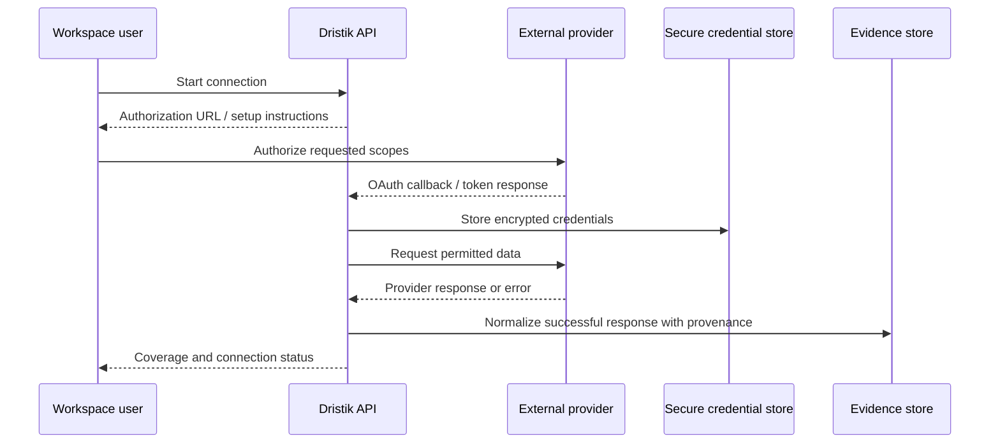

### 9.3 Connector principles

- Request only the permissions required for the chosen integration.
- Keep provider-specific metrics attributed to their source.
- Record date range and freshness.
- Report authentication, scope, quota, timeout and provider errors honestly.
- Do not treat a connector being present in a registry as proof that the user has connected it or that its data is live.
- See [external-authority.md](docs/external-authority.md) for data coverage, storage and credential notes.

---

## 10. Reports and deliverables

Depending on the enabled report path and audit configuration, outputs can include:

- Executive summary and business/site profile.
- Audit scope, crawl coverage and unavailable data.
- Technical SEO, on-page SEO, content, structured data, GEO/AEO, UX/CRO and competitor findings.
- Per-page findings and draft copy recommendations.
- Severity and prioritization explanations.
- Evidence references, confidence states and provider provenance.
- Score definitions and coverage limitations.
- Root-cause/bottleneck hypotheses and 7/30/90-day roadmap.
- Charts and summary visualizations.
- Developer remediation ZIP.
- Structured report JSON and run manifest.
- PDF report and short executive summary formats where the relevant endpoints are enabled.

### Recommended report reading order

1. Read the scope and data-coverage statement first.
2. Read the top verified bottleneck and critical findings.
3. Inspect the evidence attached to each material finding.
4. Separate verified facts from hypotheses and simulations.
5. Review the roadmap and dependencies.
6. Assign owners and approve patches.
7. Re-run checks and record verified changes.

---

## 11. Repository structure

The following is a **logical map**, not a guarantee that every optional file or subdirectory exists in every revision. Use the actual repository tree as the source of truth.

```text
dristik/
├── README.md                          # Product overview, diagrams and setup guide
├── LICENSE                            # Proprietary usage terms
├── AI_ARCHITECTURE_AND_AGENTS.md      # Architecture, features, agent DAG and backend map
├── DRISTIK_AGENTS_AND_SYSTEM_PROMPTS.md # Agent catalog and prompt governance
├── DRISTIK_PRODUCT_REPORT.md          # Feature parameters, API map and known gaps
├── docs/
│   ├── ORCHESTRATOR_AGENT_FLOW.md     # Orchestration, pipeline and integrity diagrams
│   ├── external-authority.md          # External data, connectors and provenance
│   └── ENTERPRISE_AUDIT_INTEGRITY_REMEDIATION.md # Integrity contract/remediation guidance
├── backend/
│   ├── app/
│   │   ├── main.py                   # FastAPI application entry point
│   │   ├── core/                     # Configuration and core services
│   │   ├── api/                      # API route modules (actual layout may vary)
│   │   ├── agents/                   # Specialist agents and runtime/orchestration
│   │   ├── inference/                # LLM/provider abstraction where present
│   │   ├── connectors/               # External and publishing connectors
│   │   ├── analysis/                 # Crawl, audit and analysis services where present
│   │   └── reporting/                # Report assembly/export where present
│   ├── tests/                        # Backend tests
│   ├── requirements.txt              # Python dependencies
│   └── data/                         # Local runtime data; should not contain committed secrets
├── frontend/
│   ├── src/                          # React/TypeScript application
│   ├── package.json                  # Frontend scripts and dependencies
│   └── vite.config.*                 # Vite configuration
├── prompts/                           # Shared system/governance prompts where present
├── data/runs/                         # Runtime snapshots/artifacts; deployment-dependent
├── .env.example                       # Example configuration; inspect before use
├── docker-compose.yml                 # Docker Compose configuration where present
├── setup.sh                           # Environment bootstrap script where present
├── start.sh / run.sh                  # Development launch scripts where present
└── redeploy.sh                        # Deployment helper where present
```

**Do not assume** every path above exists or that every item is included in a release. Confirm paths and scripts against the checked-out branch before running commands.

---

## 12. Local development

### 12.1 Prerequisites

- Git
- Python 3.11 or a compatible version required by the current backend dependencies
- Node.js/npm compatible with the frontend lockfile
- Chromium and OS libraries if browser rendering is enabled
- Provider credentials only for features that require them

### 12.2 Clone the repository

Access to this repository is subject to its proprietary terms and repository permissions.

```bash
git clone https://github.com/alienhousenetworks/dristik.git
cd dristik
```

### 12.3 Backend

```bash
cd backend
python3.11 -m venv .venv
source .venv/bin/activate
python -m pip install --upgrade pip
pip install -r requirements.txt
```

If the current dependency set uses Playwright and browser rendering is required:

```bash
playwright install chromium
# On supported Linux environments, install required system libraries as needed.
```

Configure the environment according to the current `.env.example` and your organization's secret-management policy. Do not commit the resulting `.env` file.

Start the API from the backend directory if the current application entry point is `app.main:app`:

```bash
uvicorn app.main:app --host 127.0.0.1 --port 8000 --reload
```

### 12.4 Frontend

In a separate terminal:

```bash
cd frontend
npm install
npm run dev -- --host 127.0.0.1 --port 5173
```

Open the local Vite URL printed by the command. The backend health endpoint and API docs are commonly available at `/health` and `/docs` on the configured API host, subject to route and authentication configuration.

### 12.5 Automated scripts

The repository documentation references `setup.sh`, `start.sh`, `run.sh`, `redeploy.sh` and `update_citation_models.sh`. Inspect a script before executing it, confirm its flags against the current version, and run with least privilege. Do not assume flags described by an older revision remain available.

---

## 13. Docker and deployment

If a Compose file exists in the checked-out revision and is configured for your environment:

```bash
docker compose config
docker compose up -d --build
docker compose ps
docker compose logs -f
```

To stop the stack:

```bash
docker compose down
```

### Production checklist

- Serve the UI and API over HTTPS behind a correctly configured reverse proxy.
- Configure trusted proxy headers explicitly; do not trust arbitrary client-supplied forwarding headers.
- Store secrets in a secret manager or protected environment configuration.
- Use a unique, high-entropy authentication/session secret.
- Configure encryption keys before saving external credentials.
- Restrict database and snapshot directories to the application service account.
- Back up databases and run artifacts according to retention requirements.
- Restrict outbound network access and validate redirects/DNS to mitigate SSRF and rebinding risks.
- Set request, crawl, concurrency, memory, timeout and LLM-cost limits.
- Configure SSE proxy buffering/timeouts correctly if streaming is enabled.
- Use a process manager/container health checks and monitor logs without secrets.
- Verify authentication, workspace isolation, authorization and tenant boundaries.
- Test restore, migration, token revocation and connector failure scenarios.
- Run tests and a smoke audit before upgrading production.

A successful container start does not prove that OAuth, crawl rendering, external integrations, PDF output, or production security controls are fully configured.

---

## 14. Environment configuration

The exact environment variables are defined by the current `.env.example` and configuration code. Common categories documented by the project include:

| Category | Examples of settings |
|---|---|
| Application/security | Authentication secret, session duration, database paths, frontend/callback URLs |
| Encryption | External integration encryption key |
| OAuth | Google/GitHub client IDs and secrets, callback URLs, state TTL |
| Crawl | Browser rendering toggle, page limit, SSRF guard toggle and request limits |
| LLM gateway | Provider, model, API keys, timeout and cost budget |
| External authority | Collection plan, sync settings, CrUX/DataForSEO/Ahrefs/Semrush/Majestic credentials |
| CMS/code publishing | Shopify, Webflow, WordPress and GitHub app credentials as supported |
| CRM/analytics | HubSpot, Salesforce, GA4 and related credentials where implemented |
| Social/messaging | LinkedIn, Meta/Instagram, WhatsApp Business and Slack credentials where implemented |
| Billing | Razorpay keys, webhook secret and currency where enabled |
| Embeddings | Provider, model and device |

### Safe configuration rules

- Use `.env.example` as the actual variable-name source of truth.
- Never copy production secrets into documentation, issues, screenshots or commits.
- Do not use example credentials or predictable default passwords in production.
- Rotate any secret that has been exposed.
- OAuth redirect URIs must match the provider console exactly.
- Enable only providers and scopes the deployment needs.
- Keep debug/token logging disabled in production.

---

## 15. API overview

The documented API includes route families similar to those below. Check the running OpenAPI specification for the exact current routes, schemas, authentication requirements and status codes.

| Area | Documented route pattern | Purpose |
|---|---|---|
| Audit creation | `POST /api/v1/analyses` | Start an audit with URL and scope options |
| Audit status | `GET /api/v1/analyses/{id}` | Read run state and progress |
| Live events | `GET /api/v1/analyses/{id}/stream` | Stream audit activity when enabled |
| Report | `GET /api/v1/analyses/{id}/report` | Retrieve structured report output |
| Manifest | `GET /api/v1/analyses/{id}/manifest` | Retrieve run integrity metadata |
| Evidence graph | `GET /api/v1/analyses/{id}/evidence-graph` | Retrieve evidence relationships when enabled |
| Snapshots | `GET /api/v1/analyses/{id}/snapshots/{sid}` | Retrieve a stored snapshot when authorized |
| Patch package | `GET /api/v1/analyses/{id}/patch-pack/zip` | Download generated remediation files |
| Patch list | `GET /api/v1/analyses/{id}/patches` | List generated patches and states |
| Patch approval/application | `POST /api/v1/analyses/{id}/patches/{pid}/approve`, `.../apply` | Approve/apply supported changes under configured controls |
| Connector registry/health | `GET /api/v1/connectors/providers`, `.../health` | Inspect providers and their current state |
| OAuth | `POST /api/v1/connectors/oauth/start`, `GET /api/v1/connectors/oauth/callback` | Start/complete supported connection flow |
| External authority | `POST /api/v1/external-authority/sync`, `GET /api/v1/external-authority/coverage` | Collect and inspect external-data coverage |
| PDF/summary | `GET /api/v1/analyses/{id}/pdf`, `.../whatsapp-summary` | Export enabled report formats |
| Health | `GET /health` | Runtime health check |

For endpoint truth, open the API's `/docs` or OpenAPI JSON in the deployed environment. Do not expose protected snapshots, reports, tokens or cross-tenant resources to unauthenticated callers.

---

## 16. Testing and verification

Run the tests that actually exist in the checked-out revision. The project documentation references the following test targets; confirm their paths before running:

```bash
cd backend
source .venv/bin/activate

# Examples from the project test documentation; files may differ by revision.
PYTHONPATH=. pytest tests/test_pipeline.py -v
PYTHONPATH=. pytest tests/test_agent_pool_35.py -v
PYTHONPATH=. pytest tests/test_zero_fake_data_and_fail_closed.py -v
PYTHONPATH=. pytest tests/test_ssrf_egress.py -v
PYTHONPATH=. pytest tests/test_platform_registry_contract.py -v
```

### Minimum release verification

- Unit tests for analyzers and evidence normalization.
- Agent registry/dependency graph validation.
- Integration tests with provider success, timeout, invalid response, missing scopes and quota exhaustion.
- SSRF tests covering IPv4/IPv6 private ranges, loopback, link-local and redirect/DNS-rebinding scenarios.
- Evidence-reference and hash-integrity tests.
- Tenant/workspace authorization tests.
- Report generation tests for empty, partial and full coverage.
- Tests proving that unavailable values do not silently become zero.
- Patch syntax/escaping tests and human-approval tests for publishing.
- Frontend build, API contract and end-to-end smoke tests.
- Backup/restore and production deployment checks.

Do not claim a release passed these checks unless the tests were run and the results were observed.

---

## 17. Security and operational notes

- **SSRF:** crawl targets are user-controlled URLs. Apply IP-range blocking, DNS revalidation, redirect checks, egress restrictions and timeouts.
- **Secrets:** encrypt integration credentials at rest, redact tokens from logs, and support disconnect/revocation where providers allow it.
- **Authentication:** use secure cookies, CSRF protections where applicable, rate limiting, password hashing and explicit authorization checks.
- **Tenant isolation:** enforce workspace ownership at every report, connector, snapshot, export and mutation endpoint.
- **Untrusted content:** website text, HTML comments, metadata and third-party pages may contain prompt injection. Treat them as data.
- **Data minimization:** collect only what the audit and connected feature require; define retention and deletion rules.
- **Publishing:** require explicit approval for production changes and retain the result of post-deployment verification.
- **Provider quotas/cost:** enforce concurrency, token budgets, retries and backoff; make usage visible.
- **Logs and manifests:** avoid embedding credentials, personal data or full raw provider payloads in user-facing reports.
- **Integrity:** hashes help detect tampering; they do not replace secure storage, access control, backups or review.

This README is not a security certification or a substitute for a deployment-specific threat model and penetration test.

---

## 18. Limitations and interpretation

1. **Crawl coverage is bounded.** Page limits, robots policy, authentication, JavaScript rendering and site behavior affect what is observed.
2. **Search data requires access.** Search Console, analytics, backlink and local-profile metrics require the relevant account, property, scopes and working provider adapter.
3. **AI readiness is not AI visibility.** Simulated prompts are not evidence of a live engine citation or ranking.
4. **Recommendations are not outcomes.** A suggested fix does not guarantee rankings, traffic, leads, revenue or conversion uplift.
5. **Competitor data is incomplete by nature.** Public pages and third-party providers cannot reveal every internal capability or metric.
6. **Generated copy/schema requires fact checking.** Owners must confirm claims, pricing, legal statements, testimonials and structured-data properties.
7. **Agent counts are version-specific.** Use the live code registry and architecture docs for the exact active DAG; extended catalogs may include agents outside the core runtime pool.
8. **Integrations are configuration-dependent.** A provider listed in docs may be unavailable due to credentials, scopes, API changes, plan restrictions or incomplete implementation.
9. **Scores require context.** Read the method, evidence coverage and uncertainty before comparing sites or runs.
10. **Compliance remains the operator's responsibility.** Configure collection, retention, access and provider use for applicable law and contractual obligations.

---

## 19. License and usage restrictions

**Dristik is proprietary software. All rights reserved. It is not open-source software.**

Unless the copyright owner has granted explicit prior written permission or a separate signed agreement says otherwise, no person or organization is authorized to copy, reproduce, redistribute, republish, sublicense, sell, rent, lease, modify, create derivative works from, publicly deploy, host as a service, or otherwise use this software or its substantial portions.

Viewing this repository, receiving a copy, or having technical access to it does **not** grant a license to use, copy, modify, distribute, or commercialize the software. No license is granted by implication, estoppel, or otherwise. All rights not expressly granted in a signed written license are reserved by the copyright owner.

Third-party components remain subject to their own licenses and notices; this proprietary notice does not override those terms. If you need permission, obtain written authorization from the rights holder before using the software.

See [LICENSE](LICENSE). This notice is a practical repository license statement, not legal advice; have qualified counsel review ownership, contributor rights, third-party notices and enforceability for your jurisdiction before commercial distribution.

---

## 20. Documentation index

| Document | What it covers |
|---|---|
| [README.md](README.md) | Product overview, feature map, workflows, setup, operations and license |
| [AI_ARCHITECTURE_AND_AGENTS.md](AI_ARCHITECTURE_AND_AGENTS.md) | Architecture, execution flow, specialist DAG and backend layout |
| [DRISTIK_AGENTS_AND_SYSTEM_PROMPTS.md](DRISTIK_AGENTS_AND_SYSTEM_PROMPTS.md) | Agent catalog, system prompts and governance |
| [DRISTIK_PRODUCT_REPORT.md](DRISTIK_PRODUCT_REPORT.md) | Detailed feature parameters, API inventory, tests and known gaps |
| [docs/ORCHESTRATOR_AGENT_FLOW.md](docs/ORCHESTRATOR_AGENT_FLOW.md) | Orchestration and pipeline diagrams |
| [docs/external-authority.md](docs/external-authority.md) | External data, provider coverage, credential and storage model |
| [docs/ENTERPRISE_AUDIT_INTEGRITY_REMEDIATION.md](docs/ENTERPRISE_AUDIT_INTEGRITY_REMEDIATION.md) | Integrity and remediation contract |

---

**Dristik AI — measure what can be measured, label what cannot, and connect every recommendation to evidence and action.**

---

## 21. Specialist audit agent flows (SEO, GEO, AEO, CRO and competitor analysis)

This section documents the **five specialist audit pipelines** and how their outputs join into the final Dristik audit. The diagrams describe the intended analytical workflow and evidence contracts; the exact agents and execution order active in a given release must be confirmed against the runtime registry and implementation. A diagram is not, by itself, proof that every node is currently implemented or enabled.

### Shared orchestration and evidence contract

All five tracks should use the same crawl snapshot and run context wherever possible. Each finding should identify its scope, evidence, confidence/limitations, impact, and recommended action. Missing integrations or failed collection must be reported as unavailable—not silently replaced with invented values. Proposed fixes are not marked verified until a post-change check confirms the result.

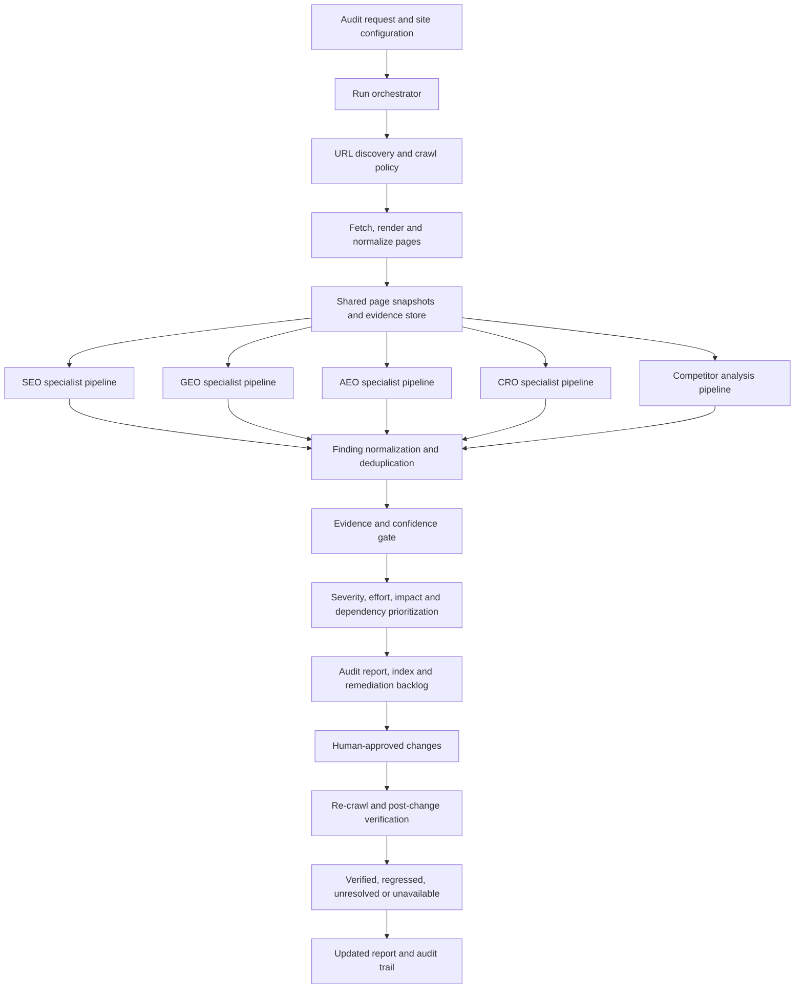

### 1. SEO specialist agents flow

**Purpose:** assess conventional search discoverability, technical health, content relevance, internal architecture and measurable search performance. SEO is its own track; GEO and AEO findings remain separately classified.

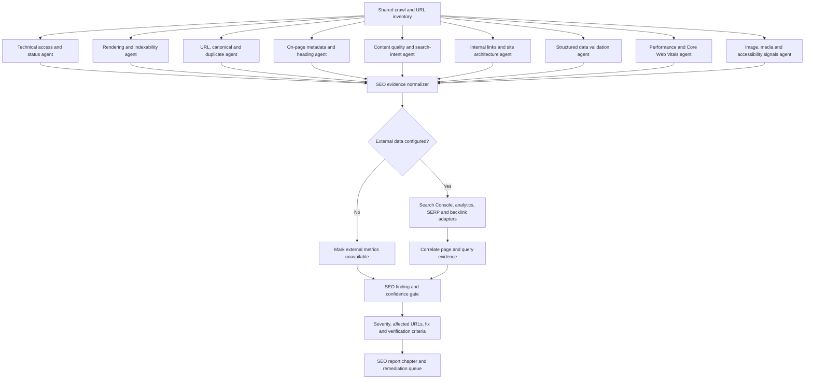

SEO output should distinguish crawl-observed facts from Search Console/analytics metrics, third-party estimates and inferred risks. Local and international SEO can be represented as SEO subdomains (for example, business-profile/local signals, hreflang, language/region targeting and international URL structure) rather than mixing their findings into GEO/AEO.

### 2. GEO (Generative Engine Optimization) specialist agents flow

**Purpose:** assess whether a brand and its useful content are discoverable, understandable and supportable as sources in generative search experiences. A site-side readiness check is not the same as a measured live AI mention or citation.

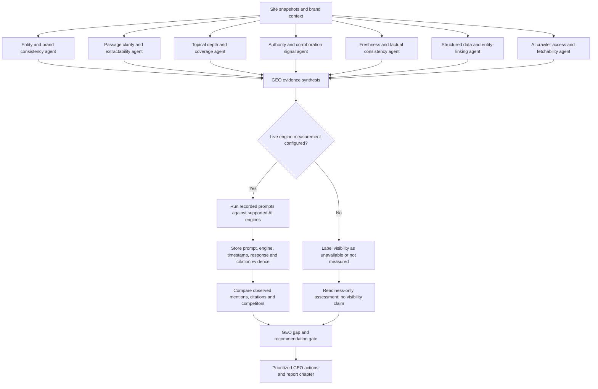

GEO results should name the engine, query/prompt, collection time and citation evidence when live measurement exists. Simulated answers, generic model opinions and technical readiness checks must never be presented as verified live visibility.

### 3. AEO (Answer Engine Optimization) specialist agents flow

**Purpose:** determine whether pages answer likely questions directly and whether answers can be extracted accurately by answer engines, featured-answer surfaces and conversational search systems.

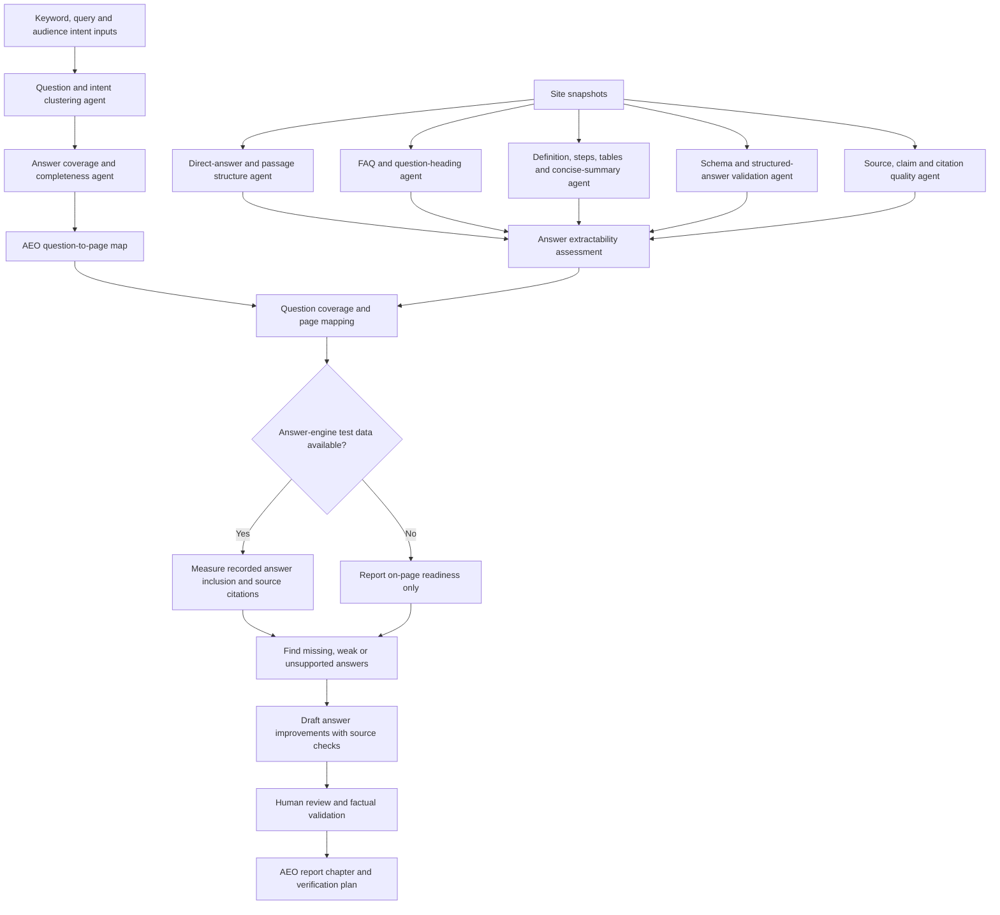

AEO recommendations should map a specific question or intent to a relevant URL and explain what answer is missing, unclear, unsupported or difficult to extract. Do not claim an answer engine displayed the page unless that behavior was actually measured.

### 4. CRO (Conversion Rate Optimization) specialist agents flow

**Purpose:** identify friction between landing-page intent and a meaningful user action. Recommendations should be based on observed page/interface evidence and connected analytics where available—not unsupported claims about conversion uplift.

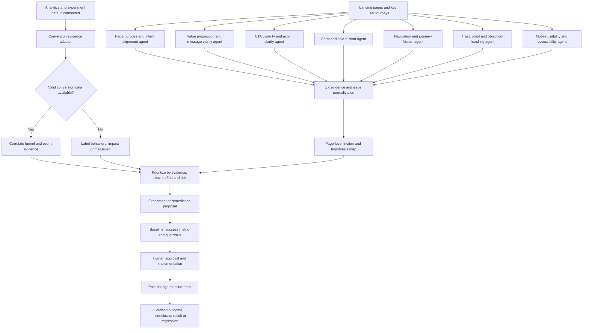

CRO findings should separate directly observed usability defects from hypotheses that require analytics, user research or controlled experiments. Do not fabricate conversion rates, revenue impact, statistical significance or predicted uplift. A fix is not a proven conversion improvement until the relevant outcome is measured.

### 5. Competitor analysis specialist agents flow

**Purpose:** compare the target site with a defined set of competitors using public, timestamped and comparable evidence, then identify actionable gaps without implying access to competitors' private analytics.

```mermaid
flowchart TD
    A[Target business, market and audience] --> B[Competitor discovery agent]
    B --> C[Validate and deduplicate competitor set]
    C --> D[Select comparable competitors and page types]
    D --> E[Collect public competitor pages]
    D --> F[Collect authorized third-party search and backlink data]
    D --> G[Collect recorded AI-answer observations, if enabled]
    E --> H[Normalize evidence by source and timestamp]
    F --> H
    G --> H
    H --> I[Technical and indexability comparison]
    H --> J[Content, topic and intent gap comparison]
    H --> K[Authority, entity and citation comparison]
    H --> L[Offer, UX and conversion-path comparison]
    I --> M[Comparable gap matrix]
    J --> M
    K --> M
    L --> M
    M --> N[Evidence, freshness and comparability gate]
    N --> O[Separate observed facts from estimates and inferences]
    O --> P[Opportunity sizing with uncertainty labels]
    P --> Q[Rank target-site actions by impact, effort and confidence]
    Q --> R[Competitor report chapter and action backlog]
```

Competitor analysis may use public pages and licensed/authorized provider data. It must not imply access to private traffic, conversion rates, customer lists, internal rankings or revenue. Comparisons should disclose missing data, mismatched page types, geography, query set and data freshness.

### Cross-track handoff and final report

The specialist tracks can identify related issues on the same URL, but they should not create five copies of one underlying defect. Keep the canonical evidence record and link each track's interpretation to it. For example, missing structured data can have an SEO interpretation and an AEO/GEO implication; consolidate the shared technical fact while retaining distinct, justified recommendations for each outcome.

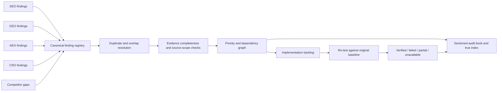

**Minimum finding record:** finding ID; track and subcategory; affected URL(s); observation; evidence reference(s) and timestamp; evidence scope (page-verified, sample-verified, site-inferred or external-verified); impact and rationale; severity and confidence; recommended fix; dependencies; verification test; and status. When required evidence is absent, mark the metric or conclusion as unavailable rather than filling the gap with a default score.

