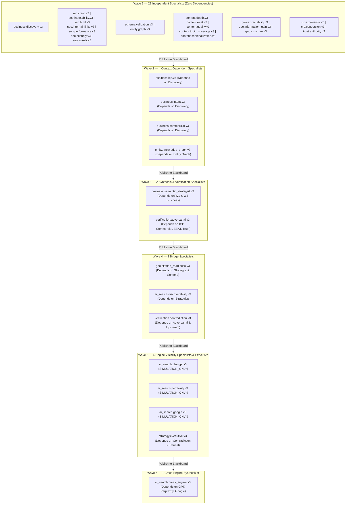
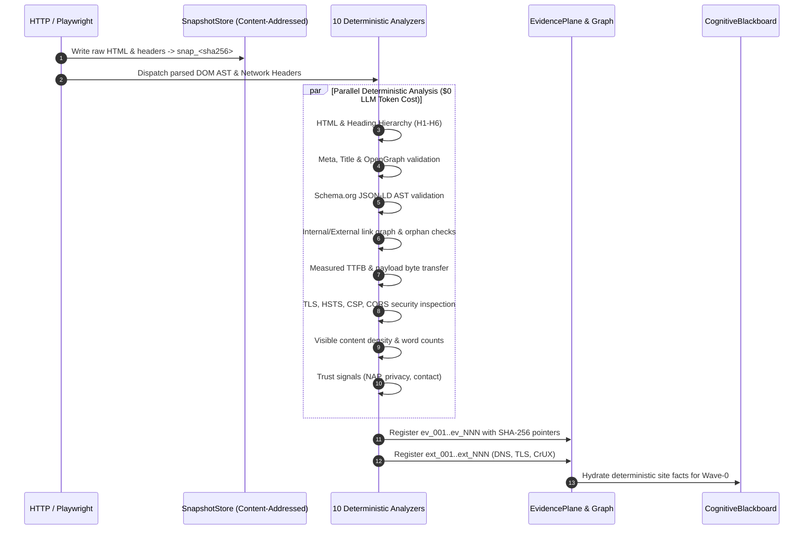
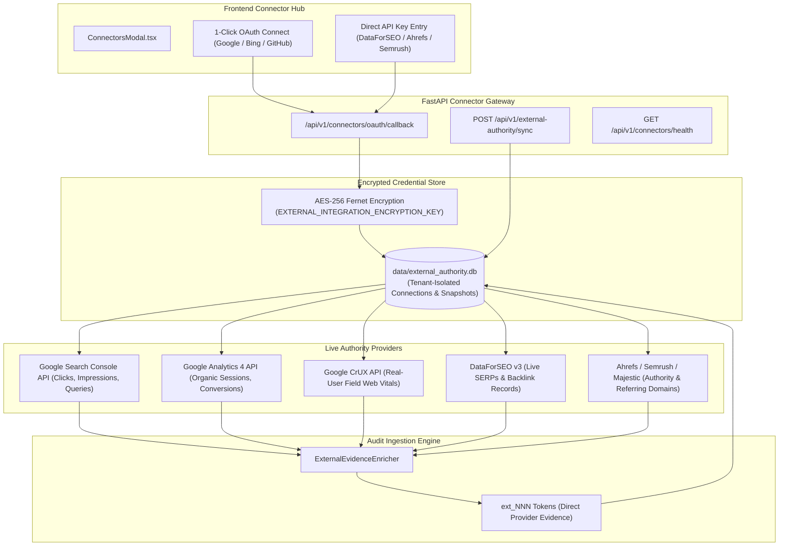
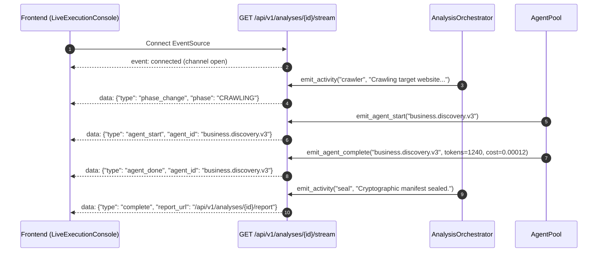
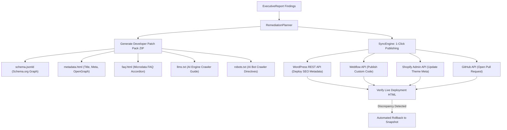
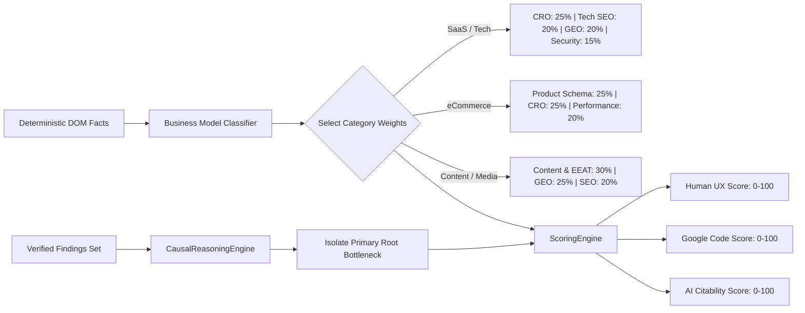

# Dristik AI — Enterprise Evidence-Driven Website Intelligence & Growth Auditor

[](https://fastapi.tiangolo.com)
[](https://reactjs.org/)
[](https://www.typescriptlang.org/)
[](https://www.python.org/)
[](https://tailwindcss.com/)
[](https://www.docker.com/)
[](#-enterprise-integrity-guarantee-zero-fake-architecture)

> **Architectural & Governance References:**
> - System Architecture, Features & 35-Agent Kahn DAG: [`AI_ARCHITECTURE_AND_AGENTS.md`](AI_ARCHITECTURE_AND_AGENTS.md)
> - Master Agent Catalog & System Prompts Directory: [`DRISTIK_AGENTS_AND_SYSTEM_PROMPTS.md`](DRISTIK_AGENTS_AND_SYSTEM_PROMPTS.md)
> - Product Map, Parameters, APIs & Integration Gaps: [`DRISTIK_PRODUCT_REPORT.md`](DRISTIK_PRODUCT_REPORT.md)
> - Pipeline DAG & Orchestration Flow Specification: [`docs/ORCHESTRATOR_AGENT_FLOW.md`](docs/ORCHESTRATOR_AGENT_FLOW.md)
> - External Authority & Connector Architecture: [`docs/external-authority.md`](docs/external-authority.md)
> - Enterprise Audit Integrity Remediation Contract: [`docs/ENTERPRISE_AUDIT_INTEGRITY_REMEDIATION.md`](docs/ENTERPRISE_AUDIT_INTEGRITY_REMEDIATION.md)

---

## 📑 Table of Contents

1. [Executive Summary & Core Philosophy](#-executive-summary--core-philosophy)
2. [How It Works: The 9-Stage Audit Lifecycle](#-how-it-works-the-9-stage-audit-lifecycle)
3. [How the Flows Work: Comprehensive Architecture Diagrams](#-how-the-flows-work-comprehensive-architecture-diagrams)
   - [Flow 1: Modular Pipeline DAG Flow (7 Sections, 18 Sub-Nodes)](#flow-1-modular-pipeline-dag-flow-7-sections-18-sub-nodes)
   - [Flow 2: Multi-Agent Kahn Topological Wave Resolution (6 Waves)](#flow-2-multi-agent-kahn-topological-wave-resolution-6-waves)
   - [Flow 3: Deterministic Ingestion & Zero-Dollar Analyzer Flow](#flow-3-deterministic-ingestion--zero-dollar-analyzer-flow)
   - [Flow 4: Multi-Tenant Connector & External Authority Architecture](#flow-4-multi-tenant-connector--external-authority-architecture)
   - [Flow 5: Domain Specialist Workflows (9 Domains)](#flow-5-domain-specialist-workflows-9-domains)
   - [Flow 6: Real-Time SSE Telemetry & Streaming Flow](#flow-6-real-time-sse-telemetry--streaming-flow)
   - [Flow 7: Autonomous Developer Remediation & Multi-Platform Publishing](#flow-7-autonomous-developer-remediation--multi-platform-publishing)
   - [Flow 8: Causal Bottleneck & Intent-Adaptive Scoring Flow](#flow-8-causal-bottleneck--intent-adaptive-scoring-flow)
4. [Detailed Directory Structure](#-detailed-directory-structure)
5. [Master Specialist Agent Workforce Catalog](#-master-specialist-agent-workforce-catalog)
   - [The 35 Core DAG Specialists](#the-35-core-dag-specialists)
   - [The 27 Extended Vertical & Competitor Specialists](#the-27-extended-vertical--competitor-specialists)
   - [The 5 Page-Level Copywriting Specialists](#the-5-page-level-copywriting-specialists)
   - [Auxiliary System Orchestrators](#auxiliary-system-orchestrators)
6. [Multi-Tenant Integration Platform Registry (26 Platforms)](#-multi-tenant-integration-platform-registry-26-platforms)
7. [Complete Setup & Installation Guide](#-complete-setup--installation-guide)
   - [System Prerequisites](#system-prerequisites)
   - [Automated Setup Scripts (`setup.sh`, `start.sh`, `run.sh`, `redeploy.sh`)](#automated-setup-scripts)
   - [Manual Local Development Setup](#manual-local-development-setup)
   - [Docker Compose Deployment](#docker-compose-deployment)
   - [Production Nginx Reverse Proxy & Systemd Units](#production-nginx-reverse-proxy--systemd-units)
   - [Automated Verification & Test Suites](#automated-verification--test-suites)
8. [Multi-Provider LLM Gateway & Full `.env` Reference](#-multi-provider-llm-gateway--full-env-reference)
   - [Gateway Architecture & Cost Controls](#gateway-architecture--cost-controls)
   - [Supported LLM Providers & Configuration](#supported-llm-providers--configuration)
   - [Local CPU Vector Embeddings](#local-cpu-vector-embeddings)
   - [Exhaustive Environment Variable Reference (8 Sections)](#exhaustive-environment-variable-reference)
9. [Enterprise REST & SSE API Reference](#-enterprise-rest--sse-api-reference)
10. [Sealed Deliverables & Zero-Fake Integrity Guarantee](#-sealed-deliverables--zero-fake-integrity-guarantee)

---

## 🎯 Executive Summary & Core Philosophy

**Dristik AI** is an enterprise-grade autonomous website intelligence and growth audit platform. Built for growth engineering teams, CMOs, technical SEO directors, and digital agencies, Dristik replaces ungrounded opinions, subjective heuristics, and LLM hallucinations with a **deterministic, cryptographically verifiable, and fail-closed audit system**.

### The Industry Problem
Traditional SEO audit tools and AI wrappers suffer from three fundamental architectural flaws:
1. **Vanity Heuristics:** Arbitrary 0–100 proprietary scores computed from surface-level scraping without causal relationship to organic traffic, conversions, or search engine indexing.
2. **Hallucinated Recommendations:** LLMs prompted with entire messy HTML dumps invent missing tags, imagine non-existent Core Web Vitals, or fabricate competitor advantages.
3. **Disconnected Execution:** Audits produce monolithic PDF slide decks that sit in corporate drives because developers have no code-level patches, schema files, or CMS integration to deploy fixes.

### Dristik's Architectural Solution
Dristik treats Large and Small Language Models (LLMs/SLMs) not as sources of truth, but as **replaceable inference engines operating strictly within an evidence sandbox**:

- **Deterministic Evidence Plane:** Raw facts are collected by 10 zero-dollar deterministic analyzers and immutable HTTP/DOM observations assigned cryptographic tokens (`ev_NNN` for DOM tokens, `ext_NNN` for external network/DNS tokens).
- **Content-Addressed Snapshot Store:** Every HTML response, header chain, and DNS record is immutably archived with SHA-256 hashes (`snap_<sha256>`).
- **Typed Cognitive Blackboard:** Agent findings are posted as structured, typed claims with bidirectional ground-truth bindings.
- **Adversarial Verification Loop:** An adversarial critic agent continuously challenges every specialist claim, downgrading or purging unbacked assertions.
- **Intent-Adaptive Scoring Engine:** Deterministic weights dynamically adjust to the detected business model (e.g. SaaS vs eCommerce vs Publisher), computing transparent scores for **Human UX**, **Google Code**, and **AI Search Citability**.
- **Autonomous Remediation & Publishing:** Every audit generates a drop-in Developer Patch Pack (`schema.jsonld`, `metadata.html`, `faq.html`, `llms.txt`, `robots.txt`) with 1-click publishing to WordPress, Webflow, Shopify, and GitHub PRs.
- **Cryptographic Seal:** Reports are pinned by a tamper-proof `manifest.json` sealing the audit run UUID to its underlying evidence hashes and token cost ledger.

---

## ⚡ How It Works: The 9-Stage Audit Lifecycle

Every audit executed through Dristik AI travels through an uncompromising 9-stage pipeline from URL intake to sealed deliverables:

```
┌──────────────────────────────────────────────────────────────────────────────────┐
│                           DRISTIK AUDIT LIFECYCLE                                │
└──────────────────────────────────────────────────────────────────────────────────┘

 [1. Ingestion & SSRF Guard] ─────► Zero-trust IP validation + Playwright SPA crawl
              │
              ▼
 [2. Deterministic Analyzers] ────► 10 analyzers: DOM, schema, links, TTFB ($0 LLM)
              │
              ▼
 [3. Evidence Plane & Tokens] ────► ev_NNN (DOM) + ext_NNN (DNS/TLS) + snap_<sha256>
              │
              ▼
 [4. Business Identity (Wave 0)] ─► Declared vs detected model + ICP & offer profile
              │
              ▼
 [5. 35-Agent Workforce Pool] ────► 6 Kahn topological waves (Business, SEO, GEO, UX)
              │
              ▼
 [6. Adversarial Verification] ───► Falsification loop + CERTAIN / LIKELY / GUESSING
              │
              ▼
 [7. Causal Engine & AI Sim] ─────► Bottleneck graph + 6 commercial buyer queries
              │
              ▼
 [8. Intent-Adaptive Scoring] ────► Human UX + Google Code + AI Citability (No vanity)
              │
              ▼
 [9. Remediation & Seal] ─────────► Developer Patch Pack ZIP + 1-Click CMS + manifest
```

### Stage-by-Stage Breakdown

#### Stage 1: Zero-Trust Ingestion & Deterministic Crawl
- **Zero-Trust SSRF Protection:** Every requested target URL is resolved against DNS rebinding defenses. Requests to private IPv4/IPv6 ranges (`10.0.0.0/8`, `172.16.0.0/12`, `192.168.0.0/16`, loopback, AWS metadata `169.254.169.254`) are blocked before socket connection.
- **Dual Ingestion Engine:** Fast HTTP streaming via `httpx` for static HTML; automatic headless Chromium browser rendering via Playwright when client-side JavaScript hydration or SPA frameworks (Next.js, Nuxt, React) are detected.
- **Discovery Sweep:** Automatically discovers, parses, and validates `robots.txt` crawler policies and XML sitemaps (`sitemap.xml`, `sitemap_index.xml`).

#### Stage 2: Deterministic Evidence Extraction ($0 Token Cost)
- Ten specialized deterministic analyzers parse raw HTML ASTs, response headers, and DOM structures without consuming a single LLM token:
  1. `HTMLAnalyzer`: Heading hierarchy (H1–H6), landmark semantics, DOM depth.
  2. `VisibleContentAnalyzer`: Word counts, boilerplate stripping, text-to-code ratio.
  3. `MetaAnalyzer`: Title lengths, meta descriptions, OpenGraph, Twitter Cards, canonicals.
  4. `DOMAnalyzer`: Accessibility markers, clickable element contrast, tap target sizing.
  5. `SchemaAnalyzer`: JSON-LD, Microdata, and RDFa AST extraction and Schema.org compliance.
  6. `LinksAnalyzer`: Internal/external link graphs, anchor text distribution, orphan detection.
  7. `PerformanceAnalyzer`: Measured Time-To-First-Byte (TTFB) and transfer payload byte sizes.
  8. `SecurityAnalyzer`: TLS version, cipher suites, HSTS, CSP, X-Frame-Options, CORS.
  9. `TrustSignalsAnalyzer`: Physical address (NAP), privacy policy, terms, corporate registrations.
  10. `DynamicContentAnalyzer`: Hydration discrepancies between raw HTML and hydrated DOM.

#### Stage 3: Immutable Evidence Plane & Content-Addressed Store
- Every observed fact is assigned an immutable evidence token:
  - `ev_001`, `ev_002` ...: On-page DOM facts with byte offsets and CSS selectors.
  - `ext_001`, `ext_002` ...: Network facts (DNS records, TLS cert chains, real CrUX origin data).
- The full raw page payload is stored in `data/runs/<analysis_id>/snapshots/` under a content-addressed SHA-256 identifier (`snap_<sha256>`). No specialist agent can claim an observation without linking to a valid snapshot token.

#### Stage 4: Wave 0 Business Identity & Entity Grounding
- `BusinessUnderstandingOrchestrator` runs before the main agent pool. It extracts declared brand names, legal entities, primary offerings, and monetization structures.
- It compares user-declared site categories against detected business patterns (e.g. self-serve SaaS vs enterprise high-touch sales vs eCommerce) to establish the category weighting matrix for scoring.

#### Stage 5: 35-Agent Topological Workforce Execution (6 Kahn Waves)
- The 35 specialist agents declare explicit inputs, outputs, and prerequisite agent dependencies.
- The `AgentPool` computes the topological dependency order using Kahn's algorithm, grouping agents into 6 sequential waves.
- Agents within each wave execute in parallel via `asyncio.gather`, governed by concurrency semaphores to protect API rate limits.
- Upstream agent findings are published to the `CognitiveBlackboard` and consumed by downstream agents with strictly scoped token windows.

#### Stage 6: Adversarial Verification & Integrity Gate
- `verification.adversarial.v3` challenges every registered finding against the raw evidence store.
- **Confidence Rubric:**
  - `CERTAIN`: Corroborated by ≥ 2 independent evidence tokens.
  - `LIKELY`: Corroborated by 1 verifiable evidence token.
  - `GUESSING`: Inferred from negative absence or marked simulation.
- **Fail-Closed Gate:** Findings marked `GUESSING` with `CRITICAL` severity are held from executive presentation. Claims referencing non-existent evidence tokens are instantly purged.
- `verification.contradiction.v3` detects conflicts between DOM claims and network ground truth, routing them as contested findings without picking biased winners.

#### Stage 7: Causal Bottleneck Graph & AI Search Simulation
- **Causal Reasoning:** Rather than presenting an overwhelming list of 50 disconnected warnings, `CausalReasoningEngine` builds a dependency graph of defects to isolate the single primary bottleneck blocking growth (e.g. site-wide `noindex` supersedes minor meta description character lengths).
- **AI Search Simulation:** `CognitiveSimulatorWorker` evaluates the website's answer extractability against 6 canonical commercial buyer queries across ChatGPT, Perplexity, Gemini, Claude, and Google AI Overviews. All outputs are strictly labeled `SIMULATION_ONLY`.

#### Stage 8: Intent-Adaptive Deterministic Scoring
- The `ScoringEngine` computes objective scores for three master pillars:
  1. **Human Experience (UX & CRO):** Layout clarity, value proposition comprehension, form friction, trust evidence.
  2. **Google Code Quality (Technical SEO & Schema):** Crawlability, indexability, semantic hierarchy, Schema.org validity.
  3. **AI Search Citability (GEO & AEO):** Answer-first definitions, structured proof points, knowledge graph entity links.
- Weights dynamically adapt to the business model (e.g. an eCommerce site prioritizes Product Schema and checkout friction; a B2B SaaS prioritizes ICP clarity and technical security).

#### Stage 9: Autonomous Remediation, CMS Publishing & Cryptographic Seal
- The `RemediationPlanner` generates ready-to-deploy code patches:
  - `schema.jsonld`: Fully populated, syntax-validated Schema.org entity graph.
  - `metadata.html`: Canonical tags, optimized titles, and OpenGraph headers.
  - `faq.html`: Semantic FAQ accordion markup with FAQPage JSON-LD.
  - `llms.txt`: Standardized AI crawler guide pointing to core offerings and documentation.
  - `robots.txt`: Modern robot directive file explicitly configuring AI user agents (`GPTBot`, `PerplexityBot`, `ClaudeBot`).
- **1-Click Publishing:** Deploy patches directly to WordPress, Shopify, Webflow, or open a GitHub Pull Request.
- **Cryptographic Seal:** Generates `manifest.json` containing SHA-256 digests of all evidence, snapshots, agent outputs, and total token cost ledger.

---

## 🔄 How the Flows Work: Comprehensive Architecture Diagrams

### Flow 1: Modular Pipeline DAG Flow (7 Sections, 18 Sub-Nodes)

The core audit engine executes a strictly ordered 7-section Directed Acyclic Graph. Each section validates its input preconditions before dispatching sub-nodes:

```mermaid
flowchart TD
    classDef s1 fill:#e1f5fe,stroke:#0288d1,stroke-width:2px;
    classDef s2 fill:#e8f5e9,stroke:#388e3c,stroke-width:2px;
    classDef s3 fill:#fff3e0,stroke:#f57c00,stroke-width:2px;
    classDef s4 fill:#ede7f6,stroke:#512da8,stroke-width:2px;
    classDef s5 fill:#ffebee,stroke:#d32f2f,stroke-width:2px;
    classDef s6 fill:#fff8e1,stroke:#fbc02d,stroke-width:2px;
    classDef s7 fill:#e0f2f1,stroke:#00796b,stroke-width:2px;

    subgraph Sec1 ["Section 1: Ingestion & Multi-Page Crawl"]
        N_crawl["node_crawl<br/><b>Multi-Page HTTP & Playwright Crawler</b><br/>Status codes, TTFB, Robots, Sitemaps"]:::s1
        N_dom["node_dom_extraction<br/><b>DOM AST & Semantic Extraction</b><br/>Headings, Links, CTAs, Word Counts"]:::s1
    end

    subgraph Sec2 ["Section 2: Deterministic Evidence & External Plane"]
        N_dns["node_dns_ssl_headers<br/><b>DNS, SSL/TLS & Security</b><br/>Certificates, HSTS, CSP, CrUX metrics"]:::s2
        N_schema["node_schema_ld_json<br/><b>Schema.org JSON-LD Parser</b><br/>Deterministic Schema AST Validator"]:::s2
    end

    subgraph Sec3 ["Section 3: Business Identity & Entity Grounding"]
        N_entity["node_entity_resolution<br/><b>Brand & Entity Resolver</b><br/>Canonical brand name & classification"]:::s3
        N_icp["node_icp_offer_profile<br/><b>ICP & Offer Profiler</b><br/>Target audience & commercial tiers"]:::s3
    end

    subgraph Sec4 ["Section 4: Specialist Workforce Waves"]
        N_wave1["node_specialist_wave_1<br/><b>Technical SEO & Crawlability</b><br/>Status, indexation, redirects"]:::s4
        N_wave2["node_specialist_wave_2<br/><b>Schema AST & On-Page Content</b><br/>Metadata, structure, thin content"]:::s4
        N_wave3["node_specialist_wave_3<br/><b>CRO, UX & Trust Proof</b><br/>CTA hierarchy, forms, social proof"]:::s4
        N_wave4["node_specialist_wave_4<br/><b>GEO & AI Citability</b><br/>LLM visibility, entity clarity"]:::s4
        N_page["node_page_intelligence<br/><b>Page-by-Page SEO & Rewrites</b><br/>Per-URL copy & title optimizations"]:::s4
    end

    subgraph Sec5 ["Section 5: Adversarial Verification & Integrity Gate"]
        N_critic["node_adversarial_critic<br/><b>Adversarial Critic & Contradictions</b><br/>Cross-examination vs DOM ground truth"]:::s5
        N_gate["node_integrity_gate<br/><b>Zero-Fake Evidence Gate</b><br/>Cryptographic hash & provenance check"]:::s5
    end

    subgraph Sec6 ["Section 6: Causal Bottlenecks & AI Search Simulation"]
        N_causal["node_causal_bottlenecks<br/><b>Causal Graph & Bottleneck Isolation</b><br/>Primary leverage growth blocker"]:::s6
        N_sim["node_ai_search_simulation<br/><b>Synthetic Commercial Query Sim</b><br/>ChatGPT, Perplexity, Gemini, Claude"]:::s6
    end

    subgraph Sec7 ["Section 7: Executive Synthesis, Scoring & Patches"]
        N_score["node_honest_scoring<br/><b>Honest 3-Pillar Scoring Engine</b><br/>Human UX, Google Code, AI Citability"]:::s7
        N_narrative["node_executive_narrative<br/><b>C-Suite Narrative Synthesis</b><br/>Strategic briefing & what to ignore"]:::s7
        N_patch["node_code_patch_pack<br/><b>Ready-to-Install Code Patch Pack</b><br/>Schema JSON-LD, FAQs, Copy Patches"]:::s7
        N_assembly["node_final_report_assembly<br/><b>Report Packaging & Validation Gate</b><br/>Audit finalization & manifest seal"]:::s7
    end

    %% Dependency Connections
    N_crawl --> N_dom
    N_dom --> N_dns
    N_dom --> N_schema
    N_dom --> N_entity
    N_entity --> N_icp

    N_schema --> N_wave1
    N_icp --> N_wave1
    N_wave1 --> N_wave2
    N_wave2 --> N_wave3
    N_wave3 --> N_wave4
    N_wave4 --> N_page
    N_wave4 --> N_critic

    N_critic --> N_gate

    N_gate --> N_causal
    N_icp --> N_sim
    N_gate --> N_sim

    N_causal --> N_score
    N_sim --> N_score
    N_score --> N_narrative
    N_score --> N_patch
    N_narrative --> N_assembly
    N_patch --> N_assembly
```



---

### Flow 2: Multi-Agent Kahn Topological Wave Resolution (6 Waves)

The 35 specialist agents in `AgentPool` are resolved dynamically into **6 sequential waves** using Kahn's algorithm. Agents in the same wave run concurrently:



---

### Flow 3: Deterministic Ingestion & Zero-Dollar Analyzer Flow

Dristik executes 10 deterministic analyzers directly over the raw response before invoking any LLM, keeping audit costs at **<$0.003 USD**:



---

### Flow 4: Multi-Tenant Connector & External Authority Architecture

External performance and authority data (Google Search Console, GA4, Bing, Ahrefs, Semrush, Majestic) is isolated in a dedicated encrypted database (`EXTERNAL_AUTHORITY_DB_PATH`). Missing credentials stay `NOT_CONFIGURED` or `NOT_CONNECTED`, never manufactured:



---

### Flow 5: Domain Specialist Workflows (9 Domains)

#### 1. Business Intelligence Workflow
```
[Homepage DOM & Nav] ──► business.discovery.v3 ──► {Brand, Offering, Monetization}
                                  │
         ┌────────────────────────┴────────────────────────┐
         ▼                                                 ▼
business.icp.v3                                  business.commercial.v3
(B2B/B2C, Company Size, Roles)                   (Pricing Tiers, Trial Friction)
         │                                                 │
         └────────────────────────┬────────────────────────┘
                                  ▼
                    business.semantic_strategist.v3
             (Identifies Positioning & Pricing Conflicts)
```

#### 2. Technical SEO & Infrastructure Workflow
All 7 technical specialists run concurrently:
- `seo.crawl.v3` evaluates crawl directives (`robots.txt`, sitemaps, status codes).
- `seo.indexability.v3` detects canonical mismatches, `noindex` directives, and pagination traps.
- `seo.html.v3` audits title tag pixel/character lengths (50–60 chars) and H1–H6 semantic hierarchy.
- `seo.internal_links.v3` constructs the internal link graph, identifying orphan URLs and generic anchor text (*"click here"*).
- `seo.performance.v3` records measured TTFB and total payload bytes (refusing to invent Core Web Vitals without CrUX).
- `seo.security.v3` inspects HTTPS enforcement, HSTS headers, and CSP directives.
- `seo.assets.v3` checks image alt tags, responsive `srcset`, and modern format adoption (WebP/AVIF).

#### 3. Structured Data & Entity Intelligence Workflow
- `schema.validation.v3` validates JSON-LD schemas against official Schema.org vocabularies.
- `entity.graph.v3` extracts core organizational entities (`Organization`, `Product`, `Person`, `Service`).
- `entity.knowledge_graph.v3` evaluates `sameAs` reconciliation links (Wikidata, Crunchbase, LinkedIn) for Knowledge Graph disambiguation.

#### 4. Content Intelligence Workflow
- `content.depth.v3` audits substantive word counts vs boilerplate template text.
- `content.eeat.v3` verifies observable author bios, credentials, and editorial policies.
- `content.quality.v3` computes corporate buzzword fluff density and Flesch-Kincaid readability.
- `content.topic_coverage.v3` inspects semantic heading structure for missing user intent topics.
- `content.cannibalization.v3` flags competing internal URLs targeting identical keyword intent.

#### 5. Generative Engine Optimization (GEO) Workflow
- `geo.extractability.v3` identifies standalone 40–60 word answer-first definition blocks.
- `geo.information_gain.v3` rewards original empirical data and penalizes rephrased commodity copy.
- `geo.structure.v3` evaluates executive summary takeaways, comparison tables, and FAQ markup.
- `geo.citation_readiness.v3` verifies whether factual claims possess direct verifiable citations.

#### 6. AI Search & Engine Readiness Simulation Workflow
- `ai_search.discoverability.v3` synthesizes 6 high-intent commercial buyer queries.
- `ai_search.chatgpt.v3`, `ai_search.perplexity.v3`, and `ai_search.google.v3` evaluate extractability against the DOM corpus.
- All outputs are labeled `SIMULATION_ONLY`. The engine never claims live search rankings without verified search API connectors.
- `ai_search.cross_engine.v3` computes cross-model visibility and answer consistency.

#### 7. UX, CRO & Trust Authority Workflow
- `ux.experience.v3` audits layout stability, mobile viewport readiness, and tap targets.
- `cro.conversion.v3` inspects CTA copy, action-oriented verbs, visual hierarchy, and form friction.
- `trust.authority.v3` checks physical address (NAP), privacy policy, refund terms, and customer proof.

#### 8. Adversarial Verification & Strategy Workflow
```
CognitiveBlackboard Claims
         │
         ▼
[verification.adversarial.v3] ◄── [EvidenceStore (ev_NNN, ext_NNN)]
         │
    ┌────┴────────────────────────┐
    ▼                             ▼
[Ungrounded Claim]        [Grounded Claim]
    │                             │
 [PURGED]                 Evaluate Sources
                                  │
                    ┌─────────────┼─────────────┐
                    ▼             ▼             ▼
                 >= 2 Src       1 Src       Sim / Absent
                    │             │             │
                 CERTAIN        LIKELY       GUESSING
                                                │
                                         Critical Severity?
                                                │
                                         ┌──────┴──────┐
                                         ▼             ▼
                                      [HOLD]       [INCLUDE]
```

#### 9. Page Intelligence & Copywriting Workflow
Runs per high-priority crawled URL, outputting ready-to-deploy text patches:
- `copywriting.seo.v3`: Search-optimized SERP title (50–60 chars) and meta description (140–160 chars).
- `copywriting.geo.v3`: 40–60 word answer-first definition and structured FAQ Q&A pairs.
- `copywriting.cro.v3`: High-converting hero hook (<10 words) and active CTA copy.
- `copywriting.clarity.v3`: Rewritten value proposition at Grade 7–9 reading level without buzzwords.
- `copywriting.section.v3`: Modular HTML/JSON-LD blocks ready for CMS injection.

---

### Flow 6: Real-Time SSE Telemetry & Streaming Flow

Dristik streams live activity events over Server-Sent Events (SSE) to power the `LiveExecutionConsole`:



---

### Flow 7: Autonomous Developer Remediation & Multi-Platform Publishing

Every audit compiles actionable code fixes and enables 1-click deployment with automated rollback:



---

### Flow 8: Causal Bottleneck & Intent-Adaptive Scoring Flow



---

## 📁 Detailed Directory Structure

```
dristik/
├── .env.example                 # Master environment template (multi-provider, connectors, auth)
├── .dockerignore                # Docker build ignore patterns
├── .gitignore                   # Git repository ignore patterns
├── Dockerfile                   # Multi-stage production container (Python 3.11 + Playwright)
├── docker-compose.yml           # Unified container orchestrator for full-stack deployment
├── pyproject.toml               # Python packaging & build configuration
├── README.md                    # Primary operational manual (this document)
├── AI_ARCHITECTURE_AND_AGENTS.md# Technical architecture & 35-agent DAG specifications
├── DRISTIK_AGENTS_AND_SYSTEM_PROMPTS.md # Complete catalog of specialist prompts
├── DRISTIK_PRODUCT_REPORT.md    # Product report, API catalog, and parameter inventory
├── setup.sh                     # Automated host setup: swap creation, Docker verification, .env init
├── start.sh                     # Production/dev launch orchestrator with live log streaming
├── run.sh                       # Quick launcher shortcut forwarding to start.sh
├── redeploy.sh                  # Automated container rebuild and zero-downtime deployment script
├── create_admin_docker.sh       # Script to generate initial admin credentials inside Docker
├── update_citation_models.sh    # Script to sync live AI search models and citation parameters
├── alienhouse_5pages.json       # Canonical reference audit fixture for regression testing
│
├── backend/                     # FastAPI core backend application
│   ├── requirements.txt         # Production Python dependencies
│   ├── app/
│   │   ├── main.py              # FastAPI application factory, middleware, CORS, lifespan, /health
│   │   ├── logging_config.py    # Structured logging with rotating file handlers
│   │   ├── api/                 # REST & SSE API Gateway
│   │   │   ├── router.py        # Master router mounting all endpoints under /api/v1 and /api
│   │   │   └── routes/          # Modular route controllers
│   │   │       ├── audits/      # POST /analyses (create), GET /analyses/{id}/stream (SSE)
│   │   │       ├── identity/    # Auth, sessions, RBAC, organization management
│   │   │       ├── platform/    # System status, contact, metadata, workspace settings
│   │   │       ├── intelligence/# Strategic insights, GEO analytics, Radar pulses, outcomes
│   │   │       ├── integrations/# Connectors: Search Console, GA4, DataForSEO, Platform Registry
│   │   │       └── remediation/ # Code patch approvals, manual application, ZIP downloads
│   │   ├── core/                # Core Infrastructure & Cross-Cutting Concerns
│   │   │   ├── config.py        # Pydantic Settings, multi-provider credentials, model overrides
│   │   │   ├── security/        # Zero-Trust SSRF protection, trust boundaries, audit logger
│   │   │   ├── privacy/         # PII redaction and prompt injection scrubbing
│   │   │   └── inference/       # Unified Multi-Provider LLM Gateway
│   │   │       ├── llm_client.py# Async HTTP client, TokenBucketRateLimiter, jitter backoff
│   │   │       ├── model_router.py # Task-to-model router (fast_slm vs reasoning_model)
│   │   │       ├── pricing.py   # Per-token cost calculation and billing ledger
│   │   │       └── fallback.py  # Provider cascading logic (Groq -> Together -> OpenRouter)
│   │   ├── orchestration/       # Multi-Agent Pipeline & DAG Execution Engine
│   │   │   ├── orchestrator.py  # AnalysisOrchestrator: 36-step pipeline coordinator
│   │   │   ├── agent_pool.py    # AgentPool: Kahn topological wave executor (6 waves)
│   │   │   ├── integrity_gate.py# Post-DAG integrity verification & dangling token purge
│   │   │   └── runtime/         # Specialist agent runtime, task cards, and registry
│   │   ├── crawl/               # Ingestion & Deterministic Analysis Subsystem
│   │   │   ├── crawler.py       # Multi-page crawler with priority scoring
│   │   │   ├── browser.py       # Playwright headless browser wrapper for SPA rendering
│   │   │   ├── sitemap.py       # XML sitemap parser
│   │   │   ├── embeddings.py    # Local Hugging Face sentence-transformers embeddings
│   │   │   ├── vector_store.py  # Semantic vector store for page similarity
│   │   │   └── analyzers/       # 10 Deterministic Analyzers ($0 LLM Token Cost)
│   │   ├── evidence/            # Evidence Plane & Ground Truth
│   │   │   ├── store.py         # EvidenceStore: ev_NNN token registry with SHA-256 validation
│   │   │   ├── graph.py         # EvidenceGraph 2.0: Bi-directional network of claims
│   │   │   └── enrichment.py    # ExternalEvidenceEnricher: ext_NNN (DNS, TLS, CrUX)
│   │   ├── cognition/           # Cognitive Reasoning & Blackboard System
│   │   │   ├── blackboard.py    # CognitiveBlackboard: Shared state across all waves
│   │   │   ├── claims.py        # Typed claims (PROVISIONAL -> VERIFIED / CONTESTED)
│   │   │   ├── finding_rubric.py# CERTAIN, LIKELY, GUESSING confidence rubric
│   │   │   └── causal.py        # CausalReasoningEngine: Primary bottleneck identification
│   │   ├── connectors/          # Platform Registry (26 platforms) & Encrypted Store
│   │   │   ├── platform_registry.py # ProviderSpec catalog and operation definitions
│   │   │   ├── store.py         # Encrypted AES-256 connector credential store
│   │   │   └── authority/       # External authority database & provider adapters
│   │   ├── remediation/         # Automated Patch & Fix Generator
│   │   │   ├── planner.py       # RemediationPlanner: Prioritizes actionable code fixes
│   │   │   ├── patches.py       # Generates schema.jsonld, metadata.html, robots.txt, etc.
│   │   │   └── sync_engine.py   # CMS connector sync engine (WordPress, Webflow, Shopify)
│   │   ├── scoring/             # Deterministic Intent-Adaptive Scoring Subsystem
│   │   └── identity/            # Enterprise Auth, Argon2 Hashing, Sessions & RBAC
│   └── tests/                   # Pytest automated test suites
│
├── frontend/                    # Vite + React 19 + TypeScript frontend application
│   ├── package.json             # React 19, Vite, Lucide icons, Tailwind dependencies
│   ├── vite.config.ts           # Vite bundler configuration with backend proxy
│   └── src/
│       ├── main.tsx             # Application mount point
│       ├── App.tsx              # Master routing, theme provider, and view orchestrator
│       ├── types.ts             # Typed schemas matching backend ExecutiveReport
│       ├── components/          # User Interface Components
│       │   ├── LiveExecutionConsole.tsx # Real-time SSE execution telemetry
│       │   ├── Big4AuditReport.tsx  # Executive Big-4 audit presentation view
│       │   ├── ConnectorsModal.tsx  # Multi-tenant 26-provider connector hub
│       │   ├── DeveloperPatchPackModal.tsx # Patch pack ZIP inspector
│       │   ├── RealAiCitationTracker.tsx # Simulated vs live AI citation matrix
│       │   └── WhatsAppShareButton.tsx # One-click C-suite WhatsApp executive brief
│       └── services/            # Axios / fetch API clients, SSE stream subscribers
│
├── data/                        # Persistent Storage
│   ├── dristik.db               # SQLite application database (users, audits, workspaces)
│   ├── external_authority.db    # Encrypted connector store and authority snapshots
│   └── runs/<analysis_id>/      # Content-addressed snapshot and manifest storage
│
└── deployment/                  # Production Infrastructure Configurations
    ├── nginx.conf               # Nginx reverse proxy config with SSE streaming support
    ├── dristik.service          # Systemd service unit for backend gateway
    └── dristik-frontend.service # Systemd service unit for frontend web server
```

---

## 🤖 Master Specialist Agent Workforce Catalog

### The 35 Core DAG Specialists

Organized across 8 operational domains, these 35 agents execute within the Kahn topological waves:

| Domain | Agent ID | Agent Name | Mode | Dependencies | Budget | Primary Purpose |
|:---|:---|:---|:---:|:---|:---:|:---|
| **Business** | `business.discovery.v3` | Business Discovery | LLM | *None* | 4000 | Identifies brand name, offerings, business model, and value proposition. |
| **Business** | `business.icp.v3` | ICP Intelligence | LLM | `business.discovery.v3` | 4000 | Classifies ideal customer profile, B2B/B2C, company size, and buyer roles. |
| **Business** | `business.intent.v3` | Search Intent | LLM | `business.discovery.v3` | 3500 | Maps visitor intent: Informational, Commercial, Transactional, Navigational. |
| **Business** | `business.commercial.v3` | Commercial Intelligence | LLM | `business.discovery.v3` | 4500 | Analyzes pricing tiers, checkout friction, guarantees, and refund terms. |
| **Business** | `business.semantic_strategist.v3` | Semantic Strategist | LLM | `discovery`, `icp`, `intent`, `commercial` | 6000 | Arbitrates positioning conflicts (e.g. enterprise pitch with self-serve pricing). |
| **Technical SEO** | `seo.crawl.v3` | Crawl Intelligence | **DET** | *None* | 2500 | Analyzes robots.txt directives, XML sitemaps, status codes, and redirects. |
| **Technical SEO** | `seo.indexability.v3` | Indexability | **HYBRID** | *None* | 3500 | Evaluates canonical consistency, noindex headers, and robots meta tags. |
| **Technical SEO** | `seo.html.v3` | Technical HTML | **DET** | *None* | 3000 | Validates title, meta description, H1–H6 hierarchy, and HTML5 landmark structure. |
| **Technical SEO** | `seo.internal_links.v3` | Internal Links | **HYBRID** | *None* | 3500 | Maps internal link graph, detects orphan pages, and flags uninformative anchors. |
| **Technical SEO** | `seo.performance.v3` | Performance | **DET** | *None* | 3000 | Evaluates measured TTFB and payload sizes. Refuses to invent Core Web Vitals. |
| **Technical SEO** | `seo.security.v3` | Security SEO | **DET** | *None* | 2500 | Inspects HTTPS, HSTS, CSP, X-Frame-Options, and TLS certificates. |
| **Technical SEO** | `seo.assets.v3` | Media & Assets | **HYBRID** | *None* | 3000 | Checks image alt text, modern formats (WebP/AVIF), dimensions, and lazy loading. |
| **Structured Data**| `schema.validation.v3` | Schema Intelligence | **HYBRID** | *None* | 4000 | Parses and validates JSON-LD / Microdata schemas against Schema.org standards. |
| **Structured Data**| `entity.graph.v3` | Entity Intelligence | LLM | *None* | 4000 | Extracts core entities (Organization, Product, Service, Person, Place). |
| **Structured Data**| `entity.knowledge_graph.v3` | Knowledge Graph | LLM | `entity.graph.v3` | 4500 | Verifies `sameAs` authority links, Wikidata entries, and entity disambiguation. |
| **Content** | `content.depth.v3` | Content Depth | LLM | *None* | 4000 | Measures substantive vs thin content, word counts, and topical completeness. |
| **Content** | `content.eeat.v3` | E-E-A-T Intelligence | LLM | *None* | 4500 | Inspects observable author credentials, expertise, and citations. |
| **Content** | `content.quality.v3` | Content Quality | LLM | *None* | 4000 | Flags corporate buzzword fluff (`cutting-edge`, `seamless`) and clarity issues. |
| **Content** | `content.topic_coverage.v3` | Topic Coverage | LLM | *None* | 4000 | Evaluates topical hierarchy across headings and identifies thematic gaps. |
| **Content** | `content.cannibalization.v3`| Cannibalization | LLM | *None* | 4000 | Identifies competing URLs targeting identical keywords and search intents. |
| **GEO** | `geo.extractability.v3` | Answer Extractability | LLM | *None* | 4500 | Identifies 40–60 word answer-first definitions, structured tables, and FAQ blocks. |
| **GEO** | `geo.information_gain.v3` | Information Gain | LLM | *None* | 4500 | Measures proprietary data, primary research, and original methodology vs fluff. |
| **GEO** | `geo.citation_readiness.v3`| Citation Readiness | LLM | `strategist`, `entity.graph`, `content.quality` | 5000 | Maps claims to verifiable proof points required for AI engine citations. |
| **GEO** | `geo.structure.v3` | Generative Structure | LLM | *None* | 4000 | Evaluates answer-first layout, executive summaries, and schema alignment for LLMs. |
| **AI Search** | `ai_search.discoverability.v3` | AI Discoverability | LLM | `business.semantic_strategist.v3` | 4500 | Synthesizes synthetic commercial buyer prompt matrices for AI search simulations. |
| **AI Search** | `ai_search.chatgpt.v3` | ChatGPT Visibility | LLM | `ai_search.discoverability.v3` | 4000 | Simulates ChatGPT answerability from DOM. Labeled `SIMULATION_ONLY`. |
| **AI Search** | `ai_search.perplexity.v3` | Perplexity Visibility | LLM | `ai_search.discoverability.v3` | 4000 | Evaluates citation eligibility and source attribution. Labeled `SIMULATION_ONLY`. |
| **AI Search** | `ai_search.google.v3` | Google AI Search | LLM | `ai_search.discoverability.v3` | 4000 | Simulates Google AI Overview and featured snippet readiness from structured evidence. |
| **AI Search** | `ai_search.cross_engine.v3` | Cross-Engine | LLM | `chatgpt`, `perplexity`, `google` | 4500 | Synthesizes simulated visibility and answer consistency across all AI engines. |
| **UX & CRO** | `ux.experience.v3` | UX Intelligence | **HYBRID** | *None* | 3500 | Assesses layout hierarchy, navigation friction, readability, and mobile responsiveness. |
| **UX & CRO** | `cro.conversion.v3` | Conversion Intelligence | LLM | *None* | 4000 | Analyzes call-to-action copy, CTA contrast, form fields, and conversion paths. |
| **UX & CRO** | `trust.authority.v3` | Trust Authority | LLM | *None* | 4000 | Verifies testimonials, physical address, phone, privacy policy, and client proof. |
| **Verification** | `verification.adversarial.v3` | Adversarial Verification | **HYBRID** | `icp`, `commercial`, `eeat`, `trust` | 5000 | Falsifies unbacked claims; downgrades ungrounded findings; holds GUESSING+CRITICAL. |
| **Verification** | `verification.contradiction.v3`| Contradiction & Causal | **HYBRID** | `adversarial`, `icp`, `commercial`, `performance`, `eeat`, `trust` | 5000 | Resolves conflicting claims between DOM and external ground truth without bias. |
| **Strategy** | `strategy.executive.v3` | Executive Intelligence | LLM | `verification.contradiction.v3` | 6000 | Synthesizes C-suite findings, prioritized 7/30/90-day roadmap, and business impact. |

> **Execution Modes:**
> - **`DET` (Deterministic):** $0 token cost. Evaluates pure DOM, network headers, and cryptographic tokens.
> - **`HYBRID`:** Deterministic pre-filter executes first; if anomalies are detected, a focused LLM merges structured insights.
> - **`LLM`:** Executes typed prompt with strict JSON schema constraints. Cannot hallucinate unbacked claims (`allow_fallback=False`).

---

### The 27 Extended Vertical & Competitor Specialists

Available for extended domain audits, competitor bake-offs, and specialized industry verticals:

| Domain | Agent ID | Agent Name | Mode | Primary Purpose |
|:---|:---|:---|:---:|:---|
| **Competitor** | `competitor.head_to_head_parity.v3` | Parity Specialist | **DET** | Side-by-side technical, structural, and schema parity comparison against competitors. |
| **Competitor** | `competitor.answer_bakeoff.v3` | Answer Bake-Off | **HYBRID** | Simulates head-to-head answer extraction comparing brand against direct rivals. |
| **Competitor** | `competitor.feature_pricing_matrix.v3` | Pricing Matrix | **HYBRID** | Compares packaging, feature tiers, and pricing friction against competitive benchmarks. |
| **Competitor** | `competitor.citation_gap.v3` | Citation Gap | **HYBRID** | Identifies third-party entity sources citing competitors that omit the target brand. |
| **AEO / Answer** | `aeo.direct_answer_box.v3` | Featured Snippet | **DET** | Evaluates direct answer block formatting, list tagging, and table structure. |
| **AEO / Answer** | `aeo.entity_consensus.v3` | Entity Authority | **HYBRID** | Assesses consensus authority across Wikipedia, Wikidata, and reference databases. |
| **AEO / Answer** | `aeo.conversational_intent.v3` | Conversational Query | **HYBRID** | Analyzes natural language question structures and voice search query readiness. |
| **Extended CRO** | `cro.form_friction.v3` | Form Abandonment | **DET** | Audits form field counts, autocomplete tagging, input types, and submission friction. |
| **Extended CRO** | `cro.pricing_psychology.v3` | Pricing Architecture | **DET** | Evaluates pricing anchors, decoy tiers, monthly vs annual framing, and guarantees. |
| **Extended CRO** | `cro.three_second_hook.v3` | Hero Hook Specialist | **HYBRID** | Evaluates above-the-fold value proposition clarity and comprehension within 3 seconds. |
| **Extended CRO** | `cro.social_proof_depth.v3` | Social Proof Depth | **HYBRID** | Audits client logo legitimacy, case study specificity, and testimonial recency. |
| **Extended GEO** | `geo.multimodal_citation.v3` | Multi-Modal Data | **DET** | Audits data tables, charts, infocards, and visual evidence citable by vision models. |
| **Extended GEO** | `geo.source_freshness.v3` | Temporal Freshness | **DET** | Audits publication dates, modified timestamps, and content freshness signals. |
| **Extended Crawl**| `crawl.rendering_hydration.v3` | Hydration Risk | **DET** | Detects client-side rendering discrepancies between raw HTML and hydrated DOM. |
| **Extended Crawl**| `crawl.international_hreflang.v3` | Hreflang Specialist | **DET** | Validates bi-directional hreflang annotations, regional canonicals, and fallbacks. |
| **Vertical SEO** | `seo.specialized.ecommerce.v3` | eCommerce SEO | **HYBRID** | Product schema, stock status, review aggregations, faceted navigation canonicals. |
| **Vertical SEO** | `seo.specialized.saas_b2b.v3` | B2B SaaS SEO | **HYBRID** | Feature pages, integration directories, self-serve onboarding, interactive demo schemas. |
| **Vertical SEO** | `seo.specialized.local.v3` | Local & Multi-Location | **HYBRID** | LocalBusiness schema, Google Business Profile alignment, geo coordinates, NAP. |
| **Vertical SEO** | `seo.specialized.international.v3` | Multi-Regional | **HYBRID** | Currency localization, geotargeting directives, regional regulatory disclosures. |
| **Vertical SEO** | `seo.specialized.accessibility.v3` | Accessibility & WCAG | **DET** | Color contrast ratios, ARIA landmarks, screen-reader navigation, tab order. |
| **Vertical SEO** | `seo.specialized.video.v3` | Video & Media SEO | **HYBRID** | VideoObject schema, transcript indexing, thumbnail markup, video sitemaps. |
| **Vertical SEO** | `seo.specialized.news.v3` | News & Publisher | **HYBRID** | NewsArticle schema, Google News sitemaps, editorial guidelines, paywall tagging. |
| **Vertical SEO** | `seo.specialized.programmatic.v3`| Programmatic SEO | **HYBRID** | Thin programmatic template detection, unique data density, crawl budget efficiency. |
| **Vertical SEO** | `seo.specialized.governance.v3` | SEO Governance | **DET** | Canonical drift, staging leak prevention, legacy URL deprecation, redirect hygiene. |
| **Vertical SEO** | `seo.specialized.forecasting.v3` | Impact Forecaster | **LLM** | Models projected organic traffic recovery and conversion uplift based on remediation. |
| **Vertical SEO** | `seo.specialized.policy_compliance.v3`| Policy Compliance | **DET** | Flags deceptive UI patterns, hidden text, doorway pages, and affiliate violations. |
| **Vertical SEO** | `seo.specialized.app.v3` | App Store & Mobile | **HYBRID** | App indexing smart banners, deep linking (`apple-app-site-association`), asset links. |

---

### The 5 Page-Level Copywriting Specialists

These agents execute once per crawled high-priority URL inside `PageIntelligenceAgent`:

| Agent ID | Human Name | Output Deliverable | Character / Word Constraints |
|:---|:---|:---|:---|
| `copywriting.seo.v3` | Search Intent & SERP Copywriter | Optimized title tag and meta description | Title: 50–60 chars, Meta: 140–160 chars |
| `copywriting.geo.v3` | Answer Engine & GEO Copywriter | Direct answer definition + FAQ pairs | Definition: 40–60 words, answer-first |
| `copywriting.cro.v3` | Conversion Experience Copywriter | High-converting hero hook + active CTAs | Hook: <10 words, Active-verb CTAs |
| `copywriting.clarity.v3` | Clarity & Executive Voice Specialist | Rewritten value proposition without fluff | Flesch-Kincaid Grade 7–9, no buzzwords |
| `copywriting.section.v3` | Section Architect & Layout Copywriter | Modular rewrites for Hero, Proof, FAQ | Structured JSON blocks ready for CMS |

---

### Auxiliary System Orchestrators

- **`BusinessUnderstandingOrchestrator`**: Runs before the 35-agent DAG. Compares user-declared site type against detected business model and flags identity contradictions.
- **`ExternalEvidenceEnricher`**: Dispatches asynchronous probes for DNS records, TLS certificate chains, security headers, and CrUX field metrics.
- **`PageIntelligenceAgent`**: Runs after the 35-agent pool to generate per-page SEO cards and copywriting patches.
- **`CognitiveSimulatorWorker`**: Simulates answers to 6 canonical buyer questions across commercial search scenarios.
- **`OutcomeStore`**: Post-seal scheduler that enqueues automated 30, 60, and 90-day verification rechecks (`outcome.tracking.v1`).

---

## 🔌 Multi-Tenant Integration Platform Registry (26 Platforms)

Dristik AI includes a unified platform registry defining 26 third-party connectors with truthful runtime health states (`HEALTHY`, `DEGRADED`, `AUTH_REQUIRED`, `UNAVAILABLE`, `UNCONFIGURED`). Capabilities marked unavailable are never presented as working:

| Category | Provider ID | Provider Name | Supported Auth Methods | Supported Operations | Adapter Key |
|:---|:---|:---|:---|:---|:---|
| **CMS** | `wordpress` | WordPress | `application_password`, `bridge_token` | `health`, `discover_pages`, `read_seo_metadata`, `update_seo_metadata`, `publish_draft`, `verify_deployment`, `rollback` | `wordpress` |
| **CMS** | `webflow` | Webflow | `oauth`, `api_token` | `health`, `discover_sites`, `discover_collections`, `read_seo_metadata`, `update_seo_metadata`, `publish`, `verify_deployment` | `webflow` |
| **CMS** | `shopify` | Shopify | `oauth`, `admin_api_token` | `health`, `read_products`, `read_collections`, `read_themes`, `read_seo_metadata`, `update_seo_metadata`, `publish`, `verify_deployment`, `rollback` | `shopify` |
| **CMS** | `sanity` | Sanity | `api_token` | `health`, `discover_datasets`, `discover_schema`, `read_documents`, `mutate_documents`, `verify_publish_state`, `rollback` | `provider_api` |
| **CMS** | `framer` | Framer | `api_token`, `oauth` | `health`, `discover_sites`, `sync_content`, `verify_deployment` | *None* |
| **CMS** | `wix` | Wix | `oauth`, `api_token` | `health`, `discover_site`, `read_content`, `update_seo_metadata`, `publish`, `verify_deployment` | *None* |
| **CMS** | `generic` | Generic Web / Custom | `none_for_read`, `sftp`, `ftp`, `deployment_api`, `github` | `health`, `crawl`, `generate_patch_pack`, `deploy_when_configured`, `verify_live_html`, `rollback_when_supported` | `generic` |
| **SEO Analytics** | `google_search_console` | Google Search Console | `google_oauth`, `service_account` | `health`, `search_queries`, `clicks`, `impressions`, `ctr`, `position`, `url_inspection_where_available` | `google_search_console` |
| **SEO Analytics** | `google_analytics_4` | Google Analytics 4 | `google_oauth`, `service_account` | `health`, `organic_sessions`, `landing_pages`, `events`, `conversions`, `attribution` | `google_analytics_4` |
| **SEO Analytics** | `crux` | Google CrUX | `api_key` | `health`, `field_core_web_vitals`, `reporting_period_validation` | `crux` |
| **SEO Analytics** | `dataforseo` | DataForSEO | `http_basic` | `health`, `live_serp`, `keywords`, `rankings`, `backlinks`, `competitors` | `dataforseo` |
| **AI Visibility** | `openai_search` | OpenAI / ChatGPT Search | `api_key` | `health`, `model_evaluation`, `search_citations_only_when_api_returns_them` | `provider_api` |
| **AI Visibility** | `perplexity` | Perplexity | `api_key` | `health`, `live_answer_retrieval`, `source_urls_when_returned` | `provider_api` |
| **AI Visibility** | `claude` | Anthropic Claude | `api_key`, `oauth` | `health`, `model_evaluation`, `web_search_evidence_only_when_tool_is_enabled` | `provider_api` |
| **AI Visibility** | `gemini` | Google Gemini | `api_key`, `google_oauth` | `health`, `model_evaluation`, `grounding_sources_only_when_returned` | `provider_api` |
| **Developer** | `github` | GitHub | `oauth`, `fine_grained_pat` | `health`, `discover_repositories`, `branches`, `commits`, `pull_requests`, `ci_checks`, `diffs`, `rollback_instructions` | `github` |
| **Social** | `linkedin` | LinkedIn | `oauth` | `health`, `publish_when_scoped`, `post_analytics_when_granted` | `provider_api` |
| **Social** | `x` | X (Twitter) | `oauth` | `health`, `publish_posts_threads_when_scoped`, `status`, `engagement_metrics_when_granted` | `provider_api` |
| **Social** | `tiktok` | TikTok | `oauth` | `health`, `media_upload_when_approved`, `publish_when_approved`, `publication_status` | `provider_api` |
| **Social** | `instagram` | Instagram Professional | `meta_oauth` | `health`, `publish_media_carousel_reels_when_granted`, `insights_when_granted` | `provider_api` |
| **Messaging** | `whatsapp_business` | WhatsApp Business Platform | `meta_oauth` | `health`, `template_messaging`, `delivery_status_webhooks`, `approval_actions` | `provider_api` |
| **Messaging** | `telegram` | Telegram Bot | `bot_token` | `health`, `send_messages`, `inline_approval_buttons`, `callback_validation`, `webhooks` | `provider_api` |
| **Messaging** | `slack` | Slack | `oauth`, `bot_token` | `health`, `block_kit_messages`, `signed_interactions`, `approval_workflows` | `provider_api` |
| **CRM / Revenue** | `hubspot` | HubSpot | `oauth`, `private_app_token` | `health`, `contacts`, `companies`, `deals`, `pipeline_stages`, `revenue_attribution` | `provider_api` |
| **CRM / Revenue** | `salesforce` | Salesforce | `oauth` | `health`, `accounts`, `leads`, `opportunities`, `campaign_data`, `revenue_reporting` | `provider_api` |
| **CRM / Revenue** | `stripe` | Stripe | `restricted_key`, `oauth` | `health`, `customers`, `subscriptions`, `payments`, `revenue_attribution_inputs` | `provider_api` |

---

## 🚀 Complete Setup & Installation Guide

### System Prerequisites

- **Operating System:** Linux (Ubuntu 22.04+ recommended), macOS (13+ Ventura / Sonoma), or Windows via WSL2.
- **Python:** `3.11` or `3.12` (Python 3.10 is not supported).
- **Node.js:** `18.18+` or `20.x+` with `npm 9+`.
- **System Memory:** Minimum 4GB RAM (8GB+ recommended for running Playwright headless browsing).
- **Docker Engine & Docker Compose:** Optional for containerized deployments.

---

### Automated Setup Scripts

Dristik includes automated shell scripts that configure the server environment, set up swap memory, generate configuration files, and launch both frontend and backend concurrently:

#### 1. Server Initialization (`./setup.sh`)
```bash
chmod +x setup.sh start.sh run.sh redeploy.sh update_citation_models.sh
./setup.sh
```
*What `./setup.sh` does automatically:*
- Checks system swap; automatically provisions and mounts a **4GB swapfile** on low-RAM (4GB VPS) instances to eliminate out-of-memory errors during Chromium browser operations.
- Verifies Docker Engine and Docker Compose installation; installs them if missing.
- Automatically generates `.env` from `.env.example` with cryptographically secure random session tokens (`AUTH_SECRET`).

#### 2. Full-Stack Launcher (`./start.sh` or `./run.sh`)
```bash
# Launch both Backend (port 8000) and Frontend (port 5173) with live log streaming
./run.sh

# Useful launch flags:
./run.sh --debug      # Launch backend with DEBUG log level
./run.sh --backend    # Launch FastAPI backend only
./run.sh --frontend   # Launch React/Vite frontend only
./run.sh --test       # Run test suite before launching servers
./run.sh --docker     # Launch entire stack via Docker Compose
./run.sh --with-db    # Start local database container with native dev servers
```

#### 3. Automated Zero-Downtime Redeployment (`./redeploy.sh`)
```bash
./redeploy.sh           # Pull git updates, rebuild containers, run healthchecks, and restart
./redeploy.sh --no-pull # Rebuild and restart locally without pulling git
```

#### 4. Sync Frontier AI Citation Models (`./update_citation_models.sh`)
```bash
./update_citation_models.sh [OPENROUTER_API_KEY] [PATH_TO_ENV_FILE]
```

---

### Manual Local Development Setup

#### Step 1: Backend Setup
```bash
cd backend

# Create and activate a dedicated virtual environment
python3.11 -m venv venv
source venv/bin/activate
# On Windows: venv\Scripts\activate

# Upgrade pip and install dependencies
pip install --upgrade pip
pip install -r requirements.txt

# Install Playwright browser binaries and system dependencies
playwright install chromium
playwright install-deps chromium

# Initialize environment variables
cp ../.env.example .env
# Edit .env and supply at least one LLM API key (see Multi-Provider Guide below)

# Launch FastAPI Gateway via Uvicorn
uvicorn app.main:app --host 0.0.0.0 --port 8000 --reload
```
- Gateway Base: `http://localhost:8000`
- Interactive OpenAPI Docs: `http://localhost:8000/docs` (Staff/Admin auth required)
- Healthcheck Endpoint: `http://localhost:8000/health`

#### Step 2: Frontend Setup
```bash
cd frontend

# Install Node dependencies
npm install

# Launch Vite development server
npm run dev -- --host 0.0.0.0 --port 5173
```
- Web Application Dashboard: `http://localhost:5173`

---

### Docker Compose Deployment

```bash
# Build images and start all containers in detached mode
docker compose up -d --build

# Inspect live container logs
docker compose logs -f

# Check container health status
docker compose ps

# Tear down containers and networks
docker compose down
```

---

### Production Nginx Reverse Proxy & Systemd Units

When deploying behind Nginx, **SSE proxy buffering must be disabled** to allow real-time telemetry streaming:

```nginx
server {
    listen 80;
    server_name app.dristik.ai;

    # Frontend Single Page Application
    location / {
        proxy_pass http://127.0.0.1:5173;
        proxy_set_header Host $host;
        proxy_set_header X-Real-IP $remote_addr;
    }

    # Backend API Endpoints
    location /api/ {
        proxy_pass http://127.0.0.1:8000;
        proxy_set_header Host $host;
        proxy_set_header X-Real-IP $remote_addr;
        proxy_set_header X-Forwarded-For $proxy_add_x_forwarded_for;
        proxy_set_header X-Forwarded-Proto $scheme;
    }

    # CRITICAL: Disable buffering for Server-Sent Events (SSE) telemetry
    location /api/v1/analyses/*/stream {
        proxy_pass http://127.0.0.1:8000;
        proxy_set_header Host $host;
        proxy_set_header X-Real-IP $remote_addr;
        proxy_http_version 1.1;
        proxy_set_header Connection '';
        proxy_buffering off;
        proxy_cache off;
        chunked_transfer_encoding off;
        proxy_read_timeout 600s;
    }
}
```

---

### Automated Verification & Test Suites

Verify pipeline integrity, the 35-agent pool, zero-fake data contracts, and SSRF guardrails:

```bash
cd backend
source venv/bin/activate

# 1. Full end-to-end audit execution pipeline
PYTHONPATH=. pytest tests/test_pipeline.py -v

# 2. Enforces exactly 35 agents with valid Kahn wave ordering
PYTHONPATH=. pytest tests/test_agent_pool_35.py -v

# 3. Enforces zero hallucinated vanity metrics and fail-closed integrity
PYTHONPATH=. pytest tests/test_zero_fake_data_and_fail_closed.py -v

# 4. Enforces SSRF guardrails against private network ranges & AWS metadata
PYTHONPATH=. pytest tests/test_ssrf_egress.py -v

# 5. Connector platform registry contracts
PYTHONPATH=. pytest tests/test_platform_registry_contract.py -v
```

---

## 🔌 Multi-Provider LLM Gateway & Full `.env` Reference

Dristik AI includes a unified multi-provider gateway supporting **7 provider configurations** with automated failover, intelligent token-bucket rate limiting, and local vector embeddings.

### Gateway Architecture & Cost Controls

- **Deterministic HTML Pre-Cleaner:** Strips SVG paths, inline styles, navigation menus, and boilerplate before passing text to LLMs. Achieves a **90% token reduction**, keeping average audit cost under **<$0.003 USD**.
- **Asynchronous TokenBucketRateLimiter:** Enforces Requests-Per-Minute (RPM) and Tokens-Per-Minute (TPM) across concurrent agents to eliminate HTTP 429 rate limit storms.
- **Provider Cascade (`ENABLE_CROSS_PROVIDER_CASCADE=true`):** If a primary provider exhausts limits or suffers an outage, requests cascade automatically (e.g. Groq -> Together -> OpenRouter).
- **Exact Cost Telemetry:** Records prompt tokens, completion tokens, latency, and exact USD cost on the sealed `manifest.json`.

---

### Supported LLM Providers & Configuration

| Provider | `LLM_PROVIDER` | Speed / Cost | Default Fast Model | Default Reasoning Model | Free Tier? |
|:---|:---:|:---:|:---|:---|:---:|
| **Auto** | `auto` | Adaptive | Auto-selected from configured keys | Auto-selected from configured keys | Yes |
| **OpenRouter** | `openrouter` | Flexible / Low | `openai/gpt-4o` | `openai/gpt-4o` | Pay-as-you-go |
| **Google Gemini** | `gemini` | Very Fast / Free | `gemini-2.0-flash` | `gemini-2.0-flash` | Yes (AI Studio) |
| **Groq** | `groq` | Ultra-Fast / Low | `openai/gpt-oss-20b` | `openai/gpt-oss-120b` | Yes (Free Dev Tier) |
| **Anthropic** | `anthropic` | High Quality | `claude-haiku-4-5-20251001` | `claude-sonnet-4-6` | Paid API |
| **Together AI** | `together` | High Throughput | `meta-llama/Meta-Llama-3.1-8B-Instruct-Turbo` | `meta-llama/Llama-3.3-70B-Instruct-Turbo` | $5 Credits |
| **NVIDIA NIM** | `nvidia` | Enterprise | `nvidia/nemotron-3-super-120b-a12b` | `nvidia/nemotron-3-super-120b-a12b` | 1,000 Credits |

---

### Local CPU Vector Embeddings

Dristik executes all semantic chunking, page similarity search, and entity retrieval **100% locally on your server CPU** without sending data to external vector cloud providers:

```env
EMBEDDING_PROVIDER=huggingface
EMBEDDING_MODEL=intfloat/e5-small-v2
EMBEDDING_DEVICE=cpu
HF_TOKEN=
```

---

### Exhaustive Environment Variable Reference

Organized into the 8 canonical sections matching `.env.example`:

#### 1. Platform Infrastructure & Encryption
| Variable | Description | Default / Example |
|:---|:---|:---|
| `AUTH_SECRET` | Master HMAC session signing key (32+ characters required) | `dristik-dev-secret-change-me...` |
| `EXTERNAL_INTEGRATION_ENCRYPTION_KEY` | AES-256 Fernet key for encrypting connector tokens | High-entropy Fernet base64 string |
| `AUTH_DATABASE_PATH` | Path to main application SQLite database | `data/dristik.db` |
| `EXTERNAL_AUTHORITY_DB_PATH` | Path to encrypted connector & authority SQLite database | `data/external_authority.db` |
| `SESSION_DAYS` | User session cookie expiration duration in days | `14` |
| `FRONTEND_URL` | Redirect target URL following OAuth completion | `http://localhost:5173` |
| `SYSTEM_ADMIN_EMAIL` | Default system administrator email (seeded on boot) | `admin@dristik.ai` |
| `SYSTEM_ADMIN_PASSWORD` | Default system administrator password | `DristikAdmin1!` |
| `SYSTEM_ADMIN_NAME` | Default system administrator display name | `Dristik Admin` |

#### 2. User Authentication & 1-Click SSO
| Variable | Description | Default / Example |
|:---|:---|:---|
| `GOOGLE_CLIENT_ID` | Google Cloud OAuth Client ID for SSO & Connectors | `...apps.googleusercontent.com` |
| `GOOGLE_CLIENT_SECRET` | Google Cloud OAuth Client Secret | Client secret string |
| `GITHUB_CLIENT_ID` | GitHub OAuth App Client ID for User SSO & PR Connectors | Client ID string |
| `GITHUB_CLIENT_SECRET` | GitHub OAuth App Client Secret | Client secret string |

#### 3. SEO, Search Console & Analytics Connectors
| Variable | Description | Default / Example |
|:---|:---|:---|
| `OAUTH_REDIRECT_URI` | Universal OAuth callback registered on CMS/CRM apps | `http://localhost:8000/api/v1/connectors/oauth/callback` |
| `EXTERNAL_OAUTH_REDIRECT_URI` | Callback registered on Google Cloud & Bing apps | `http://localhost:8000/api/v1/external-authority/oauth/callback` |
| `GOOGLE_OAUTH_REDIRECT_URI` | Dedicated callback for Google Search Console | `http://localhost:8000/api/v1/connectors/google/oauth/callback` |
| `OAUTH_STATE_TTL_SECONDS` | Time-to-live for OAuth CSRF state tokens | `600` |
| `EXTERNAL_COLLECTION_PLAN` | Authority collection tier (`FREE`, `STANDARD`, `ADVANCED`) | `STANDARD` |
| `EXTERNAL_SYNC_ON_AUDIT` | Whether to trigger external sync automatically on crawl | `false` |
| `CRUX_API_KEY` | Google Chrome UX Report API Key for field Core Web Vitals | API key string |
| `DATAFORSEO_LOGIN` | DataForSEO v3 API Basic Auth login | Provider login string |
| `DATAFORSEO_PASSWORD` | DataForSEO v3 API Basic Auth password | Provider password string |
| `AHREFS_API_KEY` | Ahrefs v3 API token (or OAuth client credentials) | API key string |
| `SEMRUSH_API_KEY` | Semrush Authority API key | API key string |
| `MAJESTIC_API_KEY` | Majestic SEO Flow Metrics API key | API key string |

#### 4. CMS & Code Remediation Connectors
| Variable | Description | Default / Example |
|:---|:---|:---|
| `SHOPIFY_CLIENT_ID` | Shopify Partner App Client ID | App client ID |
| `SHOPIFY_CLIENT_SECRET` | Shopify Partner App Client Secret | App client secret |
| `WEBFLOW_CLIENT_ID` | Webflow Developer App Client ID | App client ID |
| `WEBFLOW_CLIENT_SECRET` | Webflow Developer App Client Secret | App client secret |
| `WORDPRESS_CLIENT_ID` | WordPress Developer Application Client ID | App client ID |
| `WORDPRESS_CLIENT_SECRET` | WordPress Developer Application Client Secret | App client secret |

#### 5. CRM & Revenue Attribution Connectors
| Variable | Description | Default / Example |
|:---|:---|:---|
| `HUBSPOT_CLIENT_ID` | HubSpot Developer App Client ID | App client ID |
| `HUBSPOT_CLIENT_SECRET` | HubSpot Developer App Client Secret | App client secret |
| `SALESFORCE_CLIENT_ID` | Salesforce Connected App Client ID | Connected app key |
| `SALESFORCE_CLIENT_SECRET` | Salesforce Connected App Client Secret | Connected app secret |
| `STRIPE_CLIENT_ID` | Stripe Connect Platform Account Client ID | Platform client ID |
| `STRIPE_CLIENT_SECRET` | Stripe Restricted API Key / Secret | `rk_live_...` or `sk_test_...` |

#### 6. Social Distribution & Messaging Connectors
| Variable | Description | Default / Example |
|:---|:---|:---|
| `LINKEDIN_CLIENT_ID` | LinkedIn Developer App Client ID | App client ID |
| `LINKEDIN_CLIENT_SECRET` | LinkedIn Developer App Client Secret | App client secret |
| `SLACK_CLIENT_ID` | Slack App (OAuth v2) Client ID | App client ID |
| `SLACK_CLIENT_SECRET` | Slack App Client Secret | App client secret |
| `INSTAGRAM_CLIENT_ID` | Meta Developer App Client ID (Instagram Professional) | Meta App ID |
| `INSTAGRAM_CLIENT_SECRET` | Meta Developer App Client Secret | Meta App Secret |
| `WHATSAPP_BUSINESS_CLIENT_ID` | WhatsApp Business Platform Client ID | Meta App ID |
| `WHATSAPP_BUSINESS_CLIENT_SECRET` | WhatsApp Business Platform Client Secret | Meta App Secret |

#### 7. AI Ingestion, Citation Models & Crawler
| Variable | Description | Default / Example |
|:---|:---|:---|
| `LLM_PROVIDER` | Active LLM Gateway (`openrouter`, `groq`, `gemini`, `anthropic`, `auto`) | `openrouter` |
| `LLM_MODEL` | Default model identifier | `openai/gpt-4o` |
| `OPENROUTER_API_KEY` | OpenRouter multi-model gateway key | `sk-or-v1-...` |
| `GEMINI_API_KEY` | Google Gemini API Key | `AIzaSy...` |
| `GROQ_API_KEY` | Groq LPU API Key | `gsk_...` |
| `ANTHROPIC_API_KEY` | Anthropic Messages API Key | `sk-ant-api03-...` |
| `PLAYWRIGHT_ENABLED` | Enable headless Chromium browser rendering for SPAs | `true` |
| `MAX_CRAWL_PAGES` | Default crawl page limit (`5`, `10`, `20`, `50`, `all`) | `5` |
| `SSRF_PROTECTION_ENABLED` | Blocks loopback, private ranges, and metadata services | `true` |
| `ANALYSIS_MAX_COST_USD` | Maximum total token cost permitted per audit run | `0.05` |

#### 8. Commercial Billing (Razorpay)
| Variable | Description | Default / Example |
|:---|:---|:---|
| `RAZORPAY_KEY_ID` | Razorpay Merchant Key ID | `rzp_live_...` or `rzp_test_...` |
| `RAZORPAY_KEY_SECRET` | Razorpay Merchant Key Secret | Merchant key secret |
| `RAZORPAY_WEBHOOK_SECRET` | Razorpay Webhook Signature Secret | Webhook secret |
| `RAZORPAY_CURRENCY` | Commercial billing currency | `INR` |

---

## 📦 Enterprise REST & SSE API Reference

All endpoints are mounted with dual prefixes: `/api/v1` and `/api`.

### Audits & Telemetry
| Method | Endpoint | Description |
|:---|:---|:---|
| `POST` | `/api/v1/analyses` | Initiates an audit run (`url`, `max_pages`, `site_type`). Returns `analysis_id`. |
| `GET` | `/api/v1/analyses/{id}` | Retrieves execution status and high-level progress. |
| `GET` | `/api/v1/analyses/{id}/stream` | Server-Sent Events (SSE) telemetry stream for real-time progress. |
| `GET` | `/api/v1/analyses/{id}/report` | Retrieves the full sealed `ExecutiveReport` JSON deliverable. |
| `GET` | `/api/v1/analyses/{id}/manifest` | Retrieves the cryptographic `manifest.json` pinning evidence tokens and hashes. |
| `GET` | `/api/v1/analyses/{id}/evidence-graph` | Exports the full bidirectional evidence graph (nodes, edges, SHA-256 tokens). |
| `GET` | `/api/v1/analyses/{id}/snapshots/{sid}` | Fetches raw stored HTML snapshot body for token `snap_<sha256>`. |
| `GET` | `/api/v1/analyses/public-grader` | Public lightweight website grading endpoint. |

### Remediation & Patches
| Method | Endpoint | Description |
|:---|:---|:---|
| `GET` | `/api/v1/analyses/{id}/patch-pack/zip` | Downloads the drop-in developer remediation ZIP package. |
| `GET` | `/api/v1/analyses/{id}/patches` | Lists all generated code patches and verification states. |
| `POST` | `/api/v1/analyses/{id}/patches/{pid}/approve` | Approves a proposed patch for automated CMS synchronization. |
| `POST` | `/api/v1/analyses/{id}/patches/{pid}/apply` | Triggers deployment of an approved patch to the connected CMS or GitHub PR. |

### Connectors & External Authority
| Method | Endpoint | Description |
|:---|:---|:---|
| `GET` | `/api/v1/connectors/providers` | Lists all 26 registered platform provider specifications. |
| `GET` | `/api/v1/connectors/health` | Returns runtime health states (`HEALTHY`, `DEGRADED`, `AUTH_REQUIRED`, etc.). |
| `POST` | `/api/v1/connectors/oauth/start` | Initiates OAuth authorization flow for a selected platform provider. |
| `GET` | `/api/v1/connectors/oauth/callback` | Universal OAuth redirect handler exchanging authorization code for tokens. |
| `POST` | `/api/v1/external-authority/sync` | Enqueues an asynchronous data collection job for connected providers. |
| `GET` | `/api/v1/external-authority/coverage` | Returns data coverage states across Search Console, GA4, Bing, and backlinks. |

### Reports, Identity & Platform
| Method | Endpoint | Description |
|:---|:---|:---|
| `GET` | `/api/v1/analyses/{id}/whatsapp-summary` | Returns formatted C-suite WhatsApp executive briefing text. |
| `GET` | `/api/v1/analyses/{id}/pdf` | Generates a high-fidelity Big-4 style presentation PDF report. |
| `POST` | `/api/v1/auth/login` | Authenticates user credentials via Argon2 password hashing; sets session cookie. |
| `POST` | `/api/v1/auth/oauth/{provider}/login` | Initiates 1-click Google or GitHub Single Sign-On (SSO). |
| `GET` | `/api/v1/workspaces` | Lists workspaces accessible by the authenticated tenant. |
| `GET` | `/health` | System health check (database connections, provider status, memory). |

---

## 🛡️ Sealed Deliverables & Zero-Fake Integrity Guarantee

### Value States Contract
To guarantee zero-hallucination outputs, every numeric metric presented to customers carries an explicit value state:
1. `MEASURED`: Corroborated by a direct, reproducible observation or real provider response.
2. `DERIVED`: Computed from an explicit mathematical formula over measured inputs.
3. `ESTIMATED`: Clearly designated statistical projection; never presented as measured.
4. `SIMULATION_ONLY`: Generated via synthetic simulation (e.g. AI Search queries). Never populates live visibility scores.
5. `NOT_CONFIGURED`: The required external connector or API key is unconfigured.
6. `UNAVAILABLE`: The provider returned an error, timed out, or lacks required scopes.

### Cryptographic Run Manifest (`manifest.json`)
Every audit finalizes by generating an immutable cryptographic manifest sealing the run:

```json
{
  "manifest_version": "2.0.0",
  "analysis_id": "4a7b21e8-3f59-4d82-9a1b-7c8e9f0d1a2b",
  "target_url": "https://example.com",
  "audit_timestamp": "2026-10-25T15:50:00Z",
  "policy_pack": "enterprise_web_intel_v4",
  "snapshots": {
    "https://example.com/": "snap_e3b0c44298fc1c149afbf4c8996fb92427ae41e4649b934ca495991b7852b855",
    "https://example.com/pricing": "snap_f7ff9e8b7bb2e09b70935a5d785e0cc5d9d0abf0c39f0458df85ca1f52da8636"
  },
  "evidence_tokens_pinned": 142,
  "findings_sealed": 28,
  "telemetry": {
    "total_tokens": 42150,
    "prompt_tokens": 36200,
    "completion_tokens": 5950,
    "total_cost_usd": 0.00284,
    "wall_clock_seconds": 18.4
  },
  "sha256_seal": "a8f5f167f44f4964e6c998dee827110c"
}
```

### Developer Remediation Patch Pack (ZIP)
Included in every completed audit, the patch pack provides copy-paste ready code:
- `schema.jsonld`: Syntax-checked JSON-LD graph (`Organization`, `WebSite`, `Product`, `FAQPage`, `BreadcrumbList`).
- `metadata.html`: Canonical tags, optimized titles (50–60 chars), meta descriptions (140–160 chars), and OpenGraph headers.
- `faq.html`: Semantic FAQ accordion markup with microdata annotations.
- `llms.txt`: Standardized AI crawler guide mapping website capabilities and API endpoints.
- `robots.txt`: Modern crawler policy file including explicit directives for AI crawlers (`GPTBot`, `PerplexityBot`, `ClaudeBot`).
- `README_DEV_INSTALL.md`: Framework-specific installation instructions for Next.js, WordPress, Shopify, and Webflow.
