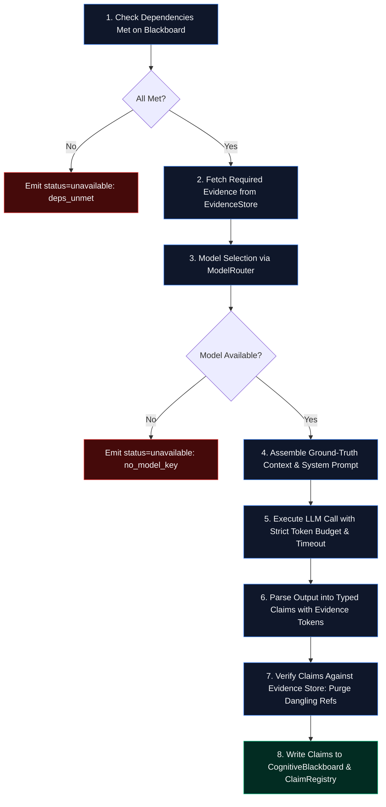

# Dristik AI — Master System Architecture, Features & AI Agent Guide

**System:** Dristik AI — Enterprise Evidence-Driven Website Intelligence, GEO/AEO & Autonomous Growth OS  
**Application Version:** `2.0.0` (`backend/app/core/config.py`)  
**Scoring Rubric Version:** `enterprise_web_intel_v4`  
**Document Classification:** Definitive Engineering Specification & Master System Reference  

---

## Table of Contents

1. [Executive Overview & Core Value Proposition](#1-executive-overview--core-value-proposition)
   - 1.1 The Industry Problem: Four Fatal Flaws of Legacy Audits
   - 1.2 The Dristik Philosophy: Evidence-First Intelligence
   - 1.3 Epistemic Hierarchy & Truth Classification
   - 1.4 Deliverables Produced on Every Audit Run
2. [High-Level Architecture Planes & Tech Stack](#2-high-level-architecture-planes--tech-stack)
   - 2.1 Technology Stack
   - 2.2 System Planes Architecture
3. [End-to-End Workflow & Pipeline Execution Flow](#3-end-to-end-workflow--pipeline-execution-flow)
   - 3.1 Step-by-Step Pipeline Sequence (Steps 1–32)
   - 3.2 End-to-End Audit Workflow Diagram (Mermaid)
4. [Exhaustive Feature, Sub-Feature & Small-Feature Catalog](#4-exhaustive-feature-sub-feature--small-feature-catalog)
   - 4.1 Crawl, Networking & Ingestion
   - 4.2 Deterministic Machine Analyzers (`ev_NNN` Plane)
   - 4.3 External Telemetry Plane (`ext_NNN`)
   - 4.4 External Authority Plane & Connected APIs
   - 4.5 Business Understanding & Identity Resolution
   - 4.6 Verification & Zero-Fake Integrity Gate
   - 4.7 Causal Reasoning, Hypotheses & Opportunity Engines
   - 4.8 Deterministic & Intent-Adaptive Scoring Engine
   - 4.9 Generative Engine Optimization (GEO/AEO) & AI Search
   - 4.10 Remediation, Patch Engine & Developer Packs
   - 4.11 Temporal Monitoring, Digital Twin & Regression
   - 4.12 Presentation, Big-4 Reporting & PPTX Compilers
   - 4.13 Multi-Tenancy, RBAC, Security & Monetization
5. [The AI Agent Workforce Behind Dristik](#5-the-ai-agent-workforce-behind-dristik)
   - 5.1 The 105 Specialist Agents Across 12 Domains
   - 5.2 The 5 Page-Level Copywriting Agents
   - 5.3 The 3 Presentation Deck Agents
   - 5.4 Auxiliary Autonomous Workers & Reasoners
6. [AI Agent Flow & Dependency Waves](#6-ai-agent-flow--dependency-waves)
   - 6.1 Kahn Topological Execution Waves
   - 6.2 105-Agent Kahn Wave Flow Diagram (Mermaid)
   - 6.3 One-Agent Internal Lifecycle Flow (`SpecialistAgent.run`)
7. [Cryptographic Manifest & Sealing Specification](#7-cryptographic-manifest--sealing-specification)

---

## 1. Executive Overview & Core Value Proposition

Dristik AI is an autonomous, evidence-driven website intelligence and growth operating system. It crawls public websites, collects deterministic DOM and network observations, enriches external telemetry, evaluates a 105-specialist agent workforce across 12 domains arranged in a 7-section topological dependency graph across a shared cognitive blackboard, adversarially verifies all claims against ground-truth evidence, and produces sealed executive reports accompanied by automated code patches and roadmaps.

### 1.1 The Industry Problem: Four Fatal Flaws of Legacy Audits

Conventional SEO and website auditing tools consistently fail modern businesses in four ways:

1. **Vanity Metrics & Fabricated Data**: Legacy tools invent synthetic numbers (Core Web Vitals from raw HTML, hallucinated CAC, estimated TAM, fabricated Google rankings, or guessed backlink totals).
2. **SEO-Only Tunnel Vision**: Standard checklists evaluate meta tags and keyword densities while completely ignoring:
   - **GEO/AEO (Generative Engine Optimization)**: Can ChatGPT, Perplexity, Claude, or Google AI Overviews extract a concise, factual, citable definition of the business?
   - **CRO (Conversion Rate Optimization)**: Can a prospective buyer understand the value proposition, identify pricing, and act within five seconds?
   - **Entity & Brand Clarity**: Who is this company, what exact problems do they solve, for whom, and under what monetization model?
3. **Unusable, Bloated Deliverables**: Generating a 60-page PDF filled with generic advice provides zero utility to engineering and product teams who need copy-paste JSON-LD schemas, character-compliant titles, and prioritized 7/30/90-day action plans.
4. **Absence of Proof & Reproducibility**: Audits fail to maintain immutable, content-addressed snapshots. Guesses, interpretations, and hard facts are mingled without cryptographic evidence tokens.

### 1.2 The Dristik Philosophy: Evidence-First Intelligence

Dristik enforces an uncompromising engineering rule: **LLMs are replaceable inference engines, not sources of truth.**

- Every observation extracted from the DOM, HTTP headers, DNS, TLS, or schemas receives a unique evidence token (`ev_NNN` or `ext_NNN`) and a content SHA-256 hash.
- An LLM may interpret, classify, or synthesize stored evidence. It is strictly forbidden from inventing facts.
- If a metric or connector is not configured (e.g., live Search Console, real-user CrUX data, live search engine trackers), the system explicitly reports `NOT_CONFIGURED`, `UNAVAILABLE`, or `SIMULATION_ONLY`.
- Category weights dynamically renormalize when external authority sources are absent.

```
+-------------------------------------------------------------------------+
|                          THE DRISTIK RULE                               |
|                                                                         |
|   "If a metric was not measured directly or verified from raw proof,    |
|    mark it UNAVAILABLE. Never invent CAC, TAM, field CWV, live          |
|    ChatGPT ranks, or backlink counts from HTML."                        |
+-------------------------------------------------------------------------+
```

### 1.3 Epistemic Hierarchy & Truth Classification

Every finding and claim produced by Dristik is audited against a three-tier epistemic confidence rubric:

| Tier | Definition | Scoring Impact |
|---|---|---|
| **CERTAIN** | Backed by $\ge 2$ independent, deterministic sources (e.g., DOM node + HTTP response header + verified schema). | Deducts full weighted penalties for deficiencies. |
| **LIKELY** | Backed by 1 strong deterministic source or corroborated by multiple high-confidence agent heuristics. | Deducts standard weighted penalties. |
| **GUESSING** | Inferred from absence, semantic extrapolation, or simulation models. | **Strictly $0$ score deduction.** Guesses never penalize a website's grade. |

*Adversarial Guardrail*: Any claim tagged as `GUESSING` that carries a `CRITICAL` materiality score is automatically quarantined and submitted to the Adversarial Verification Agent (`verification.adversarial.v3`) before it can enter executive recommendations.

### 1.4 Deliverables Produced on Every Audit Run

Every completed and sealed Dristik audit outputs:

- **Executive Report (`ExecutiveReport`)**: Complete C-suite intelligence dossier covering entity identity, 8 category scores, 3 Honest scores, finding ledgers, and causal bottleneck chains.
- **Honest 3-Pillar Scores**: Honest Human Experience (0–100), Honest Google Search (0–100), and Honest AI Readiness (0–100). Live AI citation visibility is quarantined into its own isolated scorecard.
- **8 Intent-Adaptive Category Scores**: Technical SEO, Content Quality, Schema & Structured Data, UX & Mobile, CRO, AI Discoverability, Trust & Authority, and Competitive Positioning.
- **Evidence-Tokened Finding Ledger**: Every issue linked to exact DOM selectors, URLs, raw values, and SHA-256 hashes.
- **Autonomous Developer Patch Pack (ZIP)**: Downloadable code archive containing:
  - `schema.jsonld`: Validated Organization, WebSite, and FAQPage structured data.
  - `metadata.html`: Character-safe `<title>` and `<meta name="description">` tags.
  - `faq.html`: Structured HTML FAQ section aligned with generative extractability standards.
  - `llms.txt`: Generative AI crawler manifest declaring brand boundaries, APIs, and key pages.
  - `robots.txt`: Optimized crawler directive file.
  - `README_DEV_INSTALL.md`: Deployment instructions for engineering teams.
- **7 / 30 / 90 Day Actionable Roadmap**: Prioritized remediation steps tied directly to root causes.
- **Top 10 Tactical Actions**: Highest ROI changes ranked by impact-to-effort ratio.
- **Per-Page Intelligence & Copywriting Rewrites**: Complete page-by-page SEO analysis and 5 copy cards per URL.
- **Executive WhatsApp 1-Pager**: Formatted mobile summary for immediate C-suite decision-making.
- **Visual Intelligence Graphs**: Radar charts, conversion funnels, severity distributions, and cross-engine comparisons.
- **Cryptographic Seal (`manifest.json`)**: Immutable manifest binding Report UUID, Evidence Tokens, Snapshot IDs, and Agent Model parameters.

---

## 2. High-Level Architecture Planes & Tech Stack

### 2.1 Technology Stack

```
+---------------------------------------------------------------------------------------+
|                                    TECHNOLOGY STACK                                   |
+---------------------------------------------------------------------------------------+
| Frontend       | React 18, Vite, TypeScript, Tailwind CSS, Lucide Icons               |
| Backend API    | Python 3.11+, FastAPI, Uvicorn, Pydantic v2                           |
| Concurrency    | AsyncIO, Async Semaphore Task Pools, Server-Sent Events (SSE)         |
| Crawl Engine   | HTTPX (Async HTTP/2), BeautifulSoup4, Playwright, Firecrawl API       |
| Database       | SQLite (dristik.db, geo_aeo_pipeline.db) with WAL mode & Checkpoints  |
| Storage        | Content-addressed raw snapshots under data/runs/<analysis_id>/        |
| LLM Gateway    | Multi-Provider Router: Anthropic, Google Gemini, Groq, OpenRouter     |
| Embeddings     | Local intfloat/e5-small-v2 (384-dim) & OpenRouter fallbacks           |
| Presentation   | python-pptx (16:9 native charts), ReportLab PDF                       |
| Billing & Auth | Razorpay API, HMAC webhook verification, Session Cookies, RBAC       |
+---------------------------------------------------------------------------------------+
```

### 2.2 System Planes Architecture

Dristik isolates operations into 10 decoupled system planes:

```
+---------------------------------------------------------------------------------------+
| 1. INGESTION PLANE                                                                    |
|    SSRF Guard -> Multi-Page Async Crawl -> Headless SPA Rendering -> Robots & Sitemaps|
+---------------------------------------------------------------------------------------+
                                           |
                                           v
+---------------------------------------------------------------------------------------+
| 2. DETERMINISTIC EVIDENCE PLANE (ev_NNN)                                              |
|    DOM AST -> Schema JSON-LD -> Headers -> TTFB -> Selectors -> Content SHA-256       |
+---------------------------------------------------------------------------------------+
                                           |
                                           v
+---------------------------------------------------------------------------------------+
| 3. EXTERNAL TELEMETRY & AUTHORITY PLANES (ext_NNN)                                    |
|    DNS / SSL / Sec Headers / CrUX  |  Connected APIs: GSC, GA4, Ahrefs, Semrush (No Fake)|
+---------------------------------------------------------------------------------------+
                                           |
                                           v
+---------------------------------------------------------------------------------------+
| 4. COGNITIVE BLACKBOARD & EVIDENCE GRAPH 2.0                                          |
|    Shared Knowledge State -> Graph Nodes (Site, Page, Element, Claim) -> Conflict Log |
+---------------------------------------------------------------------------------------+
                                           |
                                           v
+---------------------------------------------------------------------------------------+
| 5. SPECIALIST AI WORKFORCE DAG                                                        |
|    105 Specialist Agents (12 Domains) executing across 7 Modular Pipeline Workflows   |
+---------------------------------------------------------------------------------------+
                                           |
                                           v
+---------------------------------------------------------------------------------------+
| 6. INTEGRITY & VERIFICATION GATE                                                      |
|    Zero-Fake Provenance Audit -> Dangling Ref Purge -> Adversarial Cross-Examination  |
+---------------------------------------------------------------------------------------+
                                           |
                                           v
+---------------------------------------------------------------------------------------+
| 7. CAUSAL REASONING & SYNTHESIS PLANE                                                 |
|    Root-Cause Bottlenecks -> Hypotheses Evaluation -> Opportunity Discovery           |
+---------------------------------------------------------------------------------------+
                                           |
                                           v
+---------------------------------------------------------------------------------------+
| 8. DETERMINISTIC SCORING ENGINE                                                       |
|    8 Intent-Adaptive Categories -> Diminishing Deductions -> Honest 3-Pillar Scores   |
+---------------------------------------------------------------------------------------+
                                           |
                                           v
+---------------------------------------------------------------------------------------+
| 9. REMEDIATION & REWRITE FLEET                                                        |
|    7/30/90 Roadmaps -> 6-File Patch Pack -> 5 Page Copywriters -> WhatsApp 1-Pager    |
+---------------------------------------------------------------------------------------+
                                           |
                                           v
+---------------------------------------------------------------------------------------+
| 10. SEALING & CONTINUOUS MONITORING                                                   |
|     Cryptographic manifest.json Seal -> Digital Twin -> 30/60/90 Day Outcome Watcher  |
+---------------------------------------------------------------------------------------+
```

---

## 3. End-to-End Workflow & Pipeline Execution Flow

### 3.1 Step-by-Step Pipeline Sequence (Steps 1–32)

Every audit executed via `AnalysisOrchestrator.execute_analysis_pipeline` flows through 32 explicit stages:

1. **Mission Director Initialization**: Creates `MissionState`, binds target URL, selects capabilities based on crawl budget.
2. **SSRF Guard & Crawl Ingestion**: Validates target against private IP ranges; performs async HTTP crawl; checks HTML size; activates Playwright or Firecrawl if the page is a JavaScript SPA; parses `robots.txt` and `sitemap.xml`; prioritizes role slots (Homepage, Commercial, High-Intent, About).
3. **Evidence Graph 2.0 Population**: Generates Site, Page, and H1 nodes; stores SHA-256 hashes and DOM selectors.
4. **Durable Checkpoint 1**: Persists raw pages and initial DOM observations to disk/DB.
5. **Wave-0 Deterministic Site Facts Extraction**: Extracts business name candidates, CTA buttons, schemas, `sameAs` links, FAQs, and HTTPS status at **$0 model inference cost**.
6. **External Evidence Plane Enrichment (`ext_NNN`)**: Queries DNS, evaluates SSL/TLS certificates, checks HTTP security headers, and queries Chrome UX Report (CrUX) if API keys are set.
7. **Tier-1 Deterministic Capabilities**: Executes rules for title structure, meta descriptions, image alt tags, canonical tags, and status codes.
8. **Universal Entity Resolution**: Runs `UniversalEntityResolver` to identify canonical business name, category, and legal form.
9. **Business Understanding Pre-Pass**: Compares user-declared site type with detected site type; logs identity contradictions if a mismatch occurs.
10. **105-Specialist Agent Workforce Execution**: Deploys `AgentPool` across Kahn topological waves and 7 pipeline workflow sections. Independent agents in each wave execute concurrently under an AsyncIO semaphore.
11. **Durable Checkpoint 3**: Persists all generated specialist claims.
12. **Page-Level Intelligence Fleet**: `PageIntelligenceAgent` generates per-URL audits and executes the 5 copywriting specialists.
13. **Zero-Fake Evidence Integrity Gate & Rubric**: Purges claims referencing missing evidence; applies `CERTAIN`, `LIKELY`, and `GUESSING` tags; routes `GUESSING + CRITICAL` claims to `verification.adversarial.v3`.
14. **Causal Reasoning & Bottleneck Discovery (Pass 1)**: Isolates primary growth bottlenecks; updates hypotheses; detects growth opportunities.
15. **Synthetic Commercial Query Simulation**: Simulates 6 canonical buyer questions across ChatGPT, Perplexity, Gemini, and Claude (explicitly labeled `SIMULATION_ONLY`).
16. **Executive Strategy Narrative Synthesis**: Synthesizer consolidates verified findings into C-suite narrative.
17. **Post-DAG Specialized Analyzers**: Executes 14 deterministic deep analyzers (Canonicals, Status Codes, Headings, Link Depth/Orphans, Media Assets, Forms, WCAG, Local SEO, International SEO, Topical Authority, Ecommerce, SERP, Security, Redirects).
18. **Finding Synthesis & Initial Scoring**: `DecisionEngine` aggregates findings; `ScoringEngine.calculate_scores` runs initial 8-category tally.
19. **Calibrated Confidence Calculation**: Computes mathematical confidence based on evidence coverage and contradiction counts.
20. **Remediation Planning**: Builds 7/30/90-day roadmaps, Top 10 tactical plan, and code patches.
21. **Digital Twin & Temporal Timeline Recording**: Updates in-memory domain twin and appends audit record.
22. **Narrative Assembly**: Compiles executive narrative sections.
23. **Live AI Citation Visibility Measurement**: Runs live search trackers if API keys are active. If successful, records `status=MEASURED`. Otherwise, falls back to recent GEO pipeline database snapshots. If neither exists, visibility is left blank.
24. **On-Page GEO Readiness Evaluation**: Evaluates on-page extractability across 6 buyer questions. Visibility is attached from Step 23 without fabrication.
25. **Honest 3-Pillar Scores Calculation**: Computes Honest Human Experience, Honest Google Search, and Honest AI Readiness.
26. **Character-Safe Copy & WhatsApp Summary**: Enforces title (50–60 chars) and meta (140–160 chars) limits; builds executive WhatsApp brief.
27. **Multi-Plane Evidence Fusion & Cryptographic Sealing**: Re-syncs Evidence Graph; builds `manifest.json`; computes cryptographic hash; marks run sealed.
28. **Visual Intelligence Synthesis**: Synthesizes radar, funnel, and distribution charts.
29. **Visual UX Testing & Lifecycle Revenue**: Evaluates viewports (Desktop/Tablet/Mobile); generates lifecycle revenue projections.
30. **External Authority Attachment**: Connects historical snapshot data from GSC/GA4/Ahrefs if available.
31. **Competitive Intelligence Layer & Causal Pass 2**: Re-evaluates root causes incorporating competitor benchmark parity.
32. **Validation Gate Enforcement & Final Persistence**: Executes `ValidationGate.enforce_gate`. If validation checks pass, sets status to `COMPLETED` and streams final payload.

---

### 3.2 End-to-End Audit Workflow Diagram (Mermaid)

```mermaid
flowchart TD
    classDef startend fill:#1e293b,stroke:#38bdf8,stroke-width:2px,color:#f8fafc;
    classDef ingest fill:#0f172a,stroke:#3b82f6,stroke-width:1px,color:#f8fafc;
    classDef det fill:#022c22,stroke:#10b981,stroke-width:1px,color:#f8fafc;
    classDef agent fill:#3b0764,stroke:#a855f7,stroke-width:1px,color:#f8fafc;
    classDef gate fill:#450a0a,stroke:#ef4444,stroke-width:1px,color:#f8fafc;
    classDef score fill:#1c1917,stroke:#f59e0b,stroke-width:1px,color:#f8fafc;
    classDef seal fill:#0c4a6e,stroke:#0284c7,stroke-width:2px,color:#f8fafc;

    Start([User Submits URL]):::startend --> Ingest[1. SSRF Guard & Multi-Page Crawl]:::ingest
    Ingest --> Snap[Save Content-Addressed Snapshots]:::ingest
    Snap --> EvGraph[2. Populate Evidence Graph 2.0]:::det
    EvGraph --> Wave0[3. Wave-0 Site Facts ($0 Inference)]:::det
    Wave0 --> ExtEnrich[4. External Evidence Plane: DNS/SSL/CrUX]:::det
    ExtEnrich --> EntRes[5. Universal Entity Resolution]:::det
    EntRes --> BizPass[6. Business Understanding & Contradictions]:::det
    
    BizPass --> DAG[7. Execute 105-Agent Workforce across 7 Workflow Sections]:::agent
    
    DAG --> PageIntel[8. Page Intelligence & 5 Copywriters]:::agent
    PageIntel --> Gate[9. Zero-Fake Integrity Gate & Rubric]:::gate
    
    Gate --> Adversarial{GUESSING + CRITICAL?}:::gate
    Adversarial -- Yes --> AdvReview[Adversarial Verification Re-Audit]:::gate
    Adversarial -- No --> Causal1[10. Causal Bottlenecks & Opportunities]:::agent
    AdvReview --> Causal1
    
    Causal1 --> SimEngine[11. 6 Commercial Queries Simulation]:::agent
    SimEngine --> DeepAna[12. 14 Post-DAG Deterministic Deep Analyzers]:::det
    DeepAna --> Score1[13. Initial Scoring & Confidence Evaluation]:::score
    
    Score1 --> Remed[14. Remediation Planning & Patch Packs]:::score
    Remed --> Twin[15. Digital Twin & Timeline Update]:::score
    
    Twin --> LiveVis{Live AI Trackers Configured?}:::score
    LiveVis -- Yes --> MeasVis[Record MEASURED Citation Rate]:::score
    LiveVis -- No --> SnapVis{GEO Snapshot in DB?}:::score
    SnapVis -- Yes --> DBVis[Attach Historic GEO Snapshot]:::score
    SnapVis -- No --> BlankVis[AI Visibility = NOT_MEASURED]:::score
    
    MeasVis --> HonestScore[16. Compute Honest 3-Pillar Scores]:::score
    DBVis --> HonestScore
    BlankVis --> HonestScore
    
    HonestScore --> Fusion[17. Multi-Plane Evidence Fusion]:::seal
    Fusion --> SealManifest[18. Seal Cryptographic manifest.json]:::seal
    SealManifest --> ValGate{19. Validation Gate Checks Pass?}:::gate
    
    ValGate -- Fail --> FailRun([Audit Marked FAILED]):::gate
    ValGate -- Pass --> Complete([Audit Sealed & Delivered]):::startend
```

---

## 4. Exhaustive Feature, Sub-Feature & Small-Feature Catalog

### 4.1 Crawl, Networking & Ingestion

- **SSRF Protection Engine**:
  - `is_safe_url`: Validates target hostname before establishing connections.
  - IP Filtering: Resolves DNS and drops loopback addresses (`127.0.0.0/8`), private RFC1918 subnets (`10.0.0.0/8`, `172.16.0.0/12`, `192.168.0.0/16`), link-local (`169.254.0.0/16`), and cloud metadata IP endpoints (`169.254.169.254`).
  - Scheme Validation: Rejects non-HTTP/HTTPS schemes (e.g., `file://`, `ftp://`, `gopher://`).
- **Async HTTP Fetcher**:
  - HTTP/2 & HTTP/1.1 client powered by `httpx.AsyncClient`.
  - Configurable timeouts (default 15s connect, 20s read).
  - Redirect Management: Follows 301, 302, 307, 308 redirects up to 5 hops; tracks redirect chains.
  - Custom User-Agent: Identifies as `DristikBot/2.0 (+https://dristik.ai/bot)`.
  - Network Metrics: Measures exact TTFB (Time to First Byte) in milliseconds and total transfer time.
- **Dynamic JavaScript & SPA Rendering**:
  - Thin HTML Detection: Analyzes initial response body; triggers headless browser rendering if visible text is $<500$ characters or contains SPA hydration markers (`<div id="root"></div>`, `__NEXT_DATA__`).
  - Playwright Headless Browser: Executes headless Chromium; waits for `networkidle` or DOM mutations.
  - Firecrawl API Integration: Optional fallback for anti-bot protected or complex client-side applications.
- **Robots & Sitemap Discovery**:
  - Robots.txt Parser: Parses user-agent directives, `Disallow`, `Allow`, `Crawl-delay`, and declared sitemaps.
  - Sitemap Discovery: Discovers sitemaps via `/robots.txt`, default `/sitemap.xml`, and `/sitemap_index.xml`.
  - Recursive Sitemap Parser: Unpacks nested sitemap indices and extracts up to 5,000 internal URLs.
- **Intelligent Role-Slot Crawl Sampling**:
  - Role-Slot Priority Scoring:
    - *Slot 1 (Weight 100)*: Homepage (`/`).
    - *Slot 2 (Weight 95)*: Primary Commercial Offering (e.g., `/features`, `/platform`, `/product`).
    - *Slot 3 (Weight 85)*: High-Intent Conversion Page (e.g., `/pricing`, `/plans`, `/demo`, `/contact`).
    - *Slot 4 (Weight 75)*: Secondary Commercial / Solutions Page (e.g., `/solutions`, `/enterprise`).
    - *Slot 5 (Weight 65)*: Social Proof / Entity Authority Page (e.g., `/about`, `/company`, `/case-studies`).
  - Crawl Depth Tiers: Quick Audit (10 pages), Standard Growth (50 pages), Enterprise Deep (500 pages).
- **Content-Addressed Snapshot Repository**:
  - Stores unmodified raw response bodies under `data/runs/<analysis_id>/snapshots/` or relational DB.
  - Computes SHA-256 hash of payload; validates content integrity on read; refuses overwrite if hashes mismatch.

---

### 4.2 Deterministic Machine Analyzers (`ev_NNN` Plane)

All analyzers execute at **$0 model inference cost** and emit structured `ev_NNN` tokens:

- **HTML DOM AST & Structure**:
  - Parser: BeautifulSoup4 (`lxml` backend) generating navigable AST.
  - Word Count & Character Count: Extracts clean visible text excluding `<script>`, `<style>`, `<nav>`, and `<footer>`.
  - Readability Engine: Computes Flesch Reading Ease score and Flesch-Kincaid Grade Level.
- **Headings Tree & Semantic Hierarchy**:
  - Audits full H1–H6 hierarchy.
  - Emits findings for: Missing H1, Multiple H1s, Empty Headings, Skipped Heading Levels (e.g., H1 directly to H3).
- **Metadata & Open Graph Engine**:
  - Title Tag Auditor: Measures exact character length; flags titles outside optimal 50–60 character range.
  - Meta Description Auditor: Measures length; flags descriptions outside optimal 140–160 character range.
  - Open Graph & Twitter Cards: Checks presence of `og:title`, `og:description`, `og:image`, `og:url`, `og:type`, `twitter:card`, and `twitter:image`.
  - Robots Directives: Inspects `<meta name="robots">` and HTTP `X-Robots-Tag` for `noindex`, `nofollow`, and `noarchive`.
- **Canonical Link Auditor**:
  - Verifies presence of `<link rel="canonical">`.
  - Flags: Missing canonicals, Relative canonical URLs, Cross-domain canonicals, Canonicals pointing to 404s or redirects.
- **HTTP Status & Link Health**:
  - Status Breakdown: Tallies 2xx success, 3xx redirects, 4xx client errors, 5xx server errors.
  - Broken Link Detector: Flags internal broken links with referring URL and anchor text.
  - Redirect Loop Detector: Detects circular hops or chains exceeding 3 redirects.
- **Link Architecture & Graph**:
  - Internal Link Graph: Constructs in-memory directed graph of internal links.
  - Click Depth: Computes shortest path from homepage to each crawled URL.
  - Orphan Page Detector: Identifies pages present in `sitemap.xml` with zero incoming internal links.
  - Anchor Text Distribution: Analyzes ratios of exact-match, branded, compound, and empty/generic anchor text.
- **Media & Asset Optimization**:
  - Alt Text Coverage: Calculates percentage of images missing `alt` attributes.
  - Modern Format Detection: Flags legacy PNG/JPEG formats where WebP or AVIF should be utilized.
  - Responsive Images: Verifies `srcset` and `sizes` attributes on large visual assets.
  - Performance Attributes: Checks for `loading="lazy"` on below-the-fold media.
- **Performance & Resource Weights**:
  - Measures TTFB (Time to First Byte); flags servers exceeding 600ms.
  - Total Transfer Size: Calculates total byte payload per URL.
  - Resource Breakdown: Measures size distributions across HTML, CSS, JavaScript, Images, and Fonts.
  - Render-Blocking Assets: Identifies un-deferred scripts in the `<head>` tag.
- **Security & Infrastructure Headers**:
  - Protocol Validation: Verifies HTTPS enforcement and HTTP-to-HTTPS redirect status.
  - Security Header Checks:
    - `Strict-Transport-Security` (HSTS): Checks max-age and `includeSubDomains`.
    - `Content-Security-Policy` (CSP): Validates policy presence.
    - `X-Frame-Options`: Checks for `DENY` or `SAMEORIGIN`.
    - `X-Content-Type-Options`: Verifies `nosniff`.
    - `Referrer-Policy`: Validates modern referrer policies.
    - Mixed Content: Detects insecure `http://` assets loaded on `https://` pages.
- **Form & Input Friction**:
  - Counts form elements, input fields, and required inputs.
  - Detects presence of CSRF verification tokens.
  - Flags forms with $>5$ input fields as high friction.
  - Inspects submit button text for generic copy (e.g., "Submit" vs action verbs).
- **Schema.org Structured Data Validator**:
  - Extracts JSON-LD (`application/ld+json`), Microdata, and RDFa blocks.
  - Syntax Validation: Catches JSON parsing syntax errors and missing closing braces.
  - Type Recognition: Identifies Google Rich Results types (`Organization`, `WebSite`, `Product`, `SoftwareApplication`, `LocalBusiness`, `FAQPage`, `BreadcrumbList`, `Article`).
  - Required Property Validation: Flags missing mandatory fields (e.g., `Product` missing `offers` or `price`).
- **WCAG 2.1 AA Accessibility Screening**:
  - Contrast Screening: Flags poor color contrast stubs.
  - ARIA Landmarks: Checks for `<main>`, `<header>`, `<nav>`, and `<footer>` semantic elements.
  - Interactive Target Sizing: Flags tap targets smaller than $48 \times 48\text{px}$.
  - Form Accessibility: Ensures every `<input>` has an associated `<label>`.
- **Local SEO Analyzer**:
  - NAP Consistency: Extracts Name, Address, and Phone numbers; checks consistency across pages.
  - Geographic Meta Tags: Checks for `geo.position` and `ICBM` tags.
  - LocalBusiness Schema: Validates local schema properties and Google Business Profile links.
- **International SEO Analyzer**:
  - `hreflang` Auditor: Verifies bidirectional `hreflang` link consistency.
  - `x-default` Tagging: Confirms presence of fallback international tags.
  - Language Mismatch: Flags HTML `lang` attributes that contradict page body copy.
- **Topical Authority & Content Depth**:
  - Keyword Density & Clusters: Maps primary, secondary, and supporting topic terms.
  - Semantic Content Depth: Compares body text length against industry benchmarks.
  - Fluff Ratio: Calculates the proportion of corporate buzzwords vs technical/factual terms.
- **Ecommerce SEO Analyzer**:
  - Product Metadata: Validates `Product` schema, SKU, GTIN, and brand fields.
  - Pricing & Availability: Checks `Offer`, `priceCurrency`, `price`, and `availability` schema.
  - Review & Rating Signals: Verifies `AggregateRating` syntax.
- **SERP Appearance Simulator**:
  - Simulates Google Desktop ($600\text{px}$ container) and Mobile ($480\text{px}$ container) snippet renderings.
  - Highlights title and description truncation boundaries.
- **Host & Redirect Probing**:
  - Probes variations: `http://example.com`, `https://example.com`, `http://www.example.com`, `https://www.example.com`.
  - Flags split-domain indexing where `www` and non-`www` resolve to different status codes without 301 redirects.
  - Verifies trailing slash canonicalization consistency.

---

### 4.3 External Telemetry Plane (`ext_NNN`)

The `ExternalEvidenceEnricher` writes structured `ext_NNN` tokens for infrastructure parameters outside the DOM:

- **DNS Records**:
  - Queries A, AAAA, MX, TXT, NS records via `dnspython`.
  - Inspects email authentication: Validates SPF (`v=spf1`), DKIM selector configuration, and DMARC policies (`v=DMARC1; p=reject/quarantine`).
- **SSL/TLS Handshake & Certificates**:
  - Connects via secure TLS socket; inspects active certificate.
  - Verifies Issuer Authority, Validity Period, Expiration Date (flags certificates expiring within 14 days), and TLS protocol version (flags deprecated TLS 1.0/1.1).
- **Chrome User Experience Report (CrUX)**:
  - If `CRUX_API_KEY` is configured: Retrieves real-user field Core Web Vitals:
    - Largest Contentful Paint (LCP) in seconds.
    - Interaction to Next Paint (INP) in milliseconds.
    - Cumulative Layout Shift (CLS).
  - If unconfigured: Explicitly emits `ext_NNN` status as `NOT_CONFIGURED` without inventing numbers.

---

### 4.4 External Authority Plane & Connected APIs

All external provider integrations live in `backend/app/external_authority/` and persist to a dedicated database (`external_authority.db`). They **never** modify the crawl score directly and are omitted when not connected:

- **Supported Connectors**:
  - Search Performance: Google Search Console (GSC), Bing Webmaster Tools.
  - Analytics: Google Analytics 4 (GA4).
  - Backlinks & Domain Authority: Ahrefs, Semrush, Majestic, DataForSEO.
  - Local & Brand: Google Business Profile (GBP), SerpAPI.
- **Architectural Isolation Rule**:
  - No Universal Vanity Score: Dristik refuses to generate a fake "Universal Authority Score" (0–100) when external providers are unconfigured.
  - Weight Renormalization: When external authority is disconnected, the Trust & Authority category weight is redistributed across the remaining 7 categories.

---

### 4.5 Business Understanding & Identity Resolution

- **Universal Entity Resolver**:
  - Parses crawled pages, footer copy, schema organizations, and `sameAs` links.
  - Resolves canonical brand name, legal entity suffix (e.g., Inc, LLC, Ltd), and industry category.
- **Declared vs Detected Site Type Arbitration**:
  - Evaluates site against 6 business models: SaaS, Ecommerce, Lead Generation, Agency / Professional Services, Content / Publisher, Local Business.
  - Detects identity contradictions: If the user declares the site is "SaaS" but the crawler finds no software features, pricing tiers, or login portals—and instead finds physical service menus—the system logs an `IdentityContradiction` event.

---

### 4.6 Verification & Zero-Fake Integrity Gate

- **Cryptographic Provenance Verification**:
  - Confirms that every claim in `ClaimRegistry` contains an `evidence_refs` list pointing to active `ev_NNN` or `ext_NNN` tokens.
  - Rejects any claim containing synthetic text markers (`[MOCK]`, `lorem ipsum`, simulated IDs).
- **Dangling Reference Purge**:
  - Automatically strips claims whose referenced evidence tokens were purged or invalid.
- **Adversarial Quarantining**:
  - Evaluates claims with `confidence_rubric == GUESSING` and `materiality == CRITICAL`.
  - Quarantines these claims from the executive synthesis until re-examined by `verification.adversarial.v3`.

---

### 4.7 Causal Reasoning, Hypotheses & Opportunity Engines

- **Causal Reasoning Engine (`CausalReasoningEngine`)**:
  - Evaluates claims, crawl metrics, and business models to identify root-cause growth bottlenecks.
  - Distinguishes symptoms (e.g., "High bounce rate on pricing page") from true root causes (e.g., "Missing pricing table + missing trust badges").
- **Hypothesis Engine (`HypothesisEngine`)**:
  - Formulates pre-reasoning hypotheses at Step 4; tests them against accumulated evidence at Step 14.
  - Outputs evaluated status: `SUPPORTED`, `REFUTED`, or `INSUFFICIENT_EVIDENCE`.
- **Opportunity Detector (`OpportunityDetector`)**:
  - Identifies positive growth levers (e.g., strong topical authority ready for commercial comparison pages).

---

### 4.8 Deterministic & Intent-Adaptive Scoring Engine

- **8 Intent-Adaptive Categories**:
  1. Technical SEO (Default Weight: 15%)
  2. Content Quality & Depth (Default Weight: 15%)
  3. Schema & Structured Data (Default Weight: 10%)
  4. User Experience & Mobile (Default Weight: 15%)
  5. Conversion Rate Optimization (CRO) (Default Weight: 15%)
  6. AI Discoverability & GEO Readiness (Default Weight: 15%)
  7. Trust, Authority & Social Proof (Default Weight: 10%)
  8. Competitive & Brand Differentiation (Default Weight: 5%)
- **Intent Adaptation Rules**:
  - If Site Type is **Ecommerce**: CRO and Schema weights increase; Content Quality weight adapts.
  - If Site Type is **Publisher**: Content Quality and Technical SEO weights increase; CRO weight decreases.
- **Diminishing Penalty Function**:
  - Deductions use diminishing logarithmic curves: Minor issues cannot accumulate indefinitely to collapse an entire score to zero.
  - Hard Floor: Overall scores are bounded by a minimum floor of 20 to prevent artificial zeroing.
- **Honest 3-Pillar Scoring Architecture**:
  - **Honest Human Experience Score**: Blends UX friction, readability, mobile layout, visual CRO, and trust proof.
  - **Honest Google Search Score**: Blends technical crawlability, indexability, metadata compliance, schema richness, and speed.
  - **Honest AI Readiness Score**: Strictly evaluates on-page extractability, citable definition blocks, FAQ structures, and schema clarity.
  - **Live AI Citation Visibility Score**: **Completely decoupled.** Stays blank / `NOT_MEASURED` unless live query engine trackers ran and confirmed live search citations.

---

### 4.9 Generative Engine Optimization (GEO/AEO) & AI Search

- **On-Page Extractability Audit**:
  - Tests whether the website provides clear, single-paragraph answers to the 6 Canonical Buyer Inquiries:
    1. *What does this company sell?*
    2. *Who is the ideal customer?*
    3. *How much does it cost?*
    4. *How does it compare to competitors?*
    5. *What technical proof or certifications exist?*
    6. *How do I buy or get started?*
- **Information Gain & Data Density**:
  - Scans copy for proprietary benchmarks, original surveys, statistical data tables, and methodology write-ups.
- **Synthetic Query Simulator (`worker_simulator`)**:
  - Simulates search evaluation prompts (e.g., "Best [Industry] software alternatives", "[Brand] reviews and pricing") across ChatGPT, Perplexity, Gemini, and Claude.
  - All outputs carry the mandatory status tag `SIMULATION_ONLY`.
- **Live AI Search Monitor**:
  - Connects to external citation tracking infrastructure when configured; computes verified first-party mention rates.

---

### 4.10 Remediation, Patch Engine & Developer Packs

- **Actionable Roadmaps**:
  - **7-Day Sprint**: High-impact technical fixes (missing meta tags, broken canonicals, robots.txt blocks, critical schema errors).
  - **30-Day Program**: Conversion optimization, extractable definitions, FAQ section deployment, internal link restructuring.
  - **90-Day Strategy**: Comprehensive topical expansion, E-E-A-T author credentials, programmatic schema architecture.
- **Top 10 Prioritized Actions**:
  - Computes ROI score for each finding: $\text{ROI} = \frac{\text{Business Impact} \times \text{Confidence}}{\text{Implementation Effort}}$.
  - Delivers top 10 ranked tasks with exact code snippets.
- **Developer Patch Pack (ZIP File)**:
  - Generates downloadable archive with production-ready code:
    - `schema.jsonld`: Clean, validated JSON-LD schema ready to drop into `<head>`.
    - `metadata.html`: Pre-rendered `<title>` and `<meta>` tags adhering to 50–60 and 140–160 character rules.
    - `faq.html`: Structured HTML markup with semantic questions and answers.
    - `llms.txt`: Generative AI crawler manifest declaring brand boundaries, APIs, and key pages.
    - `robots.txt`: Optimized crawler directive file.
    - `README_DEV_INSTALL.md`: Deployment instructions for engineering teams.
- **Character-Safe Copywriter Engine**:
  - Enforces character boundaries programmatically: Titles strictly 50–60 characters; Meta descriptions strictly 140–160 characters; Hero statements strictly 40–60 words.
- **C-Suite WhatsApp 1-Pager**:
  - Generates a concise, formatted plaintext summary designed for executive messaging apps (scores, primary bottleneck, top 3 actions, and what consultant advice to ignore).

---

### 4.11 Temporal Monitoring, Digital Twin & Regression

- **Website Digital Twin (`WebsiteDigitalTwin`)**:
  - In-memory and persisted state model representing historical audits, tracked scores, findings, and remediation status.
- **Temporal Timeline & Regression Detector**:
  - Compares the current audit against previous runs for the same domain.
  - Detects regressions: Flags if scores dropped or previously resolved findings reappeared.
- **Continuous Outcome Tracking (`OutcomeStore`)**:
  - Automatically schedules automated re-check jobs at 30, 60, and 90 days (`outcome.tracking.v1`) to verify whether recommended patches were deployed to production.

---

### 4.12 Presentation, Big-4 Reporting & PPTX Compilers

- **Executive Presentation Deck Engine (`DECK_AGENTS_V1`)**:
  - Generates full 70+ slide widescreen (16:9) PowerPoint decks (`.pptx`) with native dark-mode charts.
  - Partitioned into 11 strategic modules with non-repetition guarantees.
- **Big-4 Style Audit Report**:
  - Executive-level layout featuring formal audit opinions, materiality risk matrices, and compliance ledgers.

---

### 4.13 Multi-Tenancy, RBAC, Security & Monetization

- **Multi-Tenancy & Project Scoping**:
  - Complete data isolation using `org_id` and project boundaries.
- **Role-Based Access Control (RBAC)**:
  - Roles supported: `system_admin`, `owner`, `admin`, `analyst`, `viewer`, `auditor`.
  - Permission checks enforced on audit creation (`mission:create`), configuration updates, and billing operations.
- **Monetization & Billing**:
  - Razorpay payment integration supporting INR payments.
  - Automated GST-compliant tax invoice generation.
- **Server-Sent Events (SSE)**:
  - Real-time progress updates streamed over `GET /analyses/{id}/stream`.
- **Durable Checkpoint & Replay System**:
  - Stages persist to SQLite; supports pause, resume, and instant replay of historical runs without re-crawling.

---

## 5. The AI Agent Workforce Behind Dristik

Dristik utilizes an active ensemble of **105 specialist agents across 12 domains**, supported by:
1. **105 Specialist Agents in 12 Domains** (`AGENT_REGISTRY` in `backend/app/orchestration/runtime/registry.py`).
2. **7 Modular Pipeline Workflow Sections (33 DAG Nodes)** (`SECTIONS_REGISTRY` & `NODES_REGISTRY`).
3. **5 Page-Level Copywriting Specialists** inside `PageIntelligenceAgent`.
4. **3 Executive Presentation Deck Agents** for PowerPoint generation.

---

### 5.1 The 105 Specialist Agents Across 12 Domains

Every specialist agent is defined with typed contracts, capabilities, allowed models, token budgets, risk levels, dependencies, and required evidence in `backend/app/agents/runtime/registry.py`:

| Agent ID | Agent Name | Domain | Model Tier | Budget | Dependencies | Required Evidence | Core Responsibilities |
|---|---|---|---|---|---|---|---|
| `business.discovery.v3` | Business Discovery Agent | Business | Reasoning / Fast SLM | 4,000 | *None* | `homepage_dom`, `header_nav`, `hero_text`, `footer_text` | Extracts business name, industry, offerings, target customer, business model, and value proposition. |
| `business.icp.v3` | ICP Intelligence Agent | Business | Reasoning / Fast SLM | 4,000 | `business.discovery.v3` | `homepage_dom`, `use_cases_page`, `case_studies` | Classifies B2B/B2C buyer personas, firmographics, decision-maker roles, and pain points. |
| `business.intent.v3` | Search Intent Agent | Business | Fast SLM / Reasoning | 3,500 | `business.discovery.v3` | `headings`, `meta_descriptions`, `urls` | Maps visitor search journeys across Informational, Commercial, Transactional, and Navigational intents. |
| `business.commercial.v3` | Commercial Intelligence Agent | Business | Reasoning / Fast SLM | 4,500 | `business.discovery.v3` | `pricing_table`, `cta_elements`, `terms_of_sale` | Audits pricing models, tier packaging, commercial friction, trial mechanics, and purchase paths. |
| `business.semantic_strategist.v3` | Semantic Business Strategist | Business | Judge / Reasoning | 6,000 | `business.discovery.v3`, `business.icp.v3`, `business.intent.v3`, `business.commercial.v3` | `claims` | Synthesizes business findings; detects positioning conflicts between claimed and actual offerings. |
| `seo.crawl.v3` | Crawl Intelligence Agent | Technical SEO | Deterministic | 1,000 | *None* | `robots_txt`, `sitemap_xml`, `http_status_codes` | Deterministic analysis of crawlability, status codes, robots directives, sitemaps, and redirect loops. |
| `seo.indexability.v3` | Indexability Agent | Technical SEO | Deterministic / Fast SLM | 2,000 | *None* | `canonical_url`, `meta_robots`, `x_robots_tag` | Audits noindex directives, canonical consistency, robots headers, and parameter duplication. |
| `seo.html.v3` | Technical HTML Agent | Technical SEO | Deterministic | 1,500 | *None* | `raw_dom`, `headings_tree`, `meta_tags` | Validates title tags, meta descriptions, H1–H6 hierarchy, HTML5 landmarks, and semantic conformance. |
| `seo.internal_links.v3` | Internal Linking Agent | Technical SEO | Deterministic / Fast SLM | 2,500 | *None* | `internal_link_graph`, `anchor_texts` | Builds page link graph; detects orphan URLs, excessive click depths, and weak anchor text distributions. |
| `seo.performance.v3` | Performance Agent | Technical SEO | Deterministic | 1,500 | *None* | `ttfb_ms`, `resource_timings`, `payload_size` | Audits TTFB, payload weights, render-blocking resources. Strictly prohibits inventing unmeasured CWV. |
| `seo.security.v3` | Security & Infrastructure Agent | Technical SEO | Deterministic | 1,000 | *None* | `response_headers`, `protocol_scheme` | Checks HTTPS enforcement, TLS certificate validity, HSTS, CSP, X-Frame-Options, and mixed content. |
| `seo.assets.v3` | Media & Asset Agent | Technical SEO | Deterministic / Fast SLM | 2,000 | *None* | `img_tags`, `media_elements` | Audits image dimensions, alt text coverage, modern WebP/AVIF formats, lazy loading, and video tags. |
| `schema.validation.v3` | Schema Intelligence Agent | Structured Data | Deterministic / Fast SLM | 2,500 | *None* | `raw_schema_jsonld`, `microdata_nodes` | Validates JSON-LD, Microdata, RDFa, Schema.org types, required properties, and syntax errors. |
| `entity.graph.v3` | Entity Intelligence Agent | Structured Data | Reasoning / Fast SLM | 4,000 | *None* | `raw_schema_jsonld`, `entity_text_spans` | Extracts Organization, Person, Product, and Service entities; maps semantic relationships. |
| `entity.knowledge_graph.v3` | Knowledge Graph Agent | Structured Data | Reasoning / Fast SLM | 3,500 | `entity.graph.v3` | `entity_nodes`, `sameas_urls` | Evaluates entity clarity, `sameAs` authority links, author identity, and external reference consistency. |
| `content.depth.v3` | Content Depth Agent | Content | Reasoning / Fast SLM | 5,000 | *None* | `body_copy`, `headings`, `word_counts` | Analyzes topical breadth, semantic depth, missing subtopics, and content substance vs fluff. |
| `content.eeat.v3` | E-E-A-T Agent | Content | Reasoning / Fast SLM | 4,500 | *None* | `author_bios`, `citations`, `about_page` | Audits observable author identity, credentials, editorial policies, citations, and first-hand proof. |
| `content.quality.v3` | Content Quality Agent | Content | Reasoning / Fast SLM | 4,000 | *None* | `clean_text`, `readability_metrics` | Analyzes readability, clarity, utility, specificity, evidence backing, and repetitive filler. |
| `content.topic_coverage.v3` | Topic Coverage Agent | Content | Reasoning / Fast SLM | 4,500 | *None* | `headings`, `body_text` | Builds hierarchical topic trees (Main Topic $\rightarrow$ Subtopics); identifies critical topical coverage gaps. |
| `content.cannibalization.v3` | Cannibalization Agent | Content | Fast SLM / Reasoning | 3,500 | *None* | `page_manifest`, `all_page_titles`, `canonical_links` | Compares multi-page titles, intent keywords, and body copy for cannibalization and keyword collisions. |
| `geo.extractability.v3` | Answer Extractability Agent | GEO | Reasoning / Fast SLM | 4,500 | *None* | `dom_elements`, `clean_text`, `faqs` | Measures extractability: definitions, bulleted lists, tables, concise summaries, and modular sections. |
| `geo.information_gain.v3` | Information Gain Agent | GEO | Reasoning Model | 5,000 | *None* | `clean_text`, `data_tables`, `stat_mentions` | Detects original research, proprietary data, benchmarks, unique methodology, and first-party data. |
| `geo.citation_readiness.v3` | Citation Readiness Agent | GEO | Reasoning / Fast SLM | 4,500 | `business.semantic_strategist.v3`, `entity.graph.v3`, `content.quality.v3` | `claims`, `clean_text` | Maps claim $\rightarrow$ evidence $\rightarrow$ source attribution; flags unsupported marketing assertions. |
| `geo.structure.v3` | Generative Structure Agent | GEO | Fast SLM / Reasoning | 3,500 | *None* | `headings`, `first_paragraph_texts`, `faq_blocks` | Audits TL;DR blocks, answer-first framing, FAQ structures, definitions, and entity-dense snippets. |
| `ai_search.discoverability.v3` | AI Discoverability Agent | AI Search | Reasoning / Fast SLM | 4,500 | `business.semantic_strategist.v3` | `business_profile`, `offerings` | Generates exhaustive synthetic prompt space ("Best X companies", "X alternatives", "X vs Y"). |
| `ai_search.chatgpt.v3` | ChatGPT Visibility Agent | AI Search | Reasoning Model | 4,000 | `ai_search.discoverability.v3` | `query_matrix` | Evaluates discoverability scenarios for ChatGPT. Strictly labels unverified runs as SIMULATION_ONLY. |
| `ai_search.perplexity.v3` | Perplexity Visibility Agent | AI Search | Reasoning Model | 4,000 | `ai_search.discoverability.v3` | `query_matrix` | Evaluates citation eligibility for Perplexity Search. Strictly prohibits fabricating live citations. |
| `ai_search.google.v3` | Google AI Search Agent | AI Search | Reasoning / Fast SLM | 4,000 | `ai_search.discoverability.v3` | `headings`, `direct_answers`, `query_matrix` | Audits readiness for Google AI Overviews and featured snippets. Separates OBSERVED from INFERRED. |
| `ai_search.cross_engine.v3` | Cross-Engine Search Agent | AI Search | Reasoning Model | 5,000 | `ai_search.chatgpt.v3`, `ai_search.perplexity.v3`, `ai_search.google.v3` | `engine_evaluations` | Compares simulated visibility across Google, ChatGPT, Perplexity, Gemini, and Claude. |
| `ux.experience.v3` | UX Intelligence Agent | Experience | Fast SLM / Deterministic | 3,000 | *None* | `dom_elements`, `nav_structure`, `viewport` | Audits navigation hierarchy, readability, mobile ergonomics, information architecture, and UI friction. |
| `cro.conversion.v3` | Conversion Intelligence Agent | Experience | Fast SLM / Reasoning | 3,500 | *None* | `cta_elements`, `form_fields`, `hero_section` | Audits visitor-to-customer conversion paths: CTA copy, placement, form friction, and value propositions. |
| `trust.authority.v3` | Trust Authority Agent | Experience | Fast SLM / Reasoning | 3,500 | *None* | `footer_links`, `trust_badges`, `contact_info` | Audits testimonials, customer logos, security badges, contact info, privacy policies, and compliance proof. |
| `verification.adversarial.v3` | Adversarial Verification Agent | Verification | Judge / Reasoning | 6,000 | 8 domain agents (see Section 6) | `claims`, `evidence_store`, `evidence_graph` | Adversarially attempts to falsify every claim; checks evidence presence, freshness, and extrapolation. |
| `verification.contradiction.v3` | Contradiction & Causal Agent | Verification | Judge / Reasoning | 6,000 | `verification.adversarial.v3`, + 5 agents | `claims`, `contradictions`, `page_manifest` | Detects cross-page and cross-agent contradictions; isolates root causes without picking biased winners. |
| `strategy.executive.v3` | Executive Strategy Agent | Verification | Judge / Reasoning | 8,000 | `verification.contradiction.v3`, `ai_search.cross_engine.v3` | `verified_findings`, `scores` | Consumes ONLY verified findings to build executive narrative, root-cause prioritization, and roadmaps. |

---

### 5.2 The 5 Page-Level Copywriting Agents

Operating within `PageIntelligenceAgent`, these 5 specialists execute tailored copywriting rewrites for every crawled URL:

1. **`copywriting.seo.v3` (Search Intent & SERP Specialist)**: Crafts title tags strictly between 50–60 characters and meta descriptions between 140–160 characters matching commercial search intent with zero SERP truncation.
2. **`copywriting.geo.v3` (Answer Engine & GEO Citation Copywriter)**: Formulates extractable 40–60 word definition blocks and structured FAQ Q&As optimized for citation by ChatGPT, Perplexity, and Google AI Overviews.
3. **`copywriting.cro.v3` (Direct-Response CRO Copywriter)**: Audits the 3-second hook, value proposition clarity, and objection handling; crafts high-intent CTA button microcopy using active value verbs.
4. **`copywriting.clarity.v3` (Brand Voice & Cognitive Clarity Copywriter)**: Eliminates empty corporate buzzwords and fluff; calibrates readability to Grade 7–9; writes sharp ICP audience callouts.
5. **`copywriting.section.v3` (Modular Section Architect)**: Deconstructs pages into modular blocks (Hero, Problem, Solution, Features/Proof, GEO FAQ, Closing CTA) with complete production rewrites.

---

### 5.3 The 3 Presentation Deck Agents

Operating in `DECK_AGENTS_V1`, these specialists generate 70+ slide executive PowerPoint presentations:

1. **`deck.architect.v1` (Deck Architecture & Slide Sequencing Agent)**: Blueprints 70+ slide presentations with strict non-repetition partitioning across 11 strategic modules.
2. **`deck.data_analyst.v1` (Deck Quantitative & Visual Data Agent)**: Synthesizes grounded metrics, chart specifications, and quantitative benchmarks without simulating or fabricating data.
3. **`deck.pptx_builder.v1` (Presentation Compiler & Native Chart Agent)**: Compiles slide blueprints and visual data into 16:9 widescreen PowerPoint (`.pptx`) decks with native dark-mode charts.

---

### 5.4 Auxiliary Autonomous Workers & Reasoners

- **`TechnicalReasonerAgent`**: Evaluates technical SEO correlations across the evidence graph.
- **`GeoAeoReasonerAgent`**: Evaluates answer engine extractability patterns.
- **`CroExperienceReasonerAgent`**: Analyzes conversion friction and user journey obstacles.
- **`CrossAnalystAgent`**: Identifies multi-disciplinary patterns (e.g., how slow TTFB hurts CRO on mobile).
- **`CriticAgent`**: Pre-screens claims before the adversarial verification gate.
- **`SynthesizerAgent`**: Compiles final executive narratives from blackboard claims.
- **`EvidenceCoverageCalculator`**: Mathematically measures the ratio of verified vs unverified assertions.

---

## 6. AI Agent Flow & Dependency Waves

### 6.1 Kahn Topological Execution Waves (Wave 1 to Wave 9)

The 105 specialist agents across 12 domains are scheduled dynamically using **Kahn's Topological Sort Algorithm** (`topological_waves` in `backend/app/orchestration/agent_pool.py`) and executed across 7 pipeline workflow sections. All agents whose dependencies have resolved are scheduled in the next wave. Independent agents within each wave run concurrently under an AsyncIO semaphore:

- **Wave 1 (21 Independent Agents - Base Level)**:
  - `business.discovery.v3`
  - `seo.crawl.v3`
  - `seo.indexability.v3`
  - `seo.html.v3`
  - `seo.internal_links.v3`
  - `seo.performance.v3`
  - `seo.security.v3`
  - `seo.assets.v3`
  - `schema.validation.v3`
  - `entity.graph.v3`
  - `content.depth.v3`
  - `content.eeat.v3`
  - `content.quality.v3`
  - `content.topic_coverage.v3`
  - `content.cannibalization.v3`
  - `geo.extractability.v3`
  - `geo.information_gain.v3`
  - `geo.structure.v3`
  - `ux.experience.v3`
  - `cro.conversion.v3`
  - `trust.authority.v3`
- **Wave 2 (4 Agents - Business & Entity Context)**:
  - `business.icp.v3` (depends on `business.discovery.v3`)
  - `business.intent.v3` (depends on `business.discovery.v3`)
  - `business.commercial.v3` (depends on `business.discovery.v3`)
  - `entity.knowledge_graph.v3` (depends on `entity.graph.v3`)
- **Wave 3 (1 Agent - Business Synthesis)**:
  - `business.semantic_strategist.v3` (depends on `business.discovery.v3`, `business.icp.v3`, `business.intent.v3`, `business.commercial.v3`)
- **Wave 4 (2 Agents - GEO & Search Foundations)**:
  - `geo.citation_readiness.v3` (depends on `business.semantic_strategist.v3`, `entity.graph.v3`, `content.quality.v3`)
  - `ai_search.discoverability.v3` (depends on `business.semantic_strategist.v3`)
- **Wave 5 (3 Agents - Per-Engine AI Scenarios)**:
  - `ai_search.chatgpt.v3` (depends on `ai_search.discoverability.v3`)
  - `ai_search.perplexity.v3` (depends on `ai_search.discoverability.v3`)
  - `ai_search.google.v3` (depends on `ai_search.discoverability.v3`)
- **Wave 6 (1 Agent - Cross-Engine Synthesis)**:
  - `ai_search.cross_engine.v3` (depends on `ai_search.chatgpt.v3`, `ai_search.perplexity.v3`, `ai_search.google.v3`)
- **Wave 7 (1 Agent - Adversarial Verification)**:
  - `verification.adversarial.v3` (depends on `business.icp.v3`, `business.commercial.v3`, `content.eeat.v3`, `content.quality.v3`, `trust.authority.v3`, `seo.performance.v3`, `geo.citation_readiness.v3`, `ai_search.cross_engine.v3`)
- **Wave 8 (1 Agent - Contradiction & Causal Arbitration)**:
  - `verification.contradiction.v3` (depends on `verification.adversarial.v3`, `business.icp.v3`, `business.commercial.v3`, `seo.performance.v3`, `content.eeat.v3`, `trust.authority.v3`)
- **Wave 9 (1 Agent - Final Executive Synthesis)**:
  - `strategy.executive.v3` (depends on `verification.contradiction.v3`, `ai_search.cross_engine.v3`)

---

### 6.2 105-Agent Kahn Wave Flow Diagram (Mermaid)

```mermaid
flowchart TD
    classDef w1 fill:#0f172a,stroke:#38bdf8,stroke-width:1px,color:#f8fafc;
    classDef w2 fill:#1e1b4b,stroke:#818cf8,stroke-width:1px,color:#f8fafc;
    classDef w3 fill:#311042,stroke:#c084fc,stroke-width:1px,color:#f8fafc;
    classDef w4 fill:#3b0764,stroke:#e879f9,stroke-width:1px,color:#f8fafc;
    classDef w5 fill:#450a0a,stroke:#f87171,stroke-width:1px,color:#f8fafc;
    classDef w6 fill:#431407,stroke:#fb923c,stroke-width:1px,color:#f8fafc;
    classDef w7 fill:#422006,stroke:#facc15,stroke-width:1px,color:#f8fafc;
    classDef w8 fill:#064e3b,stroke:#34d399,stroke-width:1px,color:#f8fafc;
    classDef w9 fill:#082f49,stroke:#38bdf8,stroke-width:2px,color:#f8fafc;

    subgraph Wave1 [Wave 1: Independent Base Specialists - 21 Agents]
        biz_disc[business.discovery.v3]:::w1
        seo_crawl[seo.crawl.v3]:::w1
        seo_index[seo.indexability.v3]:::w1
        seo_html[seo.html.v3]:::w1
        seo_links[seo.internal_links.v3]:::w1
        seo_perf[seo.performance.v3]:::w1
        seo_sec[seo.security.v3]:::w1
        seo_assets[seo.assets.v3]:::w1
        sch_val[schema.validation.v3]:::w1
        ent_graph[entity.graph.v3]:::w1
        cnt_depth[content.depth.v3]:::w1
        cnt_eeat[content.eeat.v3]:::w1
        cnt_qual[content.quality.v3]:::w1
        cnt_topic[content.topic_coverage.v3]:::w1
        cnt_cann[content.cannibalization.v3]:::w1
        geo_ext[geo.extractability.v3]:::w1
        geo_gain[geo.information_gain.v3]:::w1
        geo_struct[geo.structure.v3]:::w1
        ux_exp[ux.experience.v3]:::w1
        cro_conv[cro.conversion.v3]:::w1
        tru_auth[trust.authority.v3]:::w1
    end

    subgraph Wave2 [Wave 2: Commercial & Entity Context - 4 Agents]
        biz_icp[business.icp.v3]:::w2
        biz_int[business.intent.v3]:::w2
        biz_comm[business.commercial.v3]:::w2
        ent_kg[entity.knowledge_graph.v3]:::w2
    end

    biz_disc --> biz_icp
    biz_disc --> biz_int
    biz_disc --> biz_comm
    ent_graph --> ent_kg

    subgraph Wave3 [Wave 3: Business Synthesis - 1 Agent]
        biz_strat[business.semantic_strategist.v3]:::w3
    end

    biz_disc --> biz_strat
    biz_icp --> biz_strat
    biz_int --> biz_strat
    biz_comm --> biz_strat

    subgraph Wave4 [Wave 4: GEO & Search Foundations - 2 Agents]
        geo_cit[geo.citation_readiness.v3]:::w4
        ai_disc[ai_search.discoverability.v3]:::w4
    end

    biz_strat --> geo_cit
    ent_graph --> geo_cit
    cnt_qual --> geo_cit
    biz_strat --> ai_disc

    subgraph Wave5 [Wave 5: Per-Engine Simulations - 3 Agents]
        ai_chat[ai_search.chatgpt.v3]:::w5
        ai_perp[ai_search.perplexity.v3]:::w5
        ai_goog[ai_search.google.v3]:::w5
    end

    ai_disc --> ai_chat
    ai_disc --> ai_perp
    ai_disc --> ai_goog

    subgraph Wave6 [Wave 6: Cross-Engine Consensus - 1 Agent]
        ai_cross[ai_search.cross_engine.v3]:::w6
    end

    ai_chat --> ai_cross
    ai_perp --> ai_cross
    ai_goog --> ai_cross

    subgraph Wave7 [Wave 7: Adversarial Cross-Examination - 1 Agent]
        ver_adv[verification.adversarial.v3]:::w7
    end

    biz_icp --> ver_adv
    biz_comm --> ver_adv
    cnt_eeat --> ver_adv
    cnt_qual --> ver_adv
    tru_auth --> ver_adv
    seo_perf --> ver_adv
    geo_cit --> ver_adv
    ai_cross --> ver_adv

    subgraph Wave8 [Wave 8: Contradiction & Causal Arbitration - 1 Agent]
        ver_contra[verification.contradiction.v3]:::w8
    end

    ver_adv --> ver_contra
    biz_icp --> ver_contra
    biz_comm --> ver_contra
    seo_perf --> ver_contra
    cnt_eeat --> ver_contra
    tru_auth --> ver_contra

    subgraph Wave9 [Wave 9: Executive Strategy & Narrative - 1 Agent]
        strat_exec[strategy.executive.v3]:::w9
    end

    ver_contra --> strat_exec
    ai_cross --> strat_exec
```



---

### 6.3 One-Agent Internal Lifecycle Flow (`SpecialistAgent.run`)

Every individual agent execution inside `SpecialistAgent` follows a standardized 9-step sequence:



1. **Dependency Verification**: Confirms that all parent agents in `AgentDefinition.dependencies` have recorded completed results on the blackboard.
2. **Evidence Harvesting**: Retrieves only the explicit evidence tokens declared in `required_evidence`.
3. **Model Selection**: `ModelRouter` maps the agent's `allowed_models` to active provider API keys.
4. **Context Assembly**: Constructs prompt containing raw DOM/HTTP evidence tokens and parent agent claims.
5. **Inference Execution**: Executes request bounded by `token_budget` and `timeout_sec`.
6. **Schema Validation**: Validates model output against typed Pydantic claim schemas.
7. **Provenance Verification**: Validates that all referenced evidence IDs exist; purges dangling references.
8. **Blackboard Publication**: Commits validated claims to `CognitiveBlackboard.claim_registry`.
9. **Trace Recording**: Appends execution metadata (model, provider, prompt hash, tokens used, latency) to `blackboard.execution_trace`.

---

## 7. Cryptographic Manifest & Sealing Specification

Upon pipeline completion, Dristik seals the audit run using `build_run_manifest` and `seal_manifest` (`backend/app/audit/manifest.py`). The sealed `manifest.json` provides an immutable cryptographic audit trail:

```json
{
  "manifest_id": "man_a1b2c3d4e5f6",
  "app_version": "2.0.0",
  "policy_pack": "enterprise_web_intel_v4",
  "analysis_id": "run_01928374ab",
  "report_id": "3c9b1d28-7e24-4f91-b384-912837465abc",
  "target_url": "https://example.com",
  "domain": "example.com",
  "created_at": "2026-10-10T15:20:00.000Z",
  "sealed_at": "2026-10-10T15:22:30.000Z",
  "evidence_ledger": {
    "total_observations": 142,
    "sha256_root": "8f3b2c...a91e4f",
    "evidence_tokens": ["ev_001", "ev_002", "ext_001"]
  },
  "snapshots": {
    "count": 12,
    "storage_backend": "filesystem",
    "graph_snapshot_id": "snap_9a8b7c6d5e4f3a2b1c0d"
  },
  "agent_execution_pins": {
    "total_agents": 105,
    "completed": 105,
    "unavailable": 0,
    "errors": 0,
    "agents": [
      {
        "agent_id": "business.discovery.v3",
        "provider": "anthropic",
        "model": "claude-3-5-sonnet",
        "prompt_sha256": "4b5c6d...7e8f9a",
        "claims_emitted": 4
      }
    ]
  },
  "signature": {
    "algorithm": "sha256",
    "seal_hash": "e3b0c44298fc1c149afbf4c8996fb92427ae41e4649b934ca495991b7852b855"
  }
}
```

### Manifest Verification Guarantees

1. **Tamper Detection**: Altering any score, finding, or text in `ExecutiveReport` invalidates the `seal_hash`.
2. **Snapshot Pinning**: All raw DOM bodies and evidence graph trees are permanently pinned by their content SHA-256 hashes.
3. **Reproducibility**: Agent executions log exact model providers, model versions, and prompt hashes.
4. **Zero-Fake Validation Gate**: Audits lacking valid cryptographic manifests or containing ungrounded claims are automatically rejected by `ValidationGate.enforce_gate` and marked as `FAILED`.

---

*End of Specification — Dristik AI Master Architecture & Agent Guide.*
