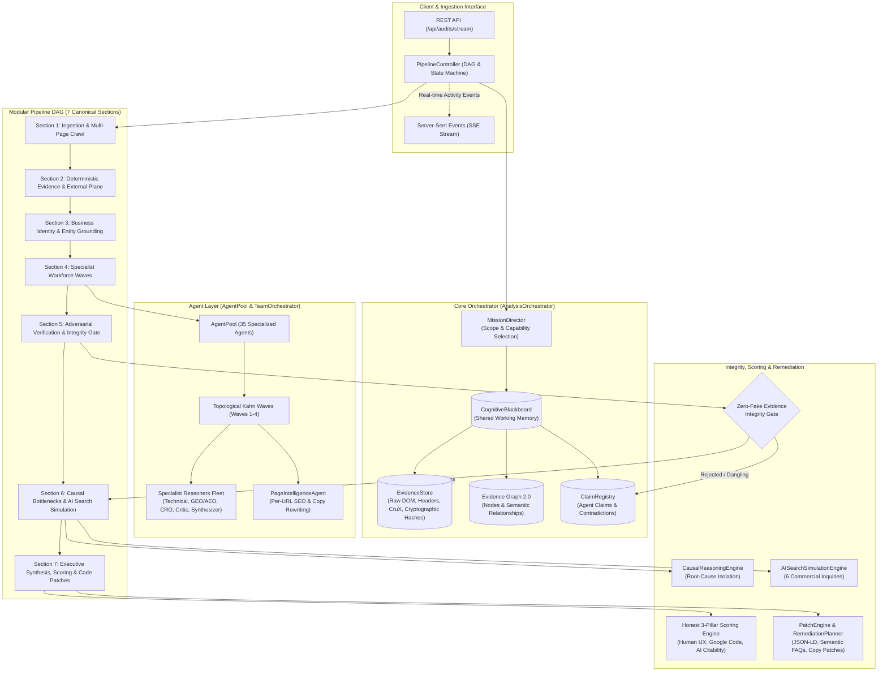
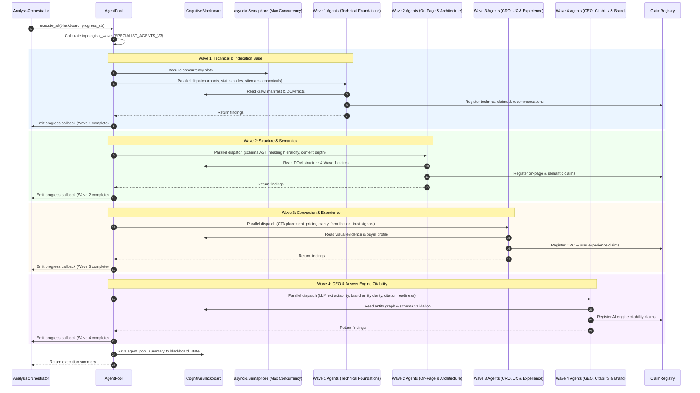
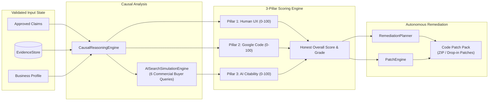

# Dristik AI: Orchestrator Layer & Agent Flow Architecture

This document provides a comprehensive technical breakdown and visual Mermaid flow diagrams of the **Dristik AI Orchestration Layer**, the **Modular Pipeline DAG (7 Workflow Sections, 33 DAG Nodes)**, the **105-Agent Specialist Workforce Pool across 12 Domains**, and the **Zero-Fake Evidence Integrity Gate**.

---

## 1. High-Level Architectural Flow

The Dristik Orchestration Layer acts as the central mission coordinator, executing audits across a 4-level cognitive architecture. It synchronizes asynchronous multi-page crawling, deterministic evidence extraction, business identity resolution, topological specialist agent waves, adversarial verification, causal bottleneck isolation, honest 3-pillar scoring, and autonomous code patch generation.



---

## 2. End-to-End Pipeline DAG Flow Diagram

The Dristik audit pipeline executes a deterministic, dependency-resolved Directed Acyclic Graph (DAG) consisting of **7 Sections** and **18 Sub-nodes**. Every node verifies prerequisite completion before execution and logs structured `ActivityEvent` records to the live telemetry stream.

```mermaid
flowchart TD
    classDef ingestion fill:#e1f5fe,stroke:#0288d1,stroke-width:2px;
    classDef deterministic fill:#e8f5e9,stroke:#388e3c,stroke-width:2px;
    classDef business fill:#fff3e0,stroke:#f57c00,stroke-width:2px;
    classDef agents fill:#ede7f6,stroke:#512da8,stroke-width:2px;
    classDef gate fill:#ffebee,stroke:#d32f2f,stroke-width:2px;
    classDef causal fill:#fff8e1,stroke:#fbc02d,stroke-width:2px;
    classDef synthesis fill:#e0f2f1,stroke:#00796b,stroke-width:2px;

    %% Section 1
    subgraph Sec1 ["Section 1: Ingestion & Multi-Page Crawl"]
        N_crawl["node_crawl<br/><b>Multi-Page HTTP Crawler</b><br/>Status codes, TTFB, Robots, Sitemaps"]:::ingestion
        N_dom["node_dom_extraction<br/><b>DOM AST & Element Ingestion</b><br/>Headings, Links, CTAs, Word Count"]:::ingestion
    end

    %% Section 2
    subgraph Sec2 ["Section 2: Deterministic Evidence & External Plane"]
        N_dns["node_dns_ssl_headers<br/><b>DNS, SSL/TLS & Security</b><br/>Certificates, HSTS, CSP, CruX metrics"]:::deterministic
        N_schema["node_schema_ld_json<br/><b>Schema.org JSON-LD Parser</b><br/>Deterministic Schema AST Validator"]:::deterministic
    end

    %% Section 3
    subgraph Sec3 ["Section 3: Business Understanding & Entity Grounding"]
        N_entity["node_entity_resolution<br/><b>Brand & Entity Resolver</b><br/>Canonical brand name & classification"]:::business
        N_icp["node_icp_offer_profile<br/><b>ICP & Value Proposition Profiler</b><br/>Target audience & commercial offers"]:::business
    end

    %% Section 4
    subgraph Sec4 ["Section 4: Specialist Workforce Waves"]
        N_wave1["node_specialist_wave_1<br/><b>Technical SEO & Crawlability</b><br/>Status, indexation, redirects"]:::agents
        N_wave2["node_specialist_wave_2<br/><b>Schema AST & On-Page Content</b><br/>Metadata, structure, thin content"]:::agents
        N_wave3["node_specialist_wave_3<br/><b>CRO, UX & Trust Proof</b><br/>CTA hierarchy, forms, social proof"]:::agents
        N_wave4["node_specialist_wave_4<br/><b>GEO & AI Citability</b><br/>LLM visibility, entity clarity"]:::agents
        N_page["node_page_intelligence<br/><b>Page-by-Page SEO & Rewrites</b><br/>Per-URL copy & title optimizations"]:::agents
    end

    %% Section 5
    subgraph Sec5 ["Section 5: Adversarial Verification & Integrity Gate"]
        N_critic["node_adversarial_critic<br/><b>Adversarial Critic & Contradictions</b><br/>Cross-examination vs DOM ground truth"]:::gate
        N_gate["node_integrity_gate<br/><b>Zero-Fake Evidence Gate</b><br/>Cryptographic hash & provenance check"]:::gate
    end

    %% Section 6
    subgraph Sec6 ["Section 6: Causal Bottlenecks & AI Search Simulation"]
        N_causal["node_causal_bottlenecks<br/><b>Causal Graph & Bottleneck Isolation</b><br/>Primary leverage growth blocker"]:::causal
        N_sim["node_ai_search_simulation<br/><b>Synthetic Commercial Query Sim</b><br/>ChatGPT, Perplexity, Gemini, Claude"]:::causal
    end

    %% Section 7
    subgraph Sec7 ["Section 7: Executive Synthesis, Scoring & Patches"]
        N_score["node_honest_scoring<br/><b>Honest 3-Pillar Scoring Engine</b><br/>Human UX, Google Code, AI Citability"]:::synthesis
        N_narrative["node_executive_narrative<br/><b>C-Suite Narrative Synthesis</b><br/>Strategic briefing & what to ignore"]:::synthesis
        N_patch["node_code_patch_pack<br/><b>Ready-to-Install Code Patch Pack</b><br/>Schema JSON-LD, FAQs, Copy Patches"]:::synthesis
        N_assembly["node_final_report_assembly<br/><b>Report Packaging & Validation Gate</b><br/>Audit finalization & persistence"]:::synthesis
    end

    %% Dependencies Flow
    N_crawl --> N_dom
    N_dom --> N_dns
    N_dom --> N_schema
    N_dom --> N_entity
    N_entity --> N_icp

    N_schema --> N_wave1
    N_icp --> N_wave1
    N_wave1 --> N_wave2
    N_wave2 --> N_wave3
    N_wave3 --> N_wave4
    N_wave4 --> N_page
    N_wave4 --> N_critic

    N_critic --> N_gate

    N_gate --> N_causal
    N_icp --> N_sim
    N_gate --> N_sim

    N_causal --> N_score
    N_sim --> N_score
    N_score --> N_narrative
    N_score --> N_patch
    N_narrative --> N_assembly
    N_patch --> N_assembly
```



---

## 3. Specialist Agent Pool: Topological Wave Execution

The `AgentPool` and Modular DAG orchestrate the 105 specialist agents across 12 domains and 7 pipeline workflow sections (33 DAG nodes) using Kahn's topological sort algorithm, ensuring agents whose inputs depend on preceding insights only run when prerequisites are fulfilled. A concurrency semaphore prevents burst limits on underlying LLM inference endpoints.



---

## 4. Adversarial Verification & Zero-Fake Integrity Gate Sub-flow

The **Zero-Fake Evidence Integrity Gate** (`backend/app/orchestration/integrity_gate.py`) enforces strict cryptographic and provenance standards. Unsubstantiated claims, dangling references, or unbacked factual assertions are quarantined or rejected before scoring and C-suite reporting.

```mermaid
flowchart TD
    Start([Specialist Wave Claims Generated]) --> GetClaims[Collect all claims from ClaimRegistry]
    GetClaims --> InspectRefs{Does Claim contain evidence_refs?}

    %% Path 1: Claim with references
    InspectRefs -->|Yes| CheckStore[Validate refs against EvidenceStore IDs]
    CheckStore --> AllValid{All refs exist in EvidenceStore?}
    AllValid -->|Yes| CheckDOMSelector[Verify DOM selector & cryptographic SHA-256 hash]
    AllValid -->|No| StripDangling[Remove non-existent references]
    StripDangling --> AnyLeft{Any valid refs remaining?}
    AnyLeft -->|Yes| LogWarning[Log Dangling Reference Violation] --> CheckDOMSelector
    AnyLeft -->|No| RejectFabrication[Mark VerificationStatus: REJECTED<br/>Set Confidence = 0.0<br/>Set held_from_executive = True]

    %% Path 2: Claim without references
    InspectRefs -->|No| CheckClaimType{Is claim_type == FACT?}
    CheckClaimType -->|Yes| RejectUnbacked[Mark VerificationStatus: REJECTED<br/>Set Confidence = 0.0<br/>Set held_from_executive = True]
    CheckClaimType -->|No (Hypothesis/Observation)| AllowUnbacked[Allow with reduced confidence rubric]

    %% Evaluation Rubric
    CheckDOMSelector --> ApplyRubric[Apply Finding Rubric:<br/>Confidence & Materiality Assessment]
    AllowUnbacked --> ApplyRubric

    ApplyRubric --> CheckEscalation{Is Confidence GUESSING<br/>AND Materiality CRITICAL<br/>AND not adversarial reviewed?}

    CheckEscalation -->|Yes| EscalateCritic[Escalate to verification.adversarial.v3<br/>Adversarial cross-examination vs DOM ground truth]
    CheckEscalation -->|No| PassGate[Claim Passed to Decision Engine]

    EscalateCritic --> CriticResult{Critic validates claim?}
    CriticResult -->|Confirmed| PassGate
    CriticResult -->|Refuted| RejectFabrication

    RejectFabrication --> HeldOut[Claim excluded from Honest Scoring & Executive Narrative]
    RejectUnbacked --> HeldOut
    PassGate --> ApprovedState[Approved Claim used in Causal Root Causes, Scoring & Patch Pack]
```

---

## 5. Decision Engine, Scoring & Remediation Pipeline

After passing the Integrity Gate, validated evidence flows through three downstream engines:

1. **Causal Reasoning Engine**: Identifies root bottlenecks rather than superficial symptoms.
2. **Deterministic 3-Pillar Scoring Engine**: Calculates non-hallucinatory 0-100 scores across:
   - **Pillar 1: Human Ease of Use** (Mobile responsiveness, visual hierarchy, CTA clarity, form simplicity).
   - **Pillar 2: Google Search Code** (Deterministic crawlability, canonicals, status codes, Schema AST).
   - **Pillar 3: AI Citability & GEO Readiness** (Entity resolution, answer engine extractability, live citations).
3. **Autonomous Patch Engine & Remediation Planner**: Generates drop-in code fixes:
   - `schema.jsonld` (Synthesized, validated JSON-LD schema markup).
   - `faq_patch.html` (Semantic Microdata FAQ blocks addressing buyer search intent).
   - `copy_patches.json` (Character-safe hero copy rewrites and page-level metadata improvements).
   - `executive_whatsapp_summary.txt` (Concise C-suite executive briefing).



---

## 6. Durable Checkpoint & Real-Time Event State Machine

The orchestrator enforces failure-resilience and cooperative lifecycle controls (pause, stop, resume) through durable SQLite checkpoints at key stage boundaries:

| Step | Stage Name | Checkpoint Payload | Saved Artifacts |
|---|---|---|---|
| **1** | `INGESTING` | Crawled page URLs, status codes, TTFB, DOM observations | Raw pages table, evidence items table |
| **2** | `DETERMINISTIC_ANALYSIS` | External DNS, SSL/TLS, Security headers, CruX data | External evidence store records |
| **3** | `SPECIALIST_EXECUTION` | 105-agent workforce results, claim counts, wave stats | Agent claims table, contradiction table |
| **4** | `VERIFICATION` | Integrity gate audit violations, adjusted claims | Quarantined claims state |
| **5** | `COMPLETED` | Final ExecutiveReport, honest scores, patch packs | Full audit JSON, PDF report, Patch ZIP |

This structure ensures that interrupted audits can be resumed immediately from the nearest checkpoint without repeating expensive crawls or external API calls.
